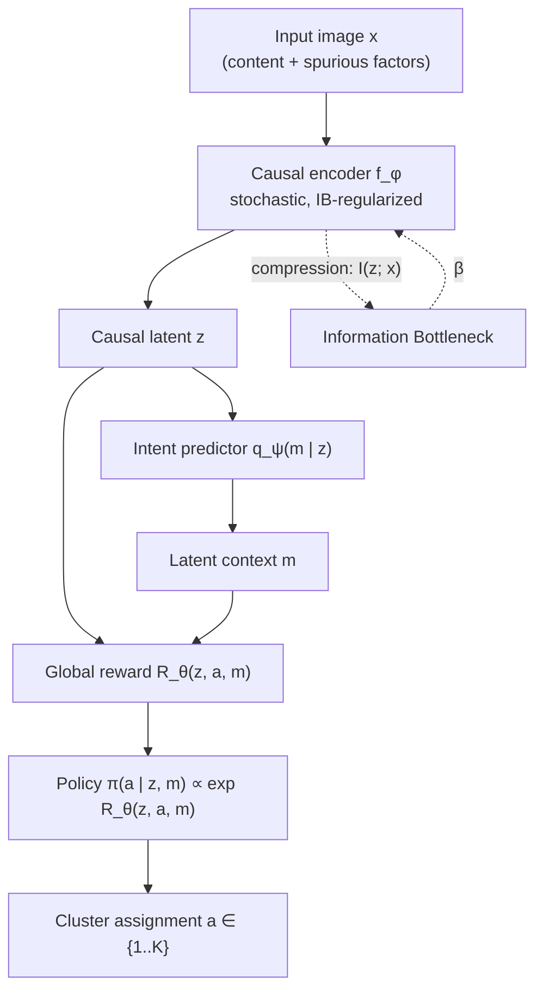
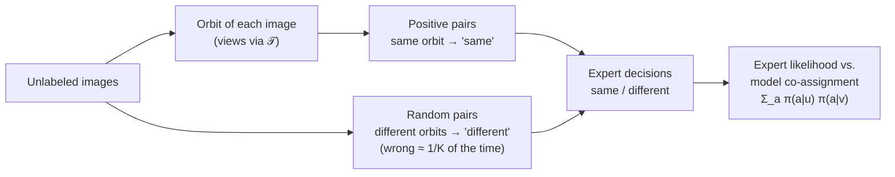

# CIB-IRL: Causal Information Bottleneck Inverse Reinforcement Learning

**Unsupervised image clustering that groups images by *what they are*, not by *where they appear*, by learning a causal representation (Information Bottleneck) together with a latent reward (multi-intention Inverse RL) from experts built out of image transformations.**

> **Status:** research prototype, work in progress. The conceptual framework is stable; the implementation and benchmarks are being built (see [Roadmap](#11-status--roadmap)).

---

## Table of Contents

1. [The Idea](#1-the-idea)
2. [Motivation](#2-motivation)
3. [Background & Reading List](#3-background--reading-list)
4. [Method](#4-method)
5. [Where Do the Experts Come From?](#5-where-do-the-experts-come-from)
6. [Components & Training](#6-components--training)
7. [Decisions & Open Questions](#7-decisions--open-questions)
8. [Evaluation Protocol](#8-evaluation-protocol)
9. [Ablations](#9-ablations)
10. [Repository Structure](#10-repository-structure-planned)
11. [Status & Roadmap](#11-status--roadmap)
12. [Citation & License](#12-citation--license)

---

## 1. The Idea

**In one sentence:** cluster images the way a child learns categories, by finding the few features that make things *distinguishable* and ignoring everything else.

### 1.1 Intuition

We recognize a cat from a handful of features (ears, whiskers, the shape of the face), not from the sofa it sits on. A baby does this without being taught any label: it simply learns to tell things apart. We want an algorithm that does the same, i.e. groups images by what they *are*, even when the background or style would be an easier (but meaningless) signal.

### 1.2 Clustering as decision-making (the IRL view)

We turn clustering into a decision problem:

- **The policy** is the act of clustering: faced with an image, it chooses which cluster to put it in.
- **The reward** is an implicit representation of the structure of the data: it scores how well a given cluster explains a given image. The policy that maximizes this reward is a clustering.
- **The expert.** We can see the creator of the data (the world that produced the cats and the dogs) as an expert who, in building these images, optimized some reward. Multi-intention IRL methods such as PEMIRL recover from expert behavior the reward attached to each category.
- **Our step beyond.** Besides the reward that makes each category what it is, there also exists a reward that **distinguishes categories from one another**, the reason we do not confuse them. Finding and optimizing it *is* learning to distinguish, and therefore clustering.

### 1.3 The obstacle, and our answer

IRL needs expert demonstrations, but an unsupervised problem has none (a supervised version would not be interesting). Our answer is to **build the experts from the images themselves**:

- all the transformed versions of an image (crops, color changes, new backgrounds, transformations of transformations) obviously show the same thing: that is an expert demonstrating "these go together";
- two random images usually show different things: that is an expert demonstrating "these do not".

The expert never says *which* cluster; it only answers "same or different?". That is enough to learn a reward that tells clusters apart. Details in [Section 5](#5-where-do-the-experts-come-from).

### 1.4 Two safeguards against shortcuts

Image datasets are full of spurious cues (background, texture, style) that are easier to use than the object. Two ingredients keep the reward on the object:

- **Information Bottleneck.** An encoder is trained to keep as much information as the reward needs and to compress away the rest, so a feature that does not help the decision is deleted.
- **Invariance check.** If the encoder really removed the useless features, the reward must not change when the image is perturbed in ways that keep the object (e.g. new background). We add this as an explicit term.

### 1.5 At a glance

| Human intuition | In CIB-IRL |
|---|---|
| The few features that make a cat a cat | Causal latent `z` (encoder + Information Bottleneck) |
| "This looks like a cat-type thing" | Latent context `m` (intent predictor) |
| Why this image belongs with these | Reward `R_θ(z, a, m)` |
| Putting it in a group | Policy `π(a \| z, m)`, `a ∈ {1..K}` |
| Someone who already knows what goes together | Expert built from transformations ([Section 5](#5-where-do-the-experts-come-from)) |
| Not being fooled by the background | Compression + reward invariance |

---

## 2. Motivation

### 2.1 What already exists

| Family | Examples | Strength | Limitation for our problem |
|---|---|---|---|
| Geometric / statistical clustering | K-Means, GMM | Simple, fast | Depends entirely on the embedding geometry |
| Self-supervised learning | SimCLR, MoCo v3, CLIP | Strong, structured latent spaces | Augmentations alone do not guarantee that backgrounds are discarded |
| Multi-intention / meta IRL | Babeş-Vroman et al. 2011, PEMIRL | Separates unlabeled demonstrations by inferring several reward functions | Designed for **temporal trajectories** of real experts, not static images |

### 2.2 The gap

1. **Modality mismatch.** Multi-intention IRL methods operate on sequences of states and actions produced by experts. A static image is categorized in a *single step* and nobody demonstrates the choice.
2. **Spurious correlations.** Applied to images, such methods inherit the shortcut-learning behavior of unsupervised learners. An agent grouping animal images will often cluster by background (ducks and boats together because both contain water) instead of by the causal features of the object.

---

## 3. Background & Reading List

Five papers cover the theoretical foundations of the framework:

1. **Meta-Inverse Reinforcement Learning with Probabilistic Context Variables**, Yu, Yu, Finn, Ermon (NeurIPS 2019).
   *Why:* learns rewards from unlabeled multi-task demonstrations through a latent context variable `m`, and infers the reward of a new task from a single demonstration.
2. **Deep Variational Information Bottleneck**, Alemi, Fischer, Dillon, Murphy (ICLR 2017).
   *Why:* compress the input while retaining task-relevant information, via variational bounds on mutual information.
3. **Invariant Risk Minimization**, Arjovsky, Bottou, Gulrajani, Lopez-Paz (2019).
   *Why:* foundational theory of causal invariance across environments (here: styles/backgrounds).
4. **Invariant Information Clustering for Unsupervised Image Classification and Segmentation**, Ji, Henriques, Vedaldi (ICCV 2019).
   *Why:* maximizing mutual information between assignments of augmented views to drive unsupervised clustering.
5. **Apprenticeship Learning About Multiple Intentions**, Babeş-Vroman, Marivate, Subramanian, Littman (ICML 2011).
   *Why:* clusters unlabeled trajectories by inferring one objective per cluster (EM over IRL), the early version of "clustering and IRL together".

Additional references used by the expert design ([Section 5](#5-where-do-the-experts-come-from)): **Debiased Contrastive Learning** (Chuang et al., NeurIPS 2020), **SCAN: Learning to Classify Images without Labels** (Van Gansbeke et al., ECCV 2020), **SimCLR** (Chen et al., 2020), **MoCo v3** (Chen, Xie, He, 2021), and **Waterbirds / Group DRO** (Sagawa et al., 2020).

---

## 4. Method

### 4.1 Pipeline



### 4.2 Single-step MDP

| Component | Definition |
|---|---|
| State `s` | Latent vector `z = f_φ(x)` extracted from the raw image `x` |
| Action `a` | Cluster index, `a ∈ {1, …, K}` |
| Latent context `m` | Continuous semantic variable for the underlying concept (e.g. species morphology), inferred by `q_ψ(m \| z)` |
| Reward | `R_θ(z, a, m)`, a single global reward shared across the dataset |
| Policy | Maximum-entropy optimal policy. With a single step there is no horizon, so `Q = R` and `π(a \| z, m) = exp R_θ(z, a, m) / Σ_a' exp R_θ(z, a', m)` |
| Expert | Not observed: built from image transformations ([Section 5](#5-where-do-the-experts-come-from)) |

### 4.3 Joint objective

Encoder `f_φ`, intent predictor `q_ψ` and reward `R_θ` are optimized together:

$$
\max_{\phi,\psi,\theta}\;\; \mathcal{I}\big(f_\phi(x);\, a, m\big) \;-\; \beta\,\mathcal{I}\big(f_\phi(x);\, x\big)
$$

- **Relevance term** `I(f_φ(x); a, m)`: mutual information between the filtered representation and the categorization output under the inferred reward. It keeps in `z` every causal marker needed for clear, confident clustering decisions.
- **Compression term** `I(f_φ(x); x)`: forces the encoder to be as restrictive as possible, deleting bits that vary a lot or do not help clustering (changing backgrounds, styles).
- **`β`** controls the compression / utility trade-off.

### 4.4 Tractable training objective

As in the Deep VIB, both terms are replaced by variational bounds. With a stochastic encoder `p_φ(z|x)` and a fixed prior `r(z)`:

$$
I(z;x) \;\le\; \mathbb{E}_{x}\,\mathrm{KL}\big(p_\phi(z\mid x)\,\|\,r(z)\big),
\qquad
I(z;a,m) \;\ge\; H(a,m) + \mathbb{E}\big[\log q_\psi(m\mid z) + \log \pi_\theta(a\mid z,m)\big]
$$

Two remarks on the second bound:

- **The targets are relational, not categorical.** Our experts say whether two images go together, not which cluster they belong to ([Section 5](#5-where-do-the-experts-come-from)). We therefore instantiate the relevance term with the *expert likelihood*: the intent loss `L_ψ` and the reward loss `L_θ` of [Section 6](#6-components--training) play the roles of `−E log q_ψ(m|z)` and `−E log π_θ(a|z,m)`. This is a surrogate for the bound, not a strict bound.
- **The entropy `H(a,m)`** is what prevents collapse in the bound. In our setting it is supplied by the repulsion between random pairs ([Section 5.3](#53-two-forces-attraction-and-repulsion)).

The loss to minimize is

$$
\mathcal{L} \;=\; \mathcal{L}_\psi \;+\; \mathcal{L}_\theta \;+\; \beta\,\mathbb{E}_x\,\mathrm{KL}\big(p_\phi(z\mid x)\,\|\,r(z)\big) \;+\; \lambda\,\mathcal{L}_{\text{inv}}
$$

### 4.5 Reward-consistency (invariance) term

A feature is spurious if removing it leaves the reward unchanged. We operationalize this with a consistency penalty under nuisance perturbations `t ~ 𝒯` (background swaps, color jitter, style transfer):

$$
\mathcal{L}_{\text{inv}} \;=\; \mathbb{E}_{x,\,t\sim\mathcal{T}}\,\Big\| R_\theta\big(f_\phi(x),\cdot,m\big) - R_\theta\big(f_\phi(t(x)),\cdot,m\big)\Big\|^2
$$

This is the bridge to IRM (invariance across environments) and IIC (agreement across views). It acts as a *check* on the encoder: if the useless features were really compressed away, the reward must not move. The exact form is an open design choice covered by the ablations in [Section 9](#9-ablations).

---

## 5. Where Do the Experts Come From?

### 5.1 The problem

IRL learns a reward by asking: *which reward would make the expert's behavior optimal?* Here the "behavior" is putting an image in the right cluster, and nobody has done that: no labels, no demonstrations. At the very start we have **no experts, no clusters, no intents**.

### 5.2 The key idea: an image's transformations are an expert demonstration

Take one image and transform it: crop it, change its colors, replace its background, transform the result again. Whatever we get shows the *same thing*. Without placing a single label, we hold a group of images that the expert would put in the same cluster, and we can produce as many as we like because transformed images can be transformed again.

**Definitions.**

- **Nuisance family `𝒯`.** Transformations that change appearance (crop, color, blur, background, style) but are meant to preserve the object.
- **Orbit of an image `x_i`.** `𝒪_i = { t_D ∘ … ∘ t_1 (x_i) : t_k ∈ 𝒯, D ≤ D_max }`: everything reachable by chaining at most `D_max` transformations, with bounded cumulative strength (long chains drift away from the object).
- **Demonstration (trajectory).** A set of `n` views drawn from `𝒪_i`. It plays the role of the trajectory in PEMIRL: the intent is a property of the whole set, not of one view.

**The expert's decision.** The expert is *relational*: for a pair of views `(u, v)` it answers

- `same`, if `u` and `v` come from the same orbit (certain, by construction);
- `different`, if they come from different orbits. This answer is wrong with probability `τ⁺`, the chance that two random images share a concept (≈ `1/K` for balanced classes): two different cat photos are "different orbits" but the same concept.

It never names a cluster. This is exactly the structure of *must-link / cannot-link* constraints in constrained clustering, generated automatically. The reward is therefore identified up to a relabeling of the clusters, which is all clustering needs.

**The model's answer.** The policy induces a probability that two views land in the same cluster:

$$
p_\theta(\text{same}\mid u,v) \;=\; \sum_{a=1}^{K} \pi_\theta(a\mid z_u,m_u)\,\pi_\theta(a\mid z_v,m_v), \qquad \pi_\theta = \mathrm{softmax}_a R_\theta
$$

Learning the reward that makes the policy agree with the expert's decisions is maximum-likelihood IRL with relational demonstrations.



### 5.3 Two forces: attraction and repulsion

Positives alone are not enough: putting everything in one cluster satisfies "an orbit stays together" perfectly. We need a force that says *different things should be told apart*, which is the "reward that distinguishes".

- **Attraction (positives).** Views of the same image must share a cluster:

$$
\mathcal{L}_{\text{pos}} \;=\; -\,\mathbb{E}_{i}\,\mathbb{E}_{u,v\in\text{orbit}_i}\big[\log p_\theta(\text{same}\mid u,v)\big]
$$

- **Repulsion (random negatives).** Two images drawn at random should not share a cluster. With `ℓ(u,v) = −log(1 − p_θ(same | u,v))`, the naive negative term is `E_v ℓ(u,v)`. A fraction `τ⁺` of random `v` are actually of the same concept, so we subtract their share, approximated by the anchor's own positives (the standard debiasing of Chuang et al. 2020), with `τ⁺ = 1/K`:

$$
\mathcal{L}_{\text{neg}} \;=\; \mathbb{E}_{u}\,\max\Big\{\tfrac{1}{1-\tau^+}\Big(\mathbb{E}_{v\sim\text{data}}\,\ell(u,v)\;-\;\tau^+\,\mathbb{E}_{v^+\in\text{orbit}(u)}\,\ell(u,v^+)\Big),\;0\Big\}
$$

The expert loss is `L_expert = L_pos + L_neg`, and it is what trains the reward (Section 6.3).

**Why random negatives are not an intervention.** We never choose pairs using knowledge of concepts. The only assumption is that random pairs are rarely of the same concept, with a *known* error rate `τ⁺`. Choosing negatives from images we know to be different would inject labels at the start and defeat the unsupervised goal; we do not do it.

### 5.4 Why two different cat photos end up together

At the start every image has its own orbit, so nothing says "these two cats belong together". Three things make them merge anyway:

1. **Limited slots.** There are only `K` clusters. With `K = 2` (cats / dogs), every orbit must pick one of two slots, so orbits that look alike must share one.
2. **Similarity in `z`.** Orbits with similar codes get similar cluster probabilities. Two cats share "cat features", so they fall in the same slot.
3. **The Information Bottleneck decides what "similar" means.** If `z` still contains the background, merging happens along the background axis (cats on grass with dogs on grass). The compression is what makes the merging happen along the animal.

So the encoder is not a side detail: it determines *along which axis* the expert's weak signal is turned into categories.

### 5.5 Phase 2: merging progressively (with brakes)

Phase 1 (orbits + random negatives) is the foundation. Phase 2 speeds up merging of the same concept across different orbits by adding **extra positives** during training: pairs of views from *different* orbits that the model itself considers the same thing.

Candidate pairs `(u, v)` are accepted if all of these hold:

- `u` and `v` are **mutual `k`-nearest neighbors** in the code space of a slowly-moving copy of the encoder (EMA);
- both are assigned to the same cluster with **high confidence** (`max_a π ≥ γ`);
- the number of accepted pairs per epoch is **capped** (`≤ M`), with a weight that ramps up over training.

Accepted pairs are added to the positives and **removed from the negatives**, so the model is no longer told that they are different. This is the progressive merging: it is useful but can be unstable (the model confirms its own mistakes, and the expert moves while the reward is still learning). The brakes above, plus monitoring of the *churn* (fraction of images changing cluster between epochs), are how we keep it under control.

### 5.6 Declared assumptions

We prefer to state what the expert silently relies on:

| Assumption | Meaning | Consequence |
|---|---|---|
| **A1. `𝒯` preserves the object** | The family of transformations changes appearance, not identity. It encodes *prior knowledge about nuisances*, not about classes. | The method is unsupervised with respect to classes, but weakly informed about nuisances, like the environments of IRM. If `𝒯` never changes the background, the expert cannot teach invariance to it, and the burden falls on the Information Bottleneck. |
| **A2. Random pairs are rarely the same concept** | `τ⁺ ≈ 1/K` for balanced classes. | Imbalanced classes make `τ⁺` larger and the debiasing approximate. |
| **A3. `K` is known** | The number of clusters is given. | Sensitivity to a wrong `K` is part of the ablations. |

### 5.7 Failure modes and what we monitor

| Failure | Symptom | Guard / monitor |
|---|---|---|
| Background shortcut | High `NMI(cluster, background)` | Nuisance-targeted `𝒯` (A1), compression `β`; **track leakage from step 0**, not only at the end |
| Low-level shortcut (color histogram, texture) | Clusters follow simple statistics | Diverse and strong `𝒯`, compression `β` |
| Collapse | Few clusters used | Repulsion ([5.3](#53-two-forces-attraction-and-repulsion)); entropy of the cluster-size histogram |
| Fragmentation | One concept split across clusters | Fixed `K`, Phase 2 merging, over-clustering analysis |
| Semantic drift along chains | Views in an orbit no longer show the same object | Bound `D_max` and cumulative strength |
| Over-strong transformations | Crops that remove the object, noisy "same" labels | Bound the strength of each `t ∈ 𝒯` |
| Confirmation bias (Phase 2) | Churn does not decrease, errors reinforced | EMA copy, mutual neighbors, confidence `γ`, rate cap `M` |
| Moving expert | Reward loss oscillates | Change the expert slowly relative to reward learning |
| False negatives | About `1/K` of random pairs are the same concept | Debiasing; check for class imbalance |

### 5.8 Relation to existing work

Taken separately, the pieces are known: orbit positives and random negatives are contrastive learning (SimCLR), the debiasing is Chuang et al. 2020, the co-assignment probability is close to IIC, the neighbor mining of Phase 2 is close to SCAN, and relational supervision is constrained clustering. **What we test** is whether casting them as expert demonstrations for a latent reward, with an Information Bottleneck on the encoder and a reward-level invariance check, removes spurious features better than the same pipeline with a plain classification head (see [Ablations](#9-ablations)).

---

## 6. Components & Training

The architecture has four trainable components: the **encoder**, the **intent predictor**, the **reward model** and the **policy**. This section fixes the notation, then gives for each component its role, its loss, and the intuition behind each term. It closes with what joint and sequential training mean in practice.

### 6.0 Notation

- For a view `u`: `z_u = f_φ(u)` and `m_u = μ_ψ(z_u)` (mean of the inferred intent).
- `π_θ(a | z, m) = softmax_a R_θ(z, a, m)` is the policy *induced by the reward* (Section 4.2). `π_ω(a | z, m)` is the *learned* policy network (Section 6.4).
- Expert signals (Section 5): positive pairs (same orbit) and random pairs (different orbits), with `τ⁺ = 1/K`.
- Intent target of an image `i`: `m*_i = sg[ mean over the orbit views of μ_ψ(z_v) ]`, where `sg[·]` is stop-gradient. The intent is a property of the orbit, not of a single view.

### 6.1 Encoder `f_φ`

**Role.** The only component that sees pixels. It maps an image to a stochastic code `z = μ_φ(x) + σ_φ(x) ⊙ ε`, `ε ~ 𝒩(0, I)`, and everything downstream sees only `z`. Its job is a trade-off: keep what the intent and the reward need, discard everything else, in particular backgrounds and styles.

**Loss.**

$$
\mathcal{L}_{\text{enc}}(\phi) \;=\; \underbrace{\mathcal{L}_\psi + \mathcal{L}_\theta}_{\text{utility, through } z} \;+\; \beta\,\underbrace{\mathbb{E}_x\,\mathrm{KL}\big(p_\phi(z\mid x)\,\|\,\mathcal{N}(0,I)\big)}_{\text{compression}} \;+\; \lambda\,\underbrace{\mathbb{E}_{x,\,t}\Big\|R_\theta(z,\cdot,m)-R_\theta(z_t,\cdot,m)\Big\|^2}_{\mathcal{L}_{\text{inv}}\;(\theta\text{ frozen})}
$$

For a diagonal Gaussian the KL has a closed form: `½ Σ_j (μ_j² + σ_j² − 1 − log σ_j²)`.

**Reading the terms.**
- **Utility `L_ψ + L_θ`.** The gradients of the intent and expert losses flow back into `z`. This is the "retain as much information as possible" pressure: anything needed to predict the concept and to tell images apart must survive.
- **Compression `β·KL`.** Pulls every code toward the prior, i.e. makes `z` carry as few bits about `x` as possible. `β` sets how hard it pushes.
- **Invariance `λ·L_inv`.** The check on the encoder. `L_pos` already asks that the *decision* (the cluster) be stable across views; `L_inv` asks more: the whole reward vector over all clusters must not move. `θ` is frozen in this term; otherwise the trivial solution `R_θ ≡ const` would satisfy it for free.

### 6.2 Intent predictor `q_ψ`

**Role.** Infers from `z` a continuous latent concept `m` (what the image is "about", e.g. species morphology) that conditions the reward. As the context variable of Meta-IRL, it lets one global reward express different notions of similarity.

**Loss.**

$$
\mathcal{L}_\psi \;=\; -\,\mathbb{E}_{i,\,u\in\text{orbit}_i}\big[\log q_\psi(m^\*_i \mid z_u)\big]
$$

**Reading the terms.**
- **Log-likelihood of the orbit's intent `m*`.** Every view of an image must give the same concept. A concept that changes when only the background changes is penalized, so `m` is pushed toward content.
- **Gaussian case.** With `q_ψ(m | z) = 𝒩(μ_ψ(z), σ_ψ²(z))`, this is a squared error weighted by the predicted precision, plus `log σ_ψ`: the model can express uncertainty but pays for it.
- **Caveat.** Nothing forces `m` to be used; a constant `m` reduces the model to single-intention IRL. The "without `m`" ablation measures this.

### 6.3 Reward model `R_θ`

**Role.** Scores every triple `(z, a, m)`: how well cluster `a` explains the image coded by `z` under concept `m`. It is the object that IRL recovers, a single global reward shared by the whole dataset, and the policy is derived from it.

**Loss.** Maximum-likelihood IRL of the expert's decisions (Section 5):

$$
\mathcal{L}_\theta \;=\; \mathcal{L}_{\text{pos}} \;+\; \mathcal{L}_{\text{neg}} \;\;\Big(\,-\,\rho\,\mathcal{H}\big(\mathbb{E}_x\,\pi_\theta(\cdot\mid z,m)\big)\ \text{optional}\Big)
$$

**Reading the terms.**
- **`L_pos` (attraction).** Raises the reward of a *common* cluster for all views of an image.
- **`L_neg` (repulsion).** Makes different images prefer different clusters, with the false-negative correction `τ⁺`. This is the "reward that distinguishes": it exists because the softmax inside `π_θ` is *relative*, so raising a cluster's reward for one image lowers the others.
- **Optional `ρ·H(marginal)`.** Entropy of the average assignment over the batch, a safeguard against collapse. With repulsion in place it should be unnecessary; it is kept for ablation (`ρ = 0` by default).

### 6.4 Policy `π_ω`

**Role.** The agent that picks the cluster. At inference, the assignment is `a = argmax_a π_ω(a | z, m)`. It is trained to act soft-optimally with respect to the current reward. In a single-step MDP the soft-optimal policy has a closed form (`π_θ ∝ exp R_θ`), so `π_ω` is redundant at the optimum. We keep it as a separate network to preserve the standard IRL split between reward and policy, to allow alternating updates, and to leave room for multi-step or large action spaces (see [Open Questions](#7-decisions--open-questions)).

**Loss.**

$$
\mathcal{L}_\omega \;=\; -\,\mathbb{E}\Big[\sum_a \pi_\omega(a\mid z,m)\,R_\theta(z,a,m)\Big] \;-\; \alpha\,\mathbb{E}\Big[\mathcal{H}\big(\pi_\omega(\cdot\mid z,m)\big)\Big] \;=\; \alpha\,\mathbb{E}\,\mathrm{KL}\big(\pi_\omega\,\|\,\mathrm{softmax}(R_\theta/\alpha)\big) + \text{const}
$$

**Reading the terms.**
- **Expected reward.** Choose the clusters the reward scores highly.
- **Entropy bonus `α·H`.** Stay stochastic instead of committing early to one cluster; `α` is a temperature (`α = 1` recovers `π_θ` of Section 4.2, `α < 1` sharpens).
- **KL form.** The same loss says "distill the reward-induced softmax into the network". It only updates `ω`; `R_θ`, `z` and `m` are detached.

### 6.5 Joint training

All components are updated at every step, on the same minibatch, from one total loss:

$$
\mathcal{L} \;=\; \mathcal{L}_\psi + \mathcal{L}_\theta + \beta\,\mathrm{KL} + \lambda\,\mathcal{L}_{\text{inv}} + \mathcal{L}_\omega
$$

The first four terms are the objective of Section 4.4; `L_ω` is the RL part. Gradient routing:

| Term | Updates |
|---|---|
| `L_ψ` (intent) | `ψ`, and `φ` through `z` |
| `L_θ` (expert likelihood) | `θ`, and `φ` through `z` |
| KL (compression) | `φ` |
| `L_inv` (invariance) | `φ` only (`θ` frozen) |
| `L_ω` (policy) | `ω` only |

**What it means.** "Useless" is defined *relative to the reward currently being learned*: the encoder compresses what the reward and intent do not use, while the reward and intent adapt to whatever the encoder keeps. This co-adaptation is the point of the method, and also its main risk: the expert changes in Phase 2 and the early reward is random, so a random reward can push the bottleneck to discard useful bits. Mitigations: a warm-up of `β` from 0, Phase 2 started only once Phase 1 has stabilized, and the brakes of Section 5.5.

### 6.6 Sequential training

Two stages, nothing flowing back from the second to the first.

1. **Encoder alone.** No reward exists yet. The encoder is trained on the *same expert signals* (Section 5) but with a reward-free similarity head (e.g. a cosine / contrastive head on `z`), together with `β·KL` and an invariance penalty on the code itself, `‖z − z_t‖²`.
2. **IRL modules on frozen codes.** `φ` is frozen and `L_ψ + L_θ + L_ω` are minimized on `z`. There is no KL, no `L_inv`, and no gradient into the encoder.

| | Joint | Sequential |
|---|---|---|
| Optimization | One stage, all parameters | Encoder first, then intent / reward / policy |
| Does the encoder see the reward? | Yes (through `L_ψ`, `L_θ`, `L_inv`) | No, only a similarity head |
| Meaning of "useless" | Irrelevant to the current reward | Irrelevant to the similarity objective |
| Strengths | Matches the definition of the method; the encoder is shaped by what clustering needs | Simple, stable, modular; the IRL stage can be re-run without retraining the encoder |
| Risks | Moving targets, instability, need for warm-up | Frozen stage-1 errors; the encoder may drop cluster-relevant bits or keep spurious ones |

Sequential training is the natural control for the claim that *joint* optimization matters (see [Ablations](#9-ablations)); with `β = 0` it reduces to the "standard multi-intention IRL" baseline.

---

## 7. Decisions & Open Questions

### 7.1 Decisions taken

1. **Expert = transformations.** Orbits of transformed images give "same" decisions; random pairs give "different" decisions. The expert is relational (no cluster is ever named).
2. **Random negatives are accepted** as non-intervention, with a known false-negative rate `τ⁺ ≈ 1/K`, corrected by debiasing. Negatives chosen from concepts known to be different are rejected.
3. **`𝒯` is prior knowledge about nuisances**, declared as such (assumption A1).
4. **Progressive merging** (Phase 2) is part of the design, under the brakes of Section 5.5.

### 7.2 Still open

1. **Collapse and self-reference.** The relevance term is self-referential (`a` and `m` come from the model). Repulsion should remove the collapse risk; is the `ρ` safeguard still needed?
2. **Identifiability of `m`.** What guarantees that `m` captures a semantic concept rather than another nuisance factor, or that it is used at all? Diagnostics: `NMI(m, background)`.
3. **Choice and imbalance of `K`.** `K` is fixed in the benchmarks, and `τ⁺ = 1/K` assumes balanced classes. How sensitive is the method to a wrong `K` or to imbalance?
4. **Design choices to confirm.** Is a separate policy network `π_ω` worth keeping, given that `π_θ` is available in closed form? Is freezing `θ` in `L_inv` the right choice?
5. **Phase 2 schedule.** When to start merging and how fast (`k`, `γ`, `M`, EMA momentum), given the risk of confirmation bias.

---

## 8. Evaluation Protocol

### 8.1 Datasets (engineered spurious correlations)

| Dataset | Setup | What it tests |
|---|---|---|
| **Colored MNIST** | Digits are strongly correlated with background/foreground color at training time; correlation is randomized or inverted at test time. 10-class variant for clustering; the binary IRM variant as a sanity check. | Whether the model clusters by digit identity instead of color |
| **Waterbirds** | Landbirds on land and waterbirds on water (strong train-time correlation); minority groups (landbird on water, waterbird on land) at test time. | Whether the model clusters by bird category instead of land/water background |

### 8.2 Baselines

1. **Geometric / statistical clustering:** K-Means and GMM on standard ResNet / ViT embeddings.
2. **Pure contrastive learning:** SimCLR, MoCo v3 (and IIC) followed by clustering, to see whether contrastive augmentations alone discard backgrounds.
3. **Standard multi-intention IRL:** a temporal IRL model adapted to single-step images **without** the causal Information Bottleneck encoder.

### 8.3 Metrics

- **Clustering Accuracy (ACC)** with optimal (Hungarian) cluster-to-label matching, and **Normalized Mutual Information (NMI)**, both measured strictly against the true semantic labels (bird species, digit ID), ignoring background.
- **Out-of-distribution (OOD) robustness:** drop in performance (`ΔACC`) between the correlated test set and the test set where the background correlation is inverted.
- **Worst-group ACC** (Waterbirds): accuracy on the least-represented (class, background) group.
- **Spurious leakage:** `NMI(cluster, background)`. Lower is better; a model that clusters by background scores high.

Training-time diagnostics (Section 5.7): leakage from step 0, cluster-size entropy, churn between epochs, and `NMI(m, background)`.

Reporting: mean ± std over several seeds, with fixed `K` equal to the number of true classes.

---

## 9. Ablations

| Ablation | Question answered |
|---|---|
| **Plain classification head** instead of reward + `m` (same experts, same encoder) | Does the IRL formalism add anything over contrastive / IIC-style clustering? |
| `β = 0` (no Information Bottleneck) | Does compression alone remove the spurious features? |
| `λ = 0` (no reward-consistency term) | Is the invariance term necessary, or is the IB sufficient? |
| No negatives (positives only) | Does collapse appear, as predicted? |
| No debiasing (`τ⁺ = 0`) | How much do false negatives hurt? |
| `𝒯` families (with / without background-targeted transformations) and `D_max` sweep | How much of the result comes from prior knowledge about nuisances (A1)? |
| Phase 2 off / on, and brakes removed one by one (EMA, mutual neighbors, `γ`, cap `M`) | Is progressive merging useful, and which brake matters? |
| Sequential training (encoder → IRL) instead of joint | Does joint optimization matter? |
| `β` sweep | Where is the compression / utility trade-off, and is there a sweet spot? |
| Wrong `K` and imbalanced classes | How sensitive is the method to `K` and to `τ⁺ = 1/K`? |
| Without latent context `m` | What does the intent variable contribute? |

---

## 10. Repository Structure (planned)

```
cib-irl/
├── README.md
├── configs/          # experiment configs (datasets, β, λ, K, 𝒯, Phase 2 brakes)
├── cibirl/
│   ├── encoder.py    # causal encoder f_φ (stochastic, VIB head)
│   ├── intent.py     # intent predictor q_ψ(m | z)
│   ├── reward.py     # global reward R_θ(z, a, m) and policies π_θ, π_ω
│   ├── experts.py    # orbits, positive / random pairs, debiasing, Phase 2 mining
│   ├── losses.py     # variational IB bound, expert likelihood, consistency term
│   └── train.py      # joint optimization loop and Phase 1 / Phase 2 schedule
├── data/             # Colored MNIST, Waterbirds loaders
├── baselines/        # K-Means/GMM, SimCLR, MoCo v3, IIC, temporal IRL
├── eval/             # ACC, NMI, OOD drop, worst-group, leakage, churn
└── scripts/          # launchers (local and SLURM)
```

---

## 11. Status & Roadmap

- [x] Problem statement and literature review
- [x] Architecture and joint objective
- [x] Expert design (orbits, relational decisions, debiased negatives, Phase 2)
- [ ] Remaining open questions settled ([Section 7.2](#72-still-open))
- [ ] Variational formulation validated (Section 4.4) and consistency term fixed (Section 4.5)
- [ ] Expert module and monitoring (leakage, churn, cluster-size entropy)
- [ ] Colored MNIST pipeline and baselines
- [ ] Waterbirds pipeline and baselines
- [ ] Phase 2 and the full ablation suite
- [ ] Write-up

---

## 12. Citation & License

```bibtex
@misc{cibirl,
  title  = {CIB-IRL: Causal Information Bottleneck Inverse Reinforcement Learning},
  author = {TODO},
  year   = {2026},
  note   = {Work in progress}
}
```

License: *TODO*.
