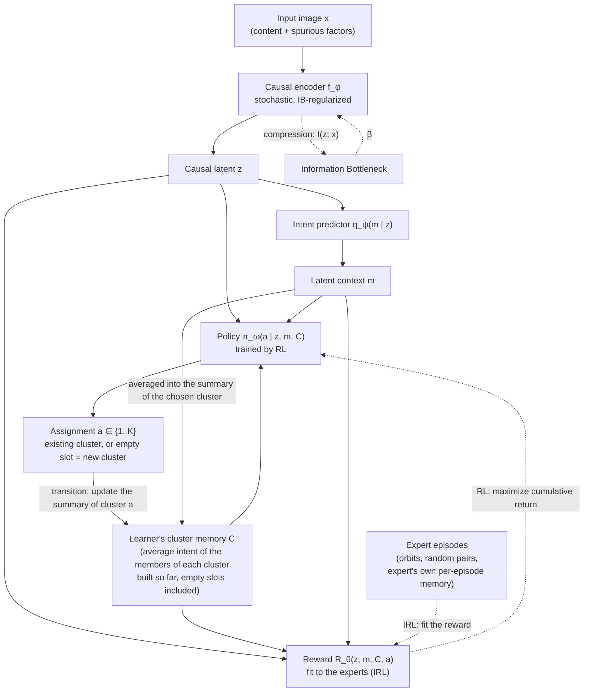
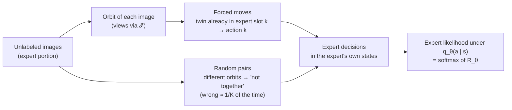
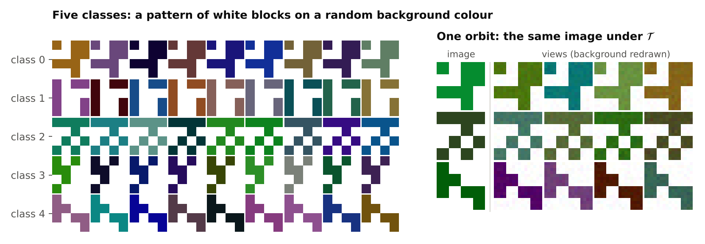
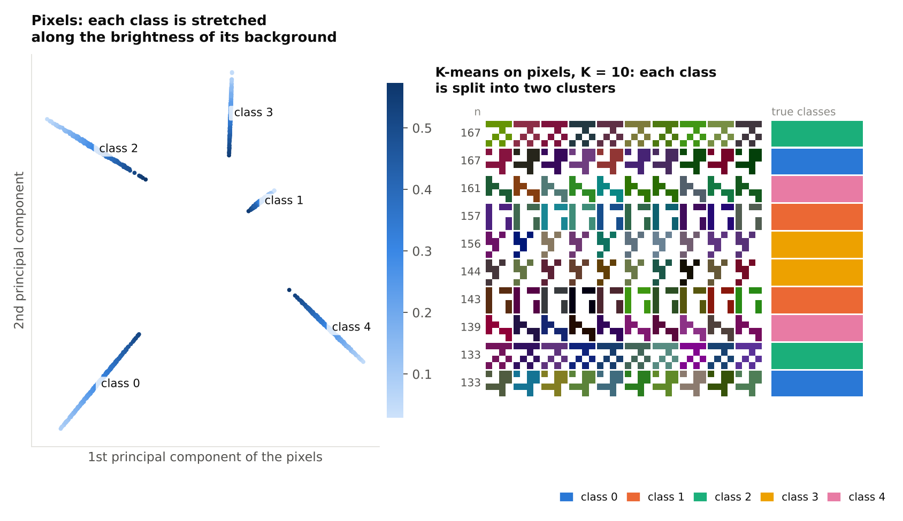
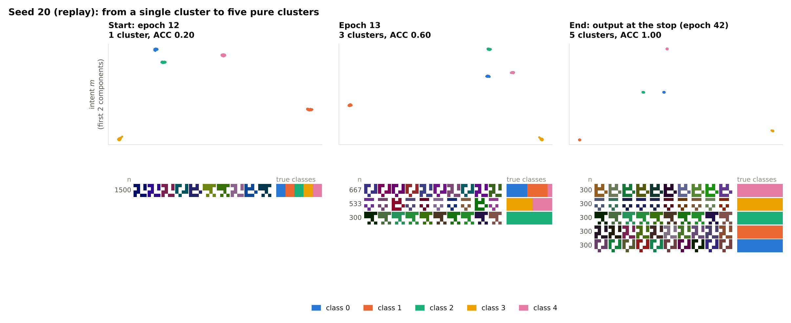
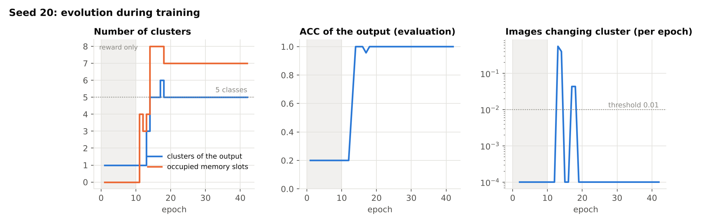
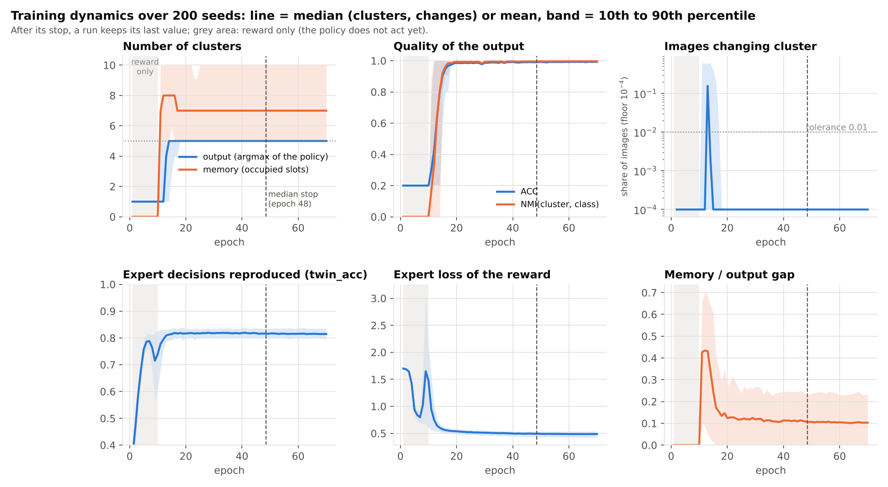
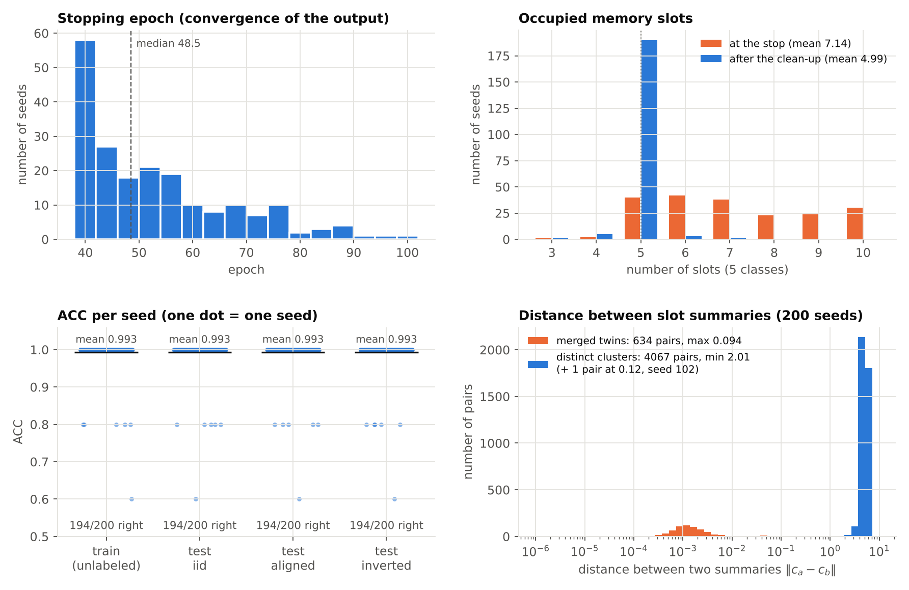
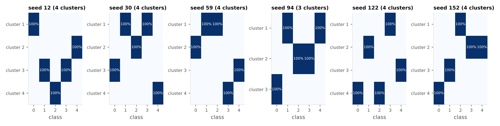

# CIB-IRL: Causal Information Bottleneck Inverse Reinforcement Learning

**Unsupervised image clustering that groups images by *what they are*, not by *where they appear*, by learning a causal representation (Information Bottleneck) together with a latent reward (multi-intention Inverse RL) from experts built out of image transformations, and a policy that builds the clusters by reinforcement learning.**

> **Status:** research prototype, work in progress. The conceptual framework is stable; the toy environment is implemented and evaluated (see [Results](#10-results)); the real benchmarks are being built (see [Roadmap](#12-status--roadmap)).

---

## Table of Contents

1. [The Idea](#1-the-idea)
2. [Motivation](#2-motivation)
3. [Background & Reading List](#3-background--reading-list)
4. [Method](#4-method)
5. [Where Do the Experts Come From?](#5-where-do-the-experts-come-from)
6. [Components & Training](#6-components--training)
7. [Decisions & Open Questions](#7-decisions--open-questions)
8. [Evaluation Protocol](#8-evaluation-protocol)
9. [Ablations](#9-ablations)
10. [Results](#10-results)
11. [Repository Structure](#11-repository-structure)
12. [Status & Roadmap](#12-status--roadmap)
13. [License](#13-license)

---

## 1. The Idea

**In one sentence:** cluster images the way a child learns categories, by finding the few features that make things *distinguishable* and ignoring everything else.

### 1.1 Intuition

We recognize a cat from a handful of features (ears, whiskers, the shape of the face), not from the sofa it sits on. A baby does this without being taught any label: it simply learns to tell things apart. We want an algorithm that does the same, i.e. groups images by what they *are*, even when the background or style would be an easier (but meaningless) signal.

### 1.2 Clustering as decision-making (the IRL view)

We turn clustering into a sequential decision problem:

- **The policy** is the act of clustering. Images arrive one after the other; for each, the policy decides which group it goes into: one of the clusters **built so far**, or a fresh one. Its decision is conditioned on what already exists, as in any unsupervised method that builds its groups along the way. It is a policy in the RL sense, a separate network trained to maximize a return, **not** a softmax of the reward.
- **The reward** is the intention behind the decision, the *intention of distinction*. It scores a placement by how well the image fits the group it joins **and** how well it is told apart from the other groups. As in any RL problem, the reward says what is worth doing and the policy learns how to do it over a whole sequence of decisions.
- **The expert.** We can see the creator of the data (the world that produced the cats and the dogs) as an expert who, in building these images, optimized some reward. Multi-intention IRL methods such as PEMIRL recover from expert behavior the reward attached to each category. Our expert is imperfect on purpose and **never constrains the learner**: it only guides the reward toward what it means to tell things apart.
- **The intent.** As in Meta-IRL, a group of images has an *intent*: what its members have in common (the context variable $m$). The memory of the groups built so far is made of these intents, so the reward and the policy compare the intent of the arriving image with the intent of each existing group.
- **Our step beyond.** Besides the reward that makes each category what it is, there also exists a reward that **distinguishes categories from one another**, the reason we do not confuse them. Finding it *is* learning to distinguish. Optimizing it by RL, over decisions that depend on the clusters already formed, is clustering.

### 1.3 The obstacle, and our answer

IRL needs expert demonstrations, but an unsupervised problem has none (a supervised version would not be interesting). Our answer is to **build the experts from the images themselves**:

- all the transformed versions of an image (crops, color changes, new backgrounds, transformations of transformations) obviously show the same thing: when one of them arrives and another is already in a group, the expert demonstrates "join that group";
- two random images usually show different things: the expert demonstrates "do not put these together".

The expert never says *which* cluster in absolute terms; it only answers "same group or not?". That is enough to learn a reward that tells clusters apart. These decisions form expert demonstrations: episodes in which the views of a few images arrive one after the other and a rule-based expert places them in its own groups. The data pipeline generated the views, so it knows which ones share an orbit. The expert does not constrain the learner's policy, which builds its own clusters; only the reward learns from the demonstrations. Details in [Section 5](#5-where-do-the-experts-come-from).

### 1.4 Two safeguards against shortcuts

Image datasets are full of spurious cues (background, texture, style) that are easier to use than the object. Two ingredients keep the reward on the object:

- **Information Bottleneck.** An encoder is trained to keep as much information as the reward needs and to compress away the rest, so a feature that does not help the decision is deleted.
- **Invariance check.** If the encoder really removed the useless features, the decision must not change when the image is perturbed in ways that keep the object (e.g. new background). We add this as an explicit term.

### 1.5 At a glance

| Human intuition | In CIB-IRL |
|---|---|
| The few features that make a cat a cat | Causal latent $z$ (encoder + Information Bottleneck) |
| "This looks like a cat-type thing" | Latent intent $m$ (intent predictor $q_\psi$: one per orbit during training, one per image at test time) |
| The groups I have formed so far | The learner's cluster memory $C$: for each cluster, the list of its members and their average intent (empty slots included); it persists across episodes |
| Why this image belongs here and not there | Reward $R_\theta(z, m, C, a)$ |
| Putting it in a group (or starting a new one) | Policy $\pi_\omega(a \mid z, m, C)$, $a\in\{1,\dots,K\}$, trained by RL |
| Someone who already knows what goes together | A rule-based expert built from transformations, with its own per-episode memory; it guides the reward and never constrains the learner ([Section 5](#5-where-do-the-experts-come-from)) |
| Not being fooled by the background | Compression + invariance of the decision |

---

## 2. Motivation

### 2.1 What already exists

| Family | Examples | Strength | Limitation for our problem |
|---|---|---|---|
| Geometric / statistical clustering | K-Means, GMM | Simple, fast | Depends entirely on the embedding geometry |
| Self-supervised learning | SimCLR, MoCo v3, CLIP | Strong, structured latent spaces | Augmentations alone do not guarantee that backgrounds are discarded |
| Multi-intention / meta IRL | Babeş-Vroman et al. 2011, PEMIRL | Separates unlabeled demonstrations by inferring several reward functions | Designed for **temporal trajectories** of real experts, not static images |

### 2.2 The gap

1. **Modality mismatch.** Multi-intention IRL methods operate on sequences of states and actions produced by experts. A static image has no trajectory and nobody demonstrates the choice. We create the sequence ourselves: the *clustering process* is the trajectory (images are assigned one after the other, and each assignment changes the state), and the expert demonstrations are fabricated from transformations.
2. **Spurious correlations.** Applied to images, such methods inherit the shortcut-learning behavior of unsupervised learners. An agent grouping animal images will often cluster by background (ducks and boats together because both contain water) instead of by the causal features of the object.
3. **A single reward.** Most IRL-based methods do not use IRL for the clustering step itself; when they do, they learn what characterizes each cluster (one reward per cluster, or one network conditioned on a per-cluster context). Our approach instead learns a single reward of *distinction*: it compares an arriving image to all existing clusters and does not depend on which slot a cluster occupies. This reward is what the policy optimizes to build the clusters. To our knowledge, this use of IRL for the clustering step is the main novelty of the project; whether it pays off is what the experiments test.

---

## 3. Background & Reading List

Six papers cover the theoretical foundations of the framework:

- [x] Yu, L., Yu, T., Finn, C., & Ermon, S. (2019).
  *Meta-Inverse Reinforcement Learning with Probabilistic Context Variables*. NeurIPS 2019.
  [PDF](https://arxiv.org/pdf/1909.09314.pdf)
  Core multi-intention IRL method — learns rewards from unlabeled multi-task demonstrations
  through a latent context variable $m$ inferred from the demonstrations, and infers the reward
  of a new task from a single demonstration. Source of our intent $m$ (Section 4.2).

- [x] Alemi, A. A., Fischer, I., Dillon, J. V., & Murphy, K. (2017).
  *Deep Variational Information Bottleneck*. ICLR 2017.
  [PDF](https://arxiv.org/pdf/1612.00410.pdf)
  Core compression method — turns the Information Bottleneck into a trainable objective with
  a variational bound on $I(z;x)$ (a KL to a prior) and a bound on relevance. Gives the
  $\beta\,\mathrm{KL}$ term of our encoder (Section 4.4).

- [x] Arjovsky, M., Bottou, L., Gulrajani, I., & Lopez-Paz, D. (2019).
  *Invariant Risk Minimization*. arXiv.
  [PDF](https://arxiv.org/pdf/1907.02893.pdf)
  Foundational theory of causal invariance — features whose predictive relation is stable across
  environments are the causal ones. Frames our nuisance family $\mathcal{T}$ as "environments", and
  introduces Colored MNIST.

- [x] Ji, X., Henriques, J. F., & Vedaldi, A. (2019).
  *Invariant Information Clustering for Unsupervised Image Classification and Segmentation*. ICCV 2019.
  [PDF](https://arxiv.org/pdf/1807.06653.pdf)
  Closest image-clustering approach in spirit — maximizes the mutual information between the
  cluster assignments of two augmented views of the same image. Our forced moves and
  invariance term play a similar role in a different formalism.

- [x] Babeş-Vroman, M., Marivate, V., Subramanian, K., & Littman, M. (2011).
  *Apprenticeship Learning About Multiple Intentions*. ICML 2011.
  [Paper page](https://mlanthology.org/icml/2011/babes2011icml-apprenticeship)
  Early "clustering and IRL together" — clusters unlabeled trajectories by inferring one
  objective per cluster with an EM procedure over IRL. Closest ancestor of the idea that a
  cluster is defined by its reward.

Additional references used by the expert design ([Section 5](#5-where-do-the-experts-come-from)): **Debiased Contrastive Learning** (Chuang et al., NeurIPS 2020), **SCAN: Learning to Classify Images without Labels** (Van Gansbeke et al., ECCV 2020), **SimCLR** (Chen et al., 2020), **MoCo v3** (Chen, Xie, He, 2021), and **Waterbirds / Group DRO** (Sagawa et al., 2020).

---

## 4. Method

### 4.1 Pipeline



### 4.2 Episodic MDP over a growing set of clusters

Two kinds of episodes share the same state, transition and reward:

- **Learner episodes.** The learner's policy $\pi_\omega$ sweeps a minibatch of training images, one view per image, presented one after the other in random order. The learner's cluster memory $C$ **persists across episodes and across training**: it is the set of clusters built so far. These episodes carry no label and no expert.
- **Expert episodes.** A dataset of demonstrations built before training from a portion of the images ([Section 5.2](#52-the-key-idea-an-images-transformations-are-an-expert-demonstration)): the views of a few images, shuffled, placed by a rule-based expert in the expert's own memory $C^E$. This memory starts empty at the beginning of each episode and is discarded at its end. Only the reward learns from these episodes.

The expert never parametrizes the learner: $\pi_\omega$ rolls out on its own states and is free to build memories and clusters that differ from the expert's.

| Component | Definition |
|---|---|
| State $s_t$ | $(z_t, m_t, C_t)$. $z_t = f_\phi(x_t)$ is the code of the image arriving at step $t$ and $m_t = \mu_\psi(z_t)$ is its inferred intent. $C_t=\{(n_k,c_k)\}_{k=1}^{K}$ is the **cluster memory**: for each slot $k$, the number of members $n_k$ and the **average intent** $c_k$ of its members. An empty slot ($n_k = 0$) carries a learned "empty" embedding. $C$ is a memory, not a differentiable function: it is updated by the transition and is stop-gradient everywhere. In an expert episode the state is the same, with the expert's memory $C^E_t$ in place of $C_t$ |
| Action $a_t$ | A slot $a\in\{1,\dots,K\}$. Choosing a non-empty slot means *joining* that cluster. Choosing an empty slot means *opening a new cluster*. $K$ is an **upper bound**; the number of clusters actually constructed starts at 0 and grows during training |
| Transition | The chosen slot is updated: $n_a \leftarrow n_a + 1$, $c_a \leftarrow c_a + (m_t - c_a)/n_a$ (running mean of the member intents). The next image then sees a different state |
| Reward | $R_\theta(s_t, a_t)$: compatibility of $z_t$ with the chosen group **and** distinctness from the other groups. One network, permutation-equivariant over slots, reading the summaries $c_k$ but not the counts $n_k$. Learned by IRL from the experts ([Section 5](#5-where-do-the-experts-come-from)) |
| Policy | $\pi_\omega(a \mid s_t)$, a **separate network** trained by RL to maximize the entropy-regularized cumulative return $\mathbb{E}\big[\textstyle\sum_t\gamma^t R_\theta(s_t,a_t)\big]+\alpha\,\mathcal{H}(\pi_\omega)$. It is *not* $\mathrm{softmax} (R_\theta)$ |
| Expert | Not observed: a rule-based expert built from image transformations, acting in its own per-episode memory ([Section 5](#5-where-do-the-experts-come-from)) |

**Keeping the learner's memory consistent.** The memory keeps, for each slot, the list of its members (a map image → slot, so an image belongs to at most one slot at a time). When an image is visited again, its previous placement is withdrawn ($n$ and $c$ are updated) before the new placement. Because the encoder keeps changing, a summary computed with an old encoder would no longer match the intents of new images: at the end of each epoch the summaries $c_k$ are **recomputed from the members with the current encoder**. The reward does not receive the counts $n_k$: in an expert episode a slot holds at most $n$ views, in a learner episode it can hold thousands, so a count would be out of distribution. The counts are still used by the transition and to know whether a slot is empty.

**What $m$ is, and why the cluster memory is made of intents.** In Meta-IRL (PEMIRL), the context $m$ is inferred from a *set* of demonstrations that share a task, and it indexes the reward of that task. Our counterpart of a set of demonstrations is a **group of images**: an orbit at first, then a cluster that gathers orbits. The $m$ of a group is its **intent**, what its members have in common. This gives two levels:

- **Per image, $m_u = \mu_\psi(z_u)$.** The intent that a single image expresses. During training $q_\psi$ is pushed to give the same intent to all views of an orbit (Section 6.2), so $m$ is the orbit-consistent, nuisance-free part of the code. At test time it is computed from one image, as PEMIRL infers the context of a new task from a single demonstration.
- **Per cluster, $c_k$.** The average of the intents of its members. The intent of a cluster *is* the summary stored in the memory.

The reward and the policy therefore receive no extra label: they compare the intent of the arriving image with the intents of the existing clusters. We do not take $m$ to be the cluster index (a distribution over slots), because that would duplicate the output of the policy. One honest remark: $m$ is a function of $z$, so it adds no information. What it adds is an extra invariance signal (orbit consistency, $L_\psi$) and a space in which clusters are compared. The ablations "without $m$" and "summaries in $z$-space" measure it ([Section 9](#9-ablations)).

**What RL brings that a classifier does not.** The reward is a *one-step* score: it says whether placing this image here is good *given the clusters as they currently are*. A placement also changes the cluster summary, hence the rewards of all later images. The policy optimizes this whole chain: it can leave an uncertain image in a fresh slot instead of polluting an existing summary, or open a cluster early because several later images will need it. If $\gamma=0$ the return is the immediate reward and the policy is essentially greedy on $R_\theta$; the ablation $\gamma=0$ / $\mathrm{softmax} (R_\theta)$ ([Section 9](#9-ablations)) measures what the sequential structure really adds.

### 4.3 Joint objective

Encoder $f_\phi$, intent predictor $q_\psi$ and reward $R_\theta$ are optimized together (the policy $\pi_\omega$ is trained against the reward, Section 6.5):

<br>

```math
\max_{\phi,\psi,\theta} \mathcal{I}\big(f_\phi(x); a, m\big) - \beta\,\mathcal{I}\big(f_\phi(x); x\big)
```

<br>

- **Relevance term** $I\big(f_\phi(x);a,m\big)$: mutual information between the filtered representation and the categorization output (the assignment $a$, plus the intent). It keeps in $z$ every causal marker needed for clear, confident clustering decisions.
- **Compression term** $I\big(f_\phi(x);x\big)$: forces the encoder to be as restrictive as possible, deleting bits that vary a lot or do not help clustering (changing backgrounds, styles).
- **$\beta$** controls the compression / utility trade-off.

### 4.4 Tractable training objective

As in the Deep VIB, both terms are replaced by variational bounds. With a stochastic encoder $p_\phi(z\mid x)$ and a fixed prior $r(z)$:

<br>

```math
I(z;x) \le \mathbb{E}_{x}\,\mathrm{KL}\big(p_\phi(z\mid x)\|r(z)\big),
\qquad
I(z;a,m) \ge H(a,m) + \mathbb{E}\,\big[\log q_\psi(m\mid z) + \log q_\theta(a\mid z,C,m)\big]
```

<br>

where $q_\theta(a\mid s)=\mathrm{softmax}_a\,R_\theta(s,a)$ is the **choice model induced by the reward** (Section 5.2). It is used to score the experts' decisions; it is not the policy that acts. Two remarks on the second bound:

- **The targets are relational, not categorical.** Our experts say whether an image goes with a group that already exists, or whether two images go together, not which cluster is "the right" one ([Section 5](#5-where-do-the-experts-come-from)). We therefore instantiate the relevance term with the *expert likelihood*: the intent loss $L_\psi$ and the reward loss $L_\theta$ of [Section 6](#6-components--training) play the roles of $-\mathbb{E}\log q_\psi(m\mid z)$ and $-\mathbb{E}\log q_\theta(a\mid z,C,m)$. This is a surrogate for the bound, not a strict bound.
- **The entropy $H(a,m)$** is what prevents collapse in the bound. In our setting it is supplied by the repulsion between random pairs ([Section 5.3](#53-two-forces-attraction-and-repulsion)) and by the finite number of slots.

The loss minimized on the encoder, intent predictor and reward is

<br>

```math
\mathcal{L} = \mathcal{L}_\psi + \mathcal{L}_\theta + \beta\,\mathbb{E}_x\,\mathrm{KL}\big(p_\phi(z\mid x)\|r(z)\big) + \lambda\,\mathcal{L}_{\text{inv}}
```

<br>

and the policy is trained separately, with its own RL loss $L_\omega$ (Section 6.4), in alternation with it (Section 6.5).

### 4.5 Decision-consistency (invariance) term

A feature is spurious if removing it leaves the decision unchanged. We operationalize this with a consistency penalty under nuisance perturbations $g\sim\mathcal{T}$ (background swaps, color jitter, style transfer). Because a softmax policy is only defined up to an additive constant per image in the reward, and because the policy is what actually decides, we compare the **policies** on the clean and the perturbed view, in the same (learner's) cluster state. With $z = f_\phi(x)$ and $\tilde{z} = f_\phi(g(x))$:

<br>

```math
\mathcal{L}_{\text{inv}}(\phi) = \mathbb{E}_{x,g\sim\mathcal{T}}\,\mathrm{KL}\Big(\pi_{\bar\omega}(\cdot\mid z,\bar C,\bar m)\Big\|\pi_{\bar\omega}(\cdot\mid \tilde z,\bar C,\bar m)\Big)
```

<br>

A bar means **stop-gradient**: the value is used but not updated by this term. The policy $\omega$, the intent $\psi$ (hence $\bar{m}$, the intent of the clean view, given to both views) and the cluster memory $C$ are *frozen* here, while the encoder $\phi$ is updated through both views. The term therefore tests the dependence of the decision on $z$; the invariance of $m$ itself is enforced by $L_\psi$. Section 6.5 explains why. This is inspired by IRM (invariance across environments) and IIC (agreement across views), but it is not the IRMv1 penalty: IRM needs labels to compute a risk per environment and only observes environments, whereas here $\mathcal{T}$ gives an intervention on each image and no label exists, so a consistency check on a frozen policy is enough. It only covers the nuisances that $\mathcal{T}$ contains (A1). It acts as a *check* on the encoder: if the useless features were really compressed away, the distribution over clusters must not move. Alternatives (the reward-induced choice model $q_{\bar{\theta}}$ instead of $\pi_{\bar{\omega}}$, raw reward differences, $\omega$ unfrozen) are covered by the ablations in [Section 9](#9-ablations).

---

## 5. Where Do the Experts Come From?

### 5.1 The problem

IRL learns a reward by asking: *which reward would make the expert's behavior optimal?* Here the "behavior" is putting an image in the right cluster, and nobody has done that: no labels, no demonstrations. At the very start we have **no experts, no clusters, no intents**, and the cluster memory is empty.

### 5.2 The key idea: an image's transformations are an expert demonstration

Take one image and transform it: crop it, change its colors, replace its background, transform the result again. Whatever we get shows the *same thing*. Without placing a single label, we hold a group of images that the expert would put in the same cluster, and we can produce as many as we like because transformed images can be transformed again.

**Definitions.**

- **Nuisance family $\mathcal{T}$.** Transformations that change appearance (crop, color, blur, background, style) but are meant to preserve the object.
- **Orbit of an image $x_i$.** $\mathcal{O}_i=\{\,g_D\circ\cdots\circ g_1(x_i)\;:\;g_k\in\mathcal{T},\ D\le D_{\max}\,\}$: everything reachable by chaining at most $D_{\max}$ transformations, with bounded cumulative strength (long chains drift away from the object).
- **Expert portion $\mathcal{D}_E$.** The portion of the training images dedicated to building the expert demonstrations; its size is a hyperparameter. The learner's environment is the whole training set.
- **Demonstration (episode).** An episode presents views drawn from several orbits, one after the other, in random order. It plays the role of the trajectory in PEMIRL. The state of each decision is $(z_t, m_t, C^E_t)$, where $C^E_t$ is the **expert's own memory**: the groups the expert has formed so far in this episode, built by the same transition as the learner's memory ([Section 4.2](#42-episodic-mdp-over-a-growing-set-of-clusters)). It starts empty and is discarded at the end of the episode.

**The expert's rule.** The expert is *relational*: it never names a cluster in absolute terms. When view $u$ arrives in the state $s^E_t = (z_t, m_t, C^E_t)$:

- **Forced move** (certain, by construction). If another view of the same orbit has already been placed, in slot $k$ of the expert's memory, the expert action is $a = k$: *join the group of your twin*.
- **Free move.** If $u$ is the first view of its orbit, the expert opens a new slot for it, so that the next views of the orbit have a group to join. In Phase 1, two different orbits are two different groups, *even when they show the same concept* (two cat photos). This placement builds the expert's state, but nothing is demonstrated about where the view "should" go: it is not supervised by attraction, it is only constrained by repulsion (below).
- **Repulsion** (probably right). A view $v$ from a different orbit that already sits in slot $k(v)$ of the expert's memory is, in all likelihood, a different thing: the expert says "do not join $k(v)$ because of $v$". This is wrong with probability $\tau^{+}$, the chance that two random images share a concept (≈ $1/K$ for balanced classes): two different cat photos are "different orbits" but the same concept.

This is exactly the structure of *must-link / cannot-link* constraints in constrained clustering, generated automatically. The reward is therefore identified up to a relabeling of the clusters, which is all clustering needs.

**The expert does not parametrize the learner.** The expert is not optimal: in Phase 1 it separates two cats. It is never used to restrict the learner. Its only job is to train the reward toward what it means to tell things apart. The learner's policy $\pi_\omega$ never sees orbit identity, the expert's slots or the expert's actions; it can build memories and clusters different from the expert's (and, with a limited number of slots, it typically has to merge what the expert separates).

**How an episode becomes expert data, step by step.** For each expert episode:

1. Draw $B$ images from $\mathcal{D}_E$ (with $B \le K$, so that the expert's memory fits in the $K$ slots of the learner), and $n$ views of each with $\mathcal{T}$ (so $B\cdot n$ views, $n$ views per orbit).
2. Shuffle the $B\cdot n$ views into one sequence. The episode is this sequence: the views arrive one at a time, and each placement updates the expert's memory (the transition).
3. The expert places each view following its rule, in its own memory $C^E$, which starts empty. This gives, at each step, a state $(z_t, m_t, C^E_t)$ and an expert action.
4. The pipeline, which generated the views and therefore knows which ones share an orbit, labels each step: forced move, free move, or repulsion pairs. These labels feed only the reward loss $L_\theta$.

**What is stored and what is recomputed.** The set of expert episodes is built once, before training, and reused, as the demonstrations of classical IRL. It stores the **structure** only: the images, the transformation recipes, the order of the views and the expert's slots. The codes $z_t$ and intents $m_t$ are recomputed with the current encoder at every training step, and $C^E_t$ is rebuilt by the transition from the expert's slots. The expert's memory never survives its episode.

A small example with six views, in this order: A1, B1, A2, C1, B2, C2 ($A$, $B$, $C$ are three images, each with two views; $A$ and $C$ are two different cats, $B$ is a dog):

| Step | Arriving view | Case | What the expert does and says |
|---|---|---|---|
| 1 | A1 | Free move | Opens slot 1 for $A$. Nothing yet to repel |
| 2 | B1 | Free move | Opens slot 2 for $B$. Repulsion: do not join slot 1 (A1) |
| 3 | A2 | Forced move | Joins slot 1, the slot of A1 |
| 4 | C1 | Free move | Opens slot 3 for $C$. Repulsion against slots 1 and 2. The repulsion from $A$ is a false negative (two cats), absorbed by $\tau^{+}$ |
| 5 | B2 | Forced move | Joins slot 2, the slot of B1 |
| 6 | C2 | Forced move | Joins slot 3, the slot of C1 |

In the expert's memory the two cats $A$ and $C$ sit in two different slots (the Phase 1 tolerance). Nothing in these signals says that they go together: if they end up in one cluster, that is the learner's doing ([Section 5.4](#54-why-two-different-cat-photos-end-up-together)).

**The same structure as classical IRL.** The demonstrations are data produced by the expert in the expert's own states and fixed before training. The learner's policy $\pi_\omega$ interacts with its environment (all the training images) on its own states and never reads the expert's actions; only the reward compares what the expert does with what the learner does. Two things are specific to us: the expert is a rule (orbit membership) and not an agent, and it is deliberately imperfect. Since the pipeline knows the orbits, it could also label the placements that the learner makes in its own episodes; we do not do this in the main method, because the signal would become "be consistent with your own placements" instead of "imitate an independent expert". It is kept as an ablation ([Section 9](#9-ablations)).

**The reward-induced choice model.** To score the expert's decisions we model the expert as choosing slot $a$ with probability proportional to $\exp R_\theta(s, a)$:

<br>

```math
q_\theta(a\mid s) = \frac{\exp R_\theta(s,a)}{\sum_{a'=1}^{K}\exp R_\theta(s,a')}
```

<br>

Learning the reward that makes the expert's decisions likely under $q_\theta$ is maximum-likelihood IRL with relational demonstrations. Two approximations are explicit: the expert is modelled as Boltzmann-rational on the *immediate* reward (no soft value iteration through the transitions), and the reward is trained on the expert's states only while it is used on the learner's states ([Section 6.3](#63-reward-model-r_theta)). Acting is left to the separate policy $\pi_\omega$ (Section 6.4).



### 5.3 Two forces: attraction and repulsion

Positives alone are not enough: putting everything in one cluster satisfies "an orbit stays together" perfectly. We need a force that says *different things should be told apart*, which is the "reward that distinguishes".

- **Attraction (forced moves).** When view $u$ arrives and a twin is already in slot $k^{+}(u)$ of the expert's memory (the slot opened by the first view of its orbit), the reward must make joining that slot likely (here and below $s_u$ is the expert's state):

<br>

```math
\mathcal{L}_{\text{pos}} = -\mathbb{E}_{u:\text{twin placed}}\,\big[\log q_\theta\big(k^+(u)\mid s_u\big)\big]
```

<br>

- **Repulsion (random negatives).** For a view $u$ and a random previously placed view $v$ of another orbit, sitting in the expert's slot $k(v)$, the reward must make joining $k(v)$ unlikely. With $\ell(u,v)=-\log\big(1-q_\theta(k(v)\mid s_u)\big)$, the naive negative term is $\mathbb{E}_v\,\ell(u,v)$. A fraction $\tau^{+}$ of random $v$ are actually of the same concept, so we subtract their share, approximated by a positive pair (the standard debiasing of Chuang et al. 2020): the anchor's own twin $v^{+}$ when one is already placed, and the batch average over the forced moves otherwise. We use $\tau^{+} = 1/K$ on Colored MNIST; on Waterbirds, where classes are imbalanced, $\tau^{+}$ is swept as a hyperparameter (see assumption A2):

<br>

```math
\mathcal{L}_{\text{neg}} = \mathbb{E}_{u}\,\max\Big\{\tfrac{1}{1-\tau^+}\Big(\mathbb{E}_{v\sim\text{placed}}\,\ell(u,v) - \tau^+\,\bar\ell^{+}(u) \Big), 0 \Big\}
```

<br>

with $\bar\ell^{+}(u)=-\log\big(1-q_\theta(k^{+}(u)\mid s_u)\big)$ if a twin of $u$ is placed, and the average of this quantity over the forced moves of the batch otherwise (so that the correction is defined for first views too).

The expert loss is $L_{\mathrm{expert}}=L_{\mathrm{pos}}+L_{\mathrm{neg}}$, and it is what trains the reward (Section 6.3). The same repulsion is what makes an **empty slot attractive**: when an image fits no existing group, the mass leaves the occupied slots and goes to an empty one, i.e. the reward values *opening a new cluster*. In an expert episode an empty slot is always available when an orbit starts, which is why $B \le K$.

**Why random negatives are not an intervention.** We never choose pairs using knowledge of concepts. The only assumption is that random pairs are rarely of the same concept, with a *known* error rate $\tau^{+}$. Choosing negatives from images we know to be different would inject labels at the start and defeat the unsupervised goal; we do not do it. In Phase 2, the candidate pairs mined by the model are excluded from the repulsion as well ([Section 5.5](#55-phase-1-and-phase-2-tolerating-then-correcting-the-expert)).

### 5.4 Why two different cat photos end up together

In Phase 1 the expert keeps two different orbits in two different slots, so nothing in the demonstrations says "these two cats belong together". The merge is the **learner's**: it is free to put them in one cluster, and with a limited number of slots it typically has to. Three things make it happen:

1. **Limited slots.** There are at most $K$ clusters. Once the slots are in use, a new orbit must join an existing group, and orbits that look alike must share one. While free slots remain, opening a new cluster is possible but is rewarded only when the image is genuinely incompatible with the groups that exist.
2. **Similarity in $z$.** Orbits with similar codes get similar rewards for the same group. Two cats share "cat features", so they fall in the same group.
3. **The Information Bottleneck decides what "similar" means.** If $z$ still contains the background, merging happens along the background axis (cats on grass with dogs on grass). The compression is what makes the merging happen along the animal.

So the encoder is not a side detail: it determines *along which axis* the expert's weak signal is turned into categories.

### 5.5 Phase 1 and Phase 2: tolerating, then correcting the expert

The project runs the expert in two phases and compares them. Both use the same learner, the same reward and the same losses; only the expert's demonstrations change.

**Phase 1: the expert is tolerated as it is.** Each image is its own orbit, so the expert separates two different cat photos. This is a known and accepted flaw: the expert is not optimal and it does not parametrize the learner ([Section 5.2](#52-the-key-idea-an-images-transformations-are-an-expert-demonstration)). The question of Phase 1 is how far this flaw biases the learner. The bias is not small on paper: with $K = 10$ balanced classes, an episode of $B$ random images contains at least one same-class pair with probability 10% for $B = 2$, 28% for $B = 3$ and about 70% for $B = 5$ (the episode is collision-free with probability 30%), and the expert places each such pair in two different groups. The repulsion $\tau^{+}$ correction absorbs part of this, but nothing in the demonstrations ever *attracts* two different cats. Phase 1 measures what the learner does with this: does it still merge the cats (limited slots, similarity in $z$, [Section 5.4](#54-why-two-different-cat-photos-end-up-together)), or does it fragment into one cluster per orbit?

**Phase 2: the expert is corrected during training.** Phase 2 changes the expert's demonstrations, slowly, so that two orbits that the model itself considers the same concept are treated as one. It does not change the learner or the loss. Its components:

1. **Relinking of the expert's slots.** A link between two images $i$ and $j$ merges their orbits for the construction of the expert episodes: in an episode that contains views of both, the expert puts them in the *same* slot of its own memory. A view of $j$ arriving after a view of $i$ becomes a forced move toward the slot of $i$, and the pair is removed from the repulsion (also from the $\tau^{+}$ correction). The expert's memory is still per episode: what changes is the rule that fills it.
2. **Source of the links.** Links come from **mutual $k$-nearest neighbors in the code space of a slowly-moving copy of the encoder (EMA)**, not from the learner's policy: using the policy's own placements would make the expert agree with the learner by construction and would give the reward nothing independent to learn from. A link is accepted only if both images are neighbors of each other and their cluster assignment by the learner (used as a confidence filter, not as a label) is confident, $\max_a\pi_\omega\ge\gamma_c$.
3. **Episodes enriched with neighbors.** In Phase 1 the images of an episode are drawn at random, so two cats rarely meet. In Phase 2, an episode is built from half random images and half of their mutual neighbors. This is what puts candidate same-concept pairs in front of the expert, so that a link has an effect on the reward.
4. **Brakes.** The expert moves while the reward is still learning, and the model can confirm its own mistakes. We therefore:
   - **cap** the number of accepted links per epoch ($\le M$) and **ramp up** their weight over training;
   - require **persistence**: a link must be proposed over several consecutive epochs before it is used;
   - apply **no automatic transitive closure**: if $i\sim j$ and $j\sim k$, then $i\sim k$ is not added by itself (chains drift from one concept to another, and a single wrong link would merge two classes);
   - **decrease the effective $\tau^{+}$** as links remove part of the false negatives from the repulsion;
   - monitor the **churn** (fraction of images changing cluster between epochs) and the number of links used.

**Comparison protocol.** The two phases are run with the same seeds, the same dataset, the same hyperparameters and the same budget. We report ACC, NMI, worst-group ACC, spurious leakage and the number of constructed clusters for Phase 1 and for Phase 2, and conclude whether Phase 2 **improves or degrades** the result. A degradation is a legitimate outcome and would be reported as such (confirmation bias, chain drift). The ablations of [Section 9](#9-ablations) remove the brakes one by one. Two Phase 1 diagnostics make the comparison interpretable: the **same-class rate among the nearest neighbors in $m$-space** (does the learner's intent space already group different cats?) and the number of non-empty slots against the number of expert orbits per episode.

**Considered, not adopted: initializing the expert with a pixel heuristic.** For Colored MNIST, a nuisance-invariant heuristic on raw pixels (e.g. grayscale binarized shape) could provide initial cross-orbit links. It would inject a prior about the classes and about the dataset, so it is not part of the method; it could be used as a sanity check to see how much a good initial linking would help.

### 5.6 Declared assumptions

We prefer to state what the expert silently relies on:

| Assumption | Meaning | Consequence |
|---|---|---|
| **A1. $\mathcal{T}$ preserves the object** | The family of transformations changes appearance, not identity. It encodes *prior knowledge about nuisances*, not about classes. | The method is unsupervised with respect to classes, but weakly informed about nuisances, like the environments of IRM. If $\mathcal{T}$ never changes the background, the expert cannot teach invariance to it, and the burden falls on the Information Bottleneck. |
| **A2. Random pairs are rarely the same concept** | $\tau^{+}\approx 1/K$ for balanced classes. | The true value is $\tau^{+}=\sum_c p_c^{2}$, the probability that two random images share a class (0.625 for two classes at 75% / 25%, instead of 0.5). We use $\tau^{+} = 1/K$ on Colored MNIST and sweep $\tau^{+}$ on Waterbirds. |
| **A3. $K$ is a known upper bound** | $K$ is given and at least the true number of concepts. The model is free to use fewer slots. | The number of clusters actually constructed is monitored; sensitivity to a $K$ larger or smaller than the truth is part of the ablations. |

### 5.7 Failure modes and what we monitor

| Failure | Symptom | Guard / monitor |
|---|---|---|
| Background shortcut | High $\mathrm{NMI}(\text{cluster},\text{background})$ | Nuisance-targeted $\mathcal{T}$ (A1), compression $\beta$; **track leakage from step 0**, not only at the end |
| Low-level shortcut (color histogram, texture) | Clusters follow simple statistics | Diverse and strong $\mathcal{T}$, compression $\beta$ |
| Collapse | Few clusters used (everything joins one slot) | Repulsion ([5.3](#53-two-forces-attraction-and-repulsion)); number of non-empty slots; entropy of the cluster-size histogram |
| Fragmentation | One concept split across clusters, too many slots opened | Upper bound $K$, Phase 2 merging, over-clustering analysis |
| Cold start of empty slots | Early on, all slots are empty and every placement looks equally good | Learned empty-slot embedding; warm-up of the reward on forced moves before the policy acts on its own; monitor the number of non-empty slots from step 0 |
| Order dependence | Different clusters for different image orders within an episode | Random order every episode; summaries recomputed with the current encoder at each epoch; report variance across orders at test time |
| Distribution shift, expert vs learner | The reward is trained on the expert's small single-orbit groups and applied to the learner's large mixed groups | No count $n_k$ in the reward input; memory summaries are averages; diagnostic: reward statistics on expert vs learner states; ablation with expert labels on learner states ([Section 9](#9-ablations)) |
| Stale summaries | Summaries computed by an old encoder no longer match the intents of new images | Recompute the summaries from the member lists at each epoch; ablation against a slow EMA |
| Expert bias (Phase 1) | Two images of the same concept are separated by the expert, so the learner fragments by orbit | Limited slots; Phase 1 vs Phase 2 comparison; same-class rate among nearest neighbors in $m$-space |
| Non-stationary state and reward | The policy chases a reward and a memory that both move | Alternating updates with a slow reward relative to the policy; frozen reward during the policy step (Section 6.5) |
| RL instability | Return oscillates, policy entropy collapses | Entropy bonus $\alpha$, small policy learning rate, critic target network, comparison with the closed-form $\mathrm{softmax} (R_\theta)$ control |
| Semantic drift along chains | Views in an orbit no longer show the same object | Bound $D_{\max}$ and cumulative strength |
| Over-strong transformations | Crops that remove the object, noisy "twin" decisions | Bound the strength of each $g \in \mathcal{T}$ |
| Confirmation bias and chain drift (Phase 2) | Churn does not decrease, errors reinforced, distinct classes merged through a chain of links | EMA copy, mutual neighbors, confidence $\gamma_c$, rate cap $M$, persistence over several epochs, no automatic transitive closure |
| Moving expert (Phase 2) | Reward loss oscillates | Change the expert slowly relative to reward learning (cap and ramp-up) |
| False negatives | About $1/K$ of random pairs are the same concept | Debiasing; check for class imbalance |

### 5.8 Relation to existing work

Taken separately, the pieces are known: orbit positives and random negatives are contrastive learning (SimCLR), the debiasing is Chuang et al. 2020, the group-joining decision is close to online prototype / sequential clustering, the neighbor mining of Phase 2 is close to SCAN (mutual nearest neighbors), and relational supervision is constrained clustering. **What we test** is whether casting them as expert demonstrations for a latent reward, with an RL policy that builds the clusters, an Information Bottleneck on the encoder and a decision-level invariance check, removes spurious features better than the same pipeline with a plain classification head (see [Ablations](#9-ablations)).

---

## 6. Components & Training

The architecture has four trained components: the **encoder**, the **intent predictor**, the **reward model** and the **policy** (a separate network with its critic, trained by RL), plus the learner's non-differentiable **cluster memory** that the policy writes to (the expert has a memory of its own, per episode). This section fixes the notation, then gives for each component its role, its loss, and the intuition behind each term. It closes with the two ways of training the encoder (joint, [6.5](#65-joint-training-the-encoder-is-trained-with-the-rest-alternating-reward-and-policy-steps), and sequential, [6.6](#66-sequential-training-the-encoder-is-trained-first-then-frozen)) and exactly what is frozen where.

> **Reading guide.** The values given in this section are those of the final toy pipeline ([Section 10](#10-results)). Where the pipeline departs from the first design, the text says **(changed)** or **(new)**; the experiments and reasons behind each change are in `docs/protocol-decisions.md`. Sections 6.1 to 6.7 describe the training; [6.8](#68-stopping-rule-and-final-clean-up) the stopping rule and the final clean-up; [6.9](#69-hyperparameters-of-the-toy-pipeline) the hyperparameters in one table.

### 6.0 Notation

- For a view $u$: $z_u = f_\phi(u)$ and $m_u = \mu_\psi(z_u)$ (mean of the inferred intent).
- $C=\{(n_k,c_k)\}$ is the learner's cluster memory (Section 4.2): $c_k$ is the average of the intents $m_v$ of the members of cluster $k$, recomputed with the current encoder at each epoch. $s_u = (z_u, m_u, C)$ is the state in which $u$ arrives. In an expert episode the memory is the expert's own, $C^E$, and the state is written $s^E_u = (z_u, m_u, C^E)$. Memories are always treated as constants. States and summaries always use the **single-view** intent $m_u$, as at test time; the orbit mean $m^{*}$ below is only a training target for $q_\psi$.
- $R_\theta(s, a)$ is the reward of placing the arriving image in slot $a$. $q_\theta(a\mid s)=\mathrm{softmax}_a\,R_\theta(s,a)$ is the choice model it induces, used to score the experts (Section 5.2).
- $\pi_\omega(a \mid s)$ is the **policy**, a network of its own, trained by RL against $R_\theta$. It is not $q_\theta$.
- A bar ($\bar{\theta}$, $\bar{\omega}$, $\bar{m}$, $\bar{C}$) means **stop-gradient**: the value is used in the computation but not updated by that loss.
- Expert signals (Section 5), always in the expert's states $s^E$: forced moves (twin already placed in the expert's memory), random previously placed views (repulsion), with $\tau^{+} = 1/K$. The expert never acts on the learner: only $L_\theta$ reads them.
- $K$ is the number of slots, an upper bound on the number of clusters. A slot is **empty** until an image is placed in it; the action "open a new cluster" is the choice of the first empty slot. During a pass over the training images, $n$ is the number of images placed so far and $n_k$ the size of slot $k$. The reward and the policy network never read $n_k$; only the prior $\pi_0$ of [6.4](#64-policy-pi_omega-separate-network-trained-by-rl) does.
- Intent target of an image $i$: $m^{*}_i=\mathrm{sg}\Big[\tfrac{1}{|\text{orbit}_i|}\sum_{v\in\text{orbit}_i}\mu_\psi(z_v)\Big]$, where $\mathrm{sg}[\cdot]$ is stop-gradient. The intent is a property of the orbit, not of a single view.

### 6.1 Encoder $f_\phi$

**Role.** The only component that sees pixels. It maps an image to a stochastic code $z=\mu_\phi(x)+\sigma_\phi(x)\odot\varepsilon$, $\varepsilon\sim\mathcal{N}(0,I)$, and everything downstream sees only $z$. Its job is a trade-off: keep what the intent and the reward need, discard everything else, in particular backgrounds and styles.

**Loss.**

<br>

```math
\mathcal{L}_{\text{enc}}(\phi) = \underbrace{\mathcal{L}_\psi + \lambda_{\text{cov}}\mathcal{L}_{\text{cov}} + \mathcal{L}_\theta}_{\text{utility, through } z} + \beta\,\underbrace{\mathbb{E}_x\,\mathrm{KL}\big(p_\phi(z\mid x)\|\mathcal{N}(0,I)\big)}_{\text{compression}} + \lambda\,\underbrace{\mathbb{E}_{x,g}\,\mathrm{KL}\big(\pi_{\bar\omega}(\cdot\mid z,\bar C,\bar m)\|\pi_{\bar\omega}(\cdot\mid \tilde z,\bar C,\bar m)\big)}_{\mathcal{L}_{\text{inv}}(\omega,\psi,C\text{ frozen})}
```

<br>

For a diagonal Gaussian the KL has a closed form: $\tfrac12\sum_j\big(\mu_j^2+\sigma_j^2-1-\log\sigma_j^2\big)$. The form of the loss is unchanged; $\mathcal{L}_{\text{cov}}$ (new, [6.2](#62-intent-predictor-q_psi)) is part of the utility term because its gradient flows through $z$.

**Hyperparameters (toy).** $\dim z = 32$; $\beta = 10^{-4}$ **(changed, was $10^{-3}$)**, reached after a warm-up of 300 iterations from 0; $\lambda = 1$. With $\beta=10^{-3}$ the KL falls to about 40 and the twin accuracy (`twin_acc`: share of the expert's forced moves that the reward reproduces) drops from about 0.83 to 0.5; with $\beta=10^{-4}$ it stays near 0.8 (`docs/protocol-decisions.md`, Section 3).

**Status of $\mathcal{L}_{\text{inv}}$ (kept, inactive on the toy).** On the toy, $\mathcal{L}_{\text{inv}}$ never exceeds $3\cdot10^{-7}$ and carries $0.5\,\%$ of the encoder gradient; the policy takes the same decision on the clean and the perturbed view for $100\,\%$ of the images. The orbits already make the encoder invariant to the background, so no effect is expected there; the ablation $\lambda=0$ is not run yet ([Section 9](#9-ablations)).

**Reading the terms.**
- **Utility $L_\psi + L_\theta$.** The gradients of the intent and expert losses flow back into $z$. This is the "retain as much information as possible" pressure: anything needed to predict the concept and to tell images apart must survive.
- **Compression $\beta\,\mathrm{KL}$.** Pulls every code toward the prior, i.e. makes $z$ carry as few bits about $x$ as possible. $\beta$ sets how hard it pushes; it must stay small enough that the reward is not degraded.
- **Invariance $\lambda\,L_{\mathrm{inv}}$.** The check on the encoder. $L_{\mathrm{pos}}$ already asks that the views of an image join the same cluster; $L_{\mathrm{inv}}$ asks that the whole distribution over clusters chosen by the policy stay the same under perturbation. $\omega$, $\psi$ and $C$ are frozen in this term (see Section 6.5); otherwise the policy could simply learn to ignore the image and satisfy it for free.

### 6.2 Intent predictor $q_\psi$

**Role.** Infers from $z$ a continuous intent $m$ (what the image is "about", e.g. species morphology), the counterpart of the context variable of Meta-IRL. It plays two roles. For an image, it is the nuisance-free summary of what the image expresses. For a cluster, the average of the intents of its members is the cluster's summary in the memory $C$, so the intent of a cluster is built from the intents of its images, as PEMIRL infers the context of a task from its demonstrations. The reward and the policy receive $m$ and compare it with the intents of the existing clusters.

**Loss.**

<br>

```math
\mathcal{L}_\psi = -\mathbb{E}_{i,u\in\text{orbit}_i}\,\big[\log q_\psi(m^*_i \mid z_u)\big]
```

<br>

**Added term (new): decorrelating the coordinates of the intent.** Alone, $\mathcal{L}_\psi$ lets the intent collapse to a single direction: the covariance of $\mu_\psi(z)$ over a batch has rank 1 and the classes superpose on one axis, so that the clusters the policy builds are not separable (docs 5.15 to 5.18). We add

<br>

```math
\mathcal{L}_{\text{cov}}=\frac1d\sum_{i\neq j}C_{ij}^{2},\qquad C=\mathrm{Cov}_{\text{expert batch}}\big(\mu_\psi(z)\big)\in\mathbb{R}^{d\times d},\qquad d=\dim m=16
```

<br>

weighted by $\lambda_{\text{cov}}=3$: the intent loss of the reward step is $\mathcal{L}_\psi+\lambda_{\text{cov}}\mathcal{L}_{\text{cov}}$. It penalizes the off-diagonal entries of $C$ only, so it asks the coordinates of $m$ to be uncorrelated without fixing their scale. As an implementation choice (outside the first design), $\mu_\psi(z)$ goes through a BatchNorm without affine parameters, so that every coordinate has unit scale. The variance $\sigma^2_\psi$ stays learned (a fixed variance and a Cholesky whitening were tested and rejected, docs 5.15 and 5.16).

**Reading the terms.**
- **$\mathcal{L}_{\text{cov}}$ (new).** Forces the intent to use several independent directions, so that different classes can sit at different places of $m$-space instead of on one line. It uses no label.
- **Log-likelihood of the orbit's intent $m^{*}$.** Every view of an image must give the same concept. A concept that changes when only the background changes is penalized, so $m$ is pushed toward content.
- **Gaussian case.** With $q_\psi(m\mid z)=\mathcal{N}\big(\mu_\psi(z),\sigma_\psi^2(z)\big)$, this is a squared error weighted by the predicted precision, plus $\log\sigma_\psi$: the model can express uncertainty but pays for it.
- **Caveat.** $m$ is a function of $z$: it adds an invariance signal, not information. A constant $m$ would leave the memory with only counts and reduce the model to single-intention IRL. The "without $m$" ablation measures what $m$ really contributes.

### 6.3 Reward model $R_\theta$

**Role.** Scores every placement $(s, a)$: how well the arriving image, coded by $z$, fits the group in slot $a$ **and** how well it is told apart from the other groups in the memory $C$. It is the object that IRL recovers, the *intention of distinction*, shared by the whole dataset. It is a permutation-equivariant network over the slots, $R_\theta(z,m,C,a)=g_\theta\big(z,m,c_a,\mathrm{pool}_{k\neq a}\,c_k\big)$: it reads the chosen slot together with a pooled view of the others, so the identity of a slot never matters, only its content (the first part measures compatibility, the second distinctness). It does **not** read the counts $n_k$, which would differ between the expert's small groups and the learner's large ones. It is trained by IRL on the expert's states $s^E$ and applied to the learner's states $s$, which is a known distribution shift ([Section 5.7](#57-failure-modes-and-what-we-monitor)); it is **not** the policy.

**Loss.** Maximum-likelihood IRL of the expert's decisions (Section 5), under the choice model $q_\theta$:

<br>

```math
\mathcal{L}_\theta = \mathcal{L}_{\text{pos}} + \mathcal{L}_{\text{neg}} - \rho\,\mathcal{H}\big(\mathbb{E}_s\,q_\theta(\cdot\mid s)\big), \qquad \rho = 0.1
```

<br>

**Reading the terms.**
- **$L_{\mathrm{pos}}$ (attraction, forced moves).** Raises the reward of the twin's slot, in the expert's memory, for the arriving view.
- **$L_{\mathrm{neg}}$ (repulsion).** Lowers the reward of joining a slot that holds a different orbit in the expert's memory, with the false-negative correction $\tau^{+}$. This is the "reward that distinguishes": it exists because the softmax inside $q_\theta$ is *relative*, so lowering a cluster's reward for one image raises the others, empty slots included.
- **$\rho\,\mathcal{H}(\text{marginal})$ ($\rho=0.1$, **changed**: it was off, $\rho=0$, and switched on only if $K_{\mathrm{eff}}<0.7\,K$).** Entropy of the average choice distribution over the batch, a safeguard against collapse; it is now always on, with a small weight. $K_{\mathrm{eff}}=\exp\big(\mathcal{H}(\bar p)\big)$, with $\bar{p}$ the average assignment distribution, is still monitored. We keep $\rho$ small because uniform cluster usage is wrong for imbalanced classes (e.g. Waterbirds), and because $K$ is only an upper bound.
- **Repulsion floor $\varepsilon$ (new, in $L_{\mathrm{neg}}$).** The debiased repulsion has zero gradient as soon as $\bar\ell(u)\le\tau^{+}\ell^{+}$ (a dead zone: $\ell^{+}$ is measured on twins, the easy cases, so the correction subtracts too much), which switches the repulsion off exactly where the reward is too permissive and joins things that should stay apart (docs 5.9). A constant added to $L_{\mathrm{neg}}$ would have no gradient, so the floor is placed inside the maximum:

<br>

```math
\mathcal{L}_{\text{neg}}=\mathbb{E}_{u}\,\max\Big\{\tfrac{1}{1-\tau^+}\big(\bar\ell(u)-\tau^+\,\ell^+(u)\big),\ \varepsilon\,\bar\ell(u)\Big\},\qquad \varepsilon=0.1,\quad \bar\ell(u)=\mathbb{E}_{v}\,\ell(u,v)
```

<br>

with $\ell(u,v)$ as in [Section 5.3](#53-two-forces-attraction-and-repulsion) and [6.7](#67-all-the-objectives-in-one-place); the first branch is the debiased loss of Section 5.3 (there with a floor of $0$), the second keeps a fraction $\varepsilon$ of the raw repulsion loss. This is the only change to the debiasing; $\tau^{+}=1/K=0.1$ is unchanged. Alone, $\rho$ and the floor did not change the formation of the clusters (docs 5.10); they are kept because they belong to the configuration validated on 200 seeds together with $\mathcal{L}_{\text{cov}}$ (the effect of each of the three was not isolated).

**Hyperparameters (toy).** Experts: $B=3$ orbits $\times$ $n=2$ views per episode, 2000 fixed episodes built from $30\,\%$ of the images, maximum transformation distance $d_{\max}=2$, 32 episodes per batch, no link between the expert's and the learner's memories. Learning rate $3\cdot10^{-4}$; the reward is trained alone during the first 150 iterations; the reward is centered. Tested and not retained: 5 orbits per episode (the reward opens more clusters but the formation is worse), and removing the debiasing on free moves (docs 5.9, 5.10).

### 6.4 Policy $\pi_\omega$ (separate network, trained by RL)

**Role.** The agent that builds the clustering. At each step it sees the arriving code and the clusters built so far, and picks a slot: join a group, or open a new one. It is a separate network $\pi_\omega(a \mid z, m, C)$ (set-conditioned over the slots, like the reward), with a critic $V_\xi(s)$ for the return estimates. It acts on the learner's states only and never sees the expert, the orbits or the expert's actions. **(New)** Its score is multiplied by a fixed **Chinese-restaurant-process prior** $\pi_0$ on the placements (below). At inference the assignment is $a=\arg\max_a\pi_\omega(a\mid s)$, prior included, with the memory $C$ frozen at the end of training.

**Loss.** Entropy-regularized RL against the *frozen* reward (actor-critic, e.g. PPO with advantages from $V_\xi$):

<br>

```math
\mathcal{L}_\omega = -\mathbb{E}_{\pi_\omega}\,\Big[\sum_{t}\gamma^{t}\,R_{\bar\theta}(s_t,a_t)\Big] - \alpha\,\mathbb{E}\,\big[\mathcal{H}\big(\pi_\omega(\cdot\mid s_t)\big)\big]
```

<br>

**Prior over placements (new).** With $K=10$ slots for 5 classes, two slots can carry one class, and nothing in the reward breaks the tie between them. The policy is therefore written as

<br>

```math
\pi_\omega(a\mid s)\;\propto\;\exp\big(\mathrm{score}_\omega(s,a)\big)\,\pi_0(a\mid s),\qquad \pi_0(k\mid s)=\frac{n_k}{n-1+\alpha_{\text{CRP}}}\ \ (\text{occupied slot }k),\qquad \pi_0(\text{open}\mid s)=\frac{\alpha_{\text{CRP}}}{n-1+\alpha_{\text{CRP}}}
```

<br>

with $\alpha_{\text{CRP}}=1$. $\log\pi_0$ is a fixed additive offset of the logits, used in the sampling, the PPO ratio, the entropy, $\mathcal{L}_{\text{inv}}$ and the final readout; $n_k$ is the size of slot $k$ without the image being placed. It reads only the slot sizes, never a label. Where the reward is indifferent between two slots the prior alone decides, in proportion to their sizes; elsewhere the score gaps of the policy ($19$ to $70$ nats) dwarf $\log n_k$ (docs 5.23 and 5.24).

**Optimizer (changed: PPO only).** The policy is trained by PPO alone, with no teacher phase: clip $0.2$, 4 PPO epochs per step, $\gamma=0.9$, GAE parameter $0.95$, entropy weight $\alpha=0.01$, critic weight $0.5$, learning rate $10^{-3}$, gradient clipping $5$, learner batch of 100 images, $K=10$ slots.

**Reading the terms.**
- **Return $\sum_t\gamma^t R_{\bar\theta}$.** The policy is judged on the *whole sequence*: each placement changes the memory $C$, hence the rewards that follow. This is what makes it a policy and not a softmax of the reward (Section 4.2).
- **Entropy bonus $\alpha\,\mathcal{H}$.** Keeps exploration alive, in particular the exploration of empty slots in the early phase.
- **$\bar{\theta}$ frozen.** During the policy step the reward does not move; it is the ruler the policy is optimized against. The encoder is frozen too: $z$ and $C$ are given, so RL never reaches the pixels.
- **$\gamma$.** $\gamma=0$ makes the policy essentially greedy on $R_\theta$; the control in Section 9 compares it with $\gamma>0$.
- **Prior $\pi_0$ (new).** Breaks ties between duplicate slots of one class in favour of the larger one, and makes opening a cluster cost $\alpha_{\text{CRP}}$ against the $n_k$ images already in the others.

### 6.5 Joint training: the encoder is trained with the rest (alternating reward and policy steps)

> **What "joint" and "sequential" mean.** Sections 6.5 and 6.6 describe two ways of training the **same architecture with the same losses**. The only thing that differs is **how the encoder $f_\phi$ is trained**. The intent predictor $\psi$, the reward $\theta$ and the policy $\omega$ keep the same losses and the same stop-gradients in both modes (gradient routing table below); what changes for them is only whether the codes $z$ they receive are still moving.
>
> - **Joint (this section).** The encoder is trained *at the same time* as $\psi$ and $\theta$, and receives the gradient of all the reward-side losses: $L_\psi$, $\lambda_{\text{cov}}L_{\mathrm{cov}}$, $L_\theta$, $\beta\,\mathrm{KL}$ and $L_{\mathrm{inv}}$. It never receives the gradient of the RL loss $L_\omega$ (the policy step freezes it).
> - **Sequential ([6.6](#66-sequential-training-the-encoder-is-trained-first-then-frozen)).** The encoder is trained *first and alone*, with a reward-free objective, and is then frozen; $\psi$, $\theta$ and $\omega$ are trained on its fixed codes.

In the joint mode, the encoder, the intent predictor and the reward are trained together in the reward step, in alternation with the policy step. One iteration:

1. **Two batches.**
   - *Expert batch.* A minibatch of expert episodes ([Section 5.2](#52-the-key-idea-an-images-transformations-are-an-expert-demonstration)), fixed in structure: $B$ images, $n$ views each, shuffled, placed by the expert in its own memory $C^E$. The codes $z_t$, intents $m_t$ and the memory summaries are recomputed with the current encoder. The pipeline labels the steps (forced moves, repulsion pairs). The learner's policy plays no role in this batch.
   - *Learner rollout.* The current policy $\pi_\omega$ sweeps a minibatch of training images, one view each, placing them one by one, seeing only $(z_t, m_t, C_t)$; the persistent memory $C$ is updated by each transition. No label is used.
2. **Reward step (IRL).** Minimize the total loss on $\phi, \psi, \theta$, with $L_\psi$, $L_\theta$ computed on the expert batch and $L_{\mathrm{inv}}$ on the learner's states:

<br>

```math
\mathcal{L} = \mathcal{L}_\psi + \lambda_{\text{cov}}\mathcal{L}_{\text{cov}} + \mathcal{L}_\theta + \beta\,\mathrm{KL} + \lambda\,\mathcal{L}_{\text{inv}}
```

<br>

3. **Policy step (RL).** With $\phi, \psi, \theta$ frozen, minimize $L_\omega$ (and the critic loss) on $\omega, \xi$ on learner rollouts. The reward is evaluated on the learner's states; it has never seen the learner's decisions.
4. **End of epoch.** Recompute the summaries $c_k$ of the learner's memory from the member lists with the current encoder.

This is the objective of Section 4.4, plus the RL loss of Section 6.4, which is why the training is alternating and not a single loss. Gradient routing (what each term updates, and what it treats as constant):

| Term | Updates | Frozen (stop-gradient) |
|---|---|---|
| $L_\psi$ (intent) | $\psi$, and $\phi$ through $z$ | The orbit target $m^{*}$ |
| $L_{\mathrm{cov}}$ (decorrelation of $m$) | $\psi$, and $\phi$ through $z$ | The covariance is computed on the expert batch |
| $L_\theta$ (expert likelihood) | $\theta$, and $\phi$ through $z$ | The memory $C^E$ and the intent $m$: $\psi$ gets no gradient from $L_\theta$. The intent is trained only by $L_\psi$, so the reward cannot bend it to make its own job easier, and the cluster summaries stay stable |
| KL (compression) | $\phi$ | None |
| $L_{\mathrm{inv}}$ (invariance) | $\phi$ only, through both $z$ and $\tilde{z}$ | $\omega$, $\psi$ (hence $m$) and $C$ |
| $L_\omega$ (RL return + entropy) | $\omega$ (and the critic $\xi$) | $\phi$, $\psi$, $\theta$, $C$: the policy step treats the encoder and the reward as given |

**What is frozen in $L_{\mathrm{inv}}$, and why.** With $\bar{\omega}$, $\bar{m}$, $\bar{C}$ frozen, the invariance term has gradient $\nabla_\omega L_{\mathrm{inv}}=0$ and $\nabla_\psi L_{\mathrm{inv}}=0$, while $\nabla_\phi L_{\mathrm{inv}}\neq 0$. This means the policy is used as a *fixed measuring stick*: if the decision it takes changes under a perturbation, the *encoder* is what gets corrected. If $\omega$ were free, the term would have a trivial minimizer: any policy that does not depend on the image,

<br>

```math
\pi_\omega(\cdot\mid z,C,m) = \pi_\omega(\cdot\mid C,m) \Longrightarrow \pi_\omega(\cdot\mid z,C,m)=\pi_\omega(\cdot\mid \tilde z,C,m) \Longrightarrow \mathcal{L}_{\text{inv}} = 0 ,
```

<br>

so the check would push the policy toward ignoring the image instead of pushing the encoder toward dropping the nuisance. The same holds for $m$: a free $\psi$ could make $m$ insensitive and cheat the term. Freezing is local to $L_{\mathrm{inv}}$: $\omega$ keeps being trained by RL through $L_\omega$, and $\theta$ by the experts through $L_\theta$, so the ruler still evolves, but never through the check. The ablations "$\omega$ unfrozen" and "$q_{\bar{\theta}}$ instead of $\pi_{\bar{\omega}}$" ([Section 9](#9-ablations)) measure how much these choices matter.

**What it means.** "Useless" is defined *relative to the reward and policy currently being learned*: the encoder compresses what they do not use, while they adapt to whatever the encoder keeps. This co-adaptation is the point of the method, and also its main risk: the early reward is random, so it can push the bottleneck to discard useful bits, and the early policy is random, so the memory $C$ is noisy. Mitigations: a warm-up of $\beta$ from 0, a reward warm-up on forced moves before the policy acts alone, and a reward updated more slowly than the policy. Since the expert's trajectories are fixed, the reward does not chase the policy's own memory; the only moving parts it sees are the encoder and, in Phase 2, the expert's links.

### 6.6 Sequential training: the encoder is trained first, then frozen

> **Only the encoder's training changes with respect to [6.5](#65-joint-training-the-encoder-is-trained-with-the-rest-alternating-reward-and-policy-steps).** The architecture and the losses $L_\psi$, $L_\theta$, $L_\omega$ are the same, and $\psi$, $\theta$, $\omega$ keep the same stop-gradients. What changes is that the encoder $f_\phi$ is trained **before** them, **alone**, with a reward-free objective, and is then **frozen**: it never sees the reward, the policy or $L_{\mathrm{inv}}$.

Two stages, nothing flowing back from the second to the first.

1. **Encoder alone.** No reward exists yet. The encoder is trained on the *same expert signals* (Section 5) but with a reward-free similarity head (e.g. a cosine / contrastive head on $z$), together with $\beta\,\mathrm{KL}$ and an invariance penalty on the code itself, $\lVert z-\tilde z\rVert^{2}$.
2. **IRL and RL modules on frozen codes.** $\phi$ is frozen. $L_\psi + L_\theta$ are minimized on $z$ and $L_\omega$ trains the policy, still in alternation (reward step, then policy step). There is no KL, no $L_{\mathrm{inv}}$, and no gradient into the encoder.

| | Joint | Sequential |
|---|---|---|
| Optimization | One loop, all networks, alternating reward / policy steps | Encoder first, then intent / reward / policy |
| What the encoder is trained on | $L_\psi+L_\theta+\beta\,\mathrm{KL}+\lambda L_{\mathrm{inv}}$, at the same time as $\psi$ and $\theta$ (never $L_\omega$) | A reward-free similarity head + $\beta\,\mathrm{KL}$ + $\lVert z-\tilde z\rVert^{2}$, alone, then frozen |
| What $\psi$, $\theta$, $\omega$ are trained on | The same losses and stop-gradients, on codes $z$ that are still moving | The same losses and stop-gradients, on fixed codes $z$ |
| Does the encoder see the reward? | Yes (through $L_\psi$, $L_\theta$, $L_{\mathrm{inv}}$) | No, only a similarity head |
| Meaning of "useless" | Irrelevant to the current reward and policy | Irrelevant to the similarity objective |
| Strengths | Matches the definition of the method; the encoder is shaped by what clustering needs | Simple, stable, modular; the IRL / RL stage can be re-run without retraining the encoder |
| Risks | Moving targets, instability, need for warm-up | Frozen stage-1 errors; the encoder may drop cluster-relevant bits or keep spurious ones |

Sequential training is the natural control for the claim that *joint* optimization matters (see [Ablations](#9-ablations)); with $\beta=0$ it reduces to the "standard multi-intention IRL" baseline.

### 6.7 All the objectives in one place

**Representation and state.** For an arriving view $u$:

<br>

```math
z_u = \mu_\phi(u)+\sigma_\phi(u)\odot\varepsilon,\qquad m_u = \mu_\psi(z_u),\qquad s_u=(z_u,m_u,C),\qquad s^E_u=(z_u,m_u,C^E),\qquad C=\{(n_k,c_k)\}_{k=1}^{K}
```

<br>

**Transition (cluster memory, for both the learner's $C$ and the expert's $C^E$).** After the assignment $a$, the chosen slot absorbs the intent of the view (an empty slot, $n_a = 0$, thereby becomes a new cluster):

<br>

```math
n_a \leftarrow n_a+1,\qquad c_a \leftarrow c_a+\frac{m_u-c_a}{n_a}
```

<br>

**Memory recompute (learner's memory, end of each epoch).** With $M_k$ the list of members of slot $k$ and the current encoder:

<br>

```math
c_k \leftarrow \frac{1}{|M_k|}\sum_{u\in M_k}\mu_\psi\big(\mu_\phi(u)\big)
```

<br>

**Intent (Section 6.2).** Every view of an orbit must give the intent of the orbit, and the coordinates of the intent must be decorrelated:

<br>

```math
\mathcal{L}_\psi=-\mathbb{E}_{i,u\in\text{orbit}_i}\,\big[\log q_\psi(m^*_i\mid z_u)\big],\qquad m^*_i=\mathrm{sg}\Big[\tfrac{1}{|\text{orbit}_i|}\textstyle\sum_{v\in\text{orbit}_i}\mu_\psi(z_v)\Big]
```

<br>

```math
\mathcal{L}_{\text{cov}}=\frac1d\sum_{i\neq j}C_{ij}^{2},\qquad C=\mathrm{Cov}_{\text{expert batch}}\big(\mu_\psi(z)\big)
```

<br>

**Reward (IRL on the experts, Sections 5.2, 5.3 and 6.3).** The choice model induced by the reward and the expert loss, evaluated in the expert's states:

<br>

```math
q_\theta(a\mid s)=\frac{\exp R_\theta(s,a)}{\sum_{a'}\exp R_\theta(s,a')},\qquad
\mathcal{L}_{\text{pos}}=-\mathbb{E}\,\big[\log q_\theta(k^+(u)\mid s^E_u)\big]
```

<br>

```math
\mathcal{L}_{\text{neg}}=\mathbb{E}_{u}\,\max\Big\{\tfrac{1}{1-\tau^+}\Big(\mathbb{E}_{v}\,\ell(u,v)-\tau^+\,\mathbb{E}_{v^+}\,\ell(u,v^+)\Big),\ \varepsilon\,\mathbb{E}_{v}\,\ell(u,v)\Big\},\quad \ell(u,v)=-\log\big(1-q_\theta(k(v)\mid s^E_u)\big)
```

<br>

with $k^{+}(u)$ and $k(v)$ slots of the expert's memory $C^E$, and $\ell(u, v^{+})$ replaced by the batch average over the forced moves when $u$ has no placed twin.

<br>

```math
\mathcal{L}_\theta=\mathcal{L}_{\text{pos}}+\mathcal{L}_{\text{neg}}-\rho\,\mathcal{H}\big(\mathbb{E}_s\,q_\theta(\cdot\mid s)\big),\qquad \rho=0.1,\ \varepsilon=0.1
```

<br>

**Invariance (Section 4.5).** The policy is the fixed ruler; only the encoder is updated:

<br>

```math
\mathcal{L}_{\text{inv}}=\mathbb{E}_{x,g\sim\mathcal{T}}\,\mathrm{KL}\Big(\pi_{\bar\omega}(\cdot\mid z,\bar m,\bar C)\Big\|\pi_{\bar\omega}(\cdot\mid \tilde z,\bar m,\bar C)\Big)
```

<br>

**Reward step** (updates $\phi, \psi, \theta$):

<br>

```math
\mathcal{L}=\mathcal{L}_\psi+\lambda_{\text{cov}}\mathcal{L}_{\text{cov}}+\mathcal{L}_\theta+\beta\,\mathbb{E}_x\,\mathrm{KL}\big(p_\phi(z\mid x)\|\mathcal{N}(0,I)\big)+\lambda\,\mathcal{L}_{\text{inv}}
```

<br>

**Policy step** (updates $\omega$ and the critic $\xi$; $\phi, \psi, \theta, C$ frozen). The policy $\pi_\omega\propto\exp(\mathrm{score}_\omega)\,\pi_0$ (prior of 6.4) maximizes the return of the learned reward by PPO, and the critic regresses it:

<br>

```math
\mathcal{L}_\omega=-\mathbb{E}_{\pi_\omega}\,\Big[\sum_t\gamma^t\,R_{\bar\theta}(s_t,a_t)\Big]-\alpha\,\mathbb{E}\,\big[\mathcal{H}(\pi_\omega(\cdot\mid s_t))\big],\qquad
\mathcal{L}_\xi=\mathbb{E}\,\big[(V_\xi(s_t)-\hat G_t)^2\big]
```

<br>

with $\hat G_t=\sum_{j\ge 0}\gamma^j R_{\bar\theta}(s_{t+j},a_{t+j})$.

**Inference.** $C$ is frozen at the end of training and each image is assigned by $a=\arg\max_a\pi_\omega(a\mid z,m,C)$ with $m = \mu_\psi(z)$, prior $\pi_0$ included. The clusters of the output are then renamed by the clean-up of 6.8 (no re-reading of the policy).

### 6.8 Stopping rule and final clean-up

Both are new, use no label, and add no parameter to the training.

**Stopping rule (output convergence).** Training stops when the **output** (the assignment $\arg\max_a\pi_\omega$ of every training image, memory frozen, prior included) has converged. Over a window of 10 epochs, all four conditions hold: (i) at most $1\,\%$ of the images change cluster between two epochs (up to a renaming of the slots); (ii) the number of clusters of the output is constant; (iii) the twin accuracy stays within $\pm0.01$; (iv) the expert part of the reward loss $L_{\text{pos}}+L_{\text{neg}}$ varies by less than $2\,\%$ (relative). A minimum of 40 epochs and a maximum of 300 apply. The model evaluated is the last epoch. A criterion on the memory (memory equal to the output) was tried and removed: the memory keeps duplicate slots that the output does not use (docs 5.25 to 5.28).

**Final clean-up (mode `relabel`, no training).** At the end of training the memory often holds two slots for one class (on the toy, 7.1 occupied slots on average for 5 classes, Section 10). The output is first **read** (argmax with the frozen memory and prior), then the duplicate slots are identified and used **only to rename** the clusters of that output:

1. Take the distances $\lVert c_a-c_b\rVert$ between the summaries of the non-empty slots and sort them.
2. If the largest ratio between two consecutive sorted distances is $\ge 10$ (a guard, not tuned), every pair of distances below that jump is a *twin pair* (two slots of one cluster). Otherwise nothing is merged.
3. Merge the twin pairs by single linkage (the largest slot is kept) and give the images of the merged slots the same cluster index.

The policy is never read again on the merged memory: doing so puts it in a state it has not seen (empty slots while the memory was full) and it then prefers to "open" a cluster, which broke 3 of 100 outputs (docs 5.28, 5.29). Two other ways to close the memory (`merge`, and re-placing the images with the frozen policy) were rejected on the same 100 seeds and on 100 fresh seeds (docs 5.29, 5.30). No distance has to be chosen: on the 200 runs, distances between twin slots are at most $0.094$ and between distinct clusters at least $2.0$ (one pair at $0.12$, Section 10).

### 6.9 Hyperparameters of the toy pipeline

| Component | Parameter | Value | Status |
|---|---|---|---|
| Data | classes $\times$ images, size | $5\times300$, $16\times16\times3$ | |
| Encoder | $\dim z$, $\beta$, $\beta$ warm-up, $\lambda$ | $32$, $10^{-4}$, 300 iterations, $1$ | $\beta$ changed ($10^{-3}$) |
| Intent | $\dim m$, $\lambda_{\text{cov}}$, BatchNorm on $m$ | $16$, $3$, yes (no affine) | new |
| Reward | $\rho$, $\varepsilon$, $\tau^{+}$ | $0.1$, $0.1$, $1/K=0.1$ | $\rho$ changed (0), $\varepsilon$ new |
| Reward | learning rate, warm-up, centering | $3\cdot10^{-4}$, 150 iterations, yes | |
| Experts | orbits $\times$ views, episodes, share of images, $d_{\max}$, episodes per batch | $3\times2$, 2000, $30\,\%$, 2, 32 | |
| Policy | slots $K$, prior $\alpha_{\text{CRP}}$ | $10$, $1$ | new |
| Policy | PPO clip, epochs, $\gamma$, GAE, $\alpha$, critic weight, lr, grad. clip, batch | $0.2$, 4, $0.9$, $0.95$, $0.01$, $0.5$, $10^{-3}$, 5, 100 | PPO only (no teacher phase) |
| Stopping | window, partition change, twin, loss plateau, min / max epochs | 10, $1\,\%$, $\pm0.01$, $2\,\%$, 40 / 300 | new |
| Clean-up | mode, jump guard | `relabel`, 10 | new |

---

## 7. Decisions & Open Questions

### 7.1 Decisions taken

Each decision is given with its reason and with what we rejected.

| # | Decision | Why | Rejected alternative |
|---|---|---|---|
| 1 | **Expert = transformations.** The views of an orbit show the same thing, so they give certain "join your twin" decisions (forced moves). | IRL needs demonstrations and an unsupervised problem has none; the images themselves can provide the "same" signal for free. | Experts built from labels (not unsupervised). |
| 2 | **Relational expert.** The expert never names a cluster in absolute terms: forced moves (attraction), free moves (first view of an orbit), repulsion between random views. | Must-link / cannot-link constraints are enough to identify the reward up to a relabeling of clusters, which is all clustering needs. | Absolute cluster labels as expert actions. |
| 3 | **Random negatives with a known false-negative rate $\tau^{+}$, debiased.** | Random pairs are rarely the same concept; the error rate is known and corrected (Chuang et al. 2020). It is not an intervention. | Negatives chosen from concepts known to be different: they inject labels at the start and bias the unsupervised goal. |
| 4 | **$\mathcal{T}$ is prior knowledge about nuisances** (assumption A1). | It encodes what should *not* matter, not what the classes are, like the environments of IRM. | Pretending the method needs no prior at all. |
| 5 | **A separate policy $\pi_\omega$, trained by RL, conditioned on the clusters built so far.** Actions are the existing clusters or an empty slot; each placement updates the memory $C$. | IRL must bring something new. The reward is the *intention of distinction* (learned from the experts) and the policy optimizes the *return* over a sequence of placements that change the state. A closed-form $\mathrm{softmax} (R)$ would only be a per-image classifier. | The policy as the softmax of the reward (kept as a control, $\gamma=0$); no cluster memory (kept as an ablation). |
| 6 | **$K$ is an upper bound; clusters are opened progressively.** Slots start empty, choosing an empty slot opens a cluster, and the number of constructed clusters grows during training. **On the toy, $K=10$ for 5 classes.** | Consistent with the cluster memory (a cluster exists once it has members) and with the "unsupervised, built along the way" intuition. $K$ known as an upper bound is a weaker assumption than $K$ exact; with $K$ equal to the number of classes the partition in 5 clusters can be forced by capacity alone (docs 5.19). | A fixed $K$ all active from step 0; $K$ equal to the true number of classes. |
| 7 | **Alternating training.** Reward step (IRL: encoder, intent, reward) then policy step (RL, with the others frozen). | The policy is optimized against a reward, so the reward must be a ruler that does not move during the policy step; both co-adapt across iterations. | A single end-to-end loss through the RL return. |
| 8 | **$m$ is the intent, and the cluster memory is made of intents.** $m$ is inferred per image by $q_\psi$ (made consistent over an orbit by $L_\psi$); the summary of a cluster is the average intent of its members; the reward and the policy receive $z$, $m$ and $C$. $\psi$ is trained only by $L_\psi$. | It is the direct counterpart of Meta-IRL: the context of a task is inferred from the set of its demonstrations. It avoids a redundant per-image latent next to the memory. | $m$ as the cluster index (duplicates the policy output); $m$ absent (kept as an ablation); $\psi$ trained by $L_\theta$ (the reward could distort the intent). |
| 9 | **Invariance compares policies, with $\omega$, $\psi$ and $C$ frozen.** $L_{\mathrm{inv}}$ is a KL between the policies on the clean and perturbed views, in the same cluster state. | A reward is defined only up to a per-image constant under a softmax, so policies are the comparable objects. A free policy could ignore the image and give $L_{\mathrm{inv}} = 0$ for free. | Raw reward differences; $\omega$ unfrozen (kept as ablations). |
| 10 | **A small collapse safeguard, always on (changed).** $\rho=0.1$ (it was $0$, switched on only if $K_{\mathrm{eff}}<0.7\,K$). | Part of the configuration validated on 200 seeds, with $\mathcal{L}_{\text{cov}}$ and the repulsion floor (decision 18). A small weight keeps the bias towards uniform usage, wrong for imbalanced classes, weak. | A large $\rho$; the conditional activation rule. |
| 11 | **$\tau^{+}$ and $K$.** $\tau^{+} = 1/K$ with $K$ the number of slots ($0.1$ on the toy), swept on Waterbirds; $K$ is twice the true number of classes on the toy, with sensitivity in the ablations. | $1/K$ is exact for balanced classes when every slot is a class; Waterbirds is imbalanced ($\tau^{+}=\sum_c p_c^{2}$). | A single universal $\tau^{+}$. |
| 12 | **The expert does not parametrize the learner.** The learner's policy $\pi_\omega$ never sees orbits, the expert's slots or the expert's actions, and nothing restricts the memories and clusters it builds. | The expert is not optimal (in Phase 1 it separates two cats); it is only used to guide the reward toward what it means to tell things apart. | Constraining the learner to the expert's groups; policy imitation of the expert. |
| 13 | **Fixed expert trajectories with a per-episode expert memory.** Demonstrations are built before training from a portion of the images: each orbit is a slot of the expert's own memory, the first view opens it, the later views join it. Only the structure is stored; $z$, $m$ and the memory summaries are recomputed with the current encoder. | Same status as expert demonstrations in classical IRL: data produced by the expert in its own states, independent of the learner. The learner rolls out on its own states. | Labelling the learner's own placements on the fly (a DAgger-like variant; kept as an ablation): the signal would become "be consistent with your own placements". |
| 14 | **The learner's memory persists, with member lists and summaries recomputed with the current encoder at each epoch.** | The clusters must survive an episode to be clusters; the encoder moves, so stored summaries go stale. | Memory reset every episode (ablation); summaries updated by a slow EMA only (ablation). |
| 15 | **The counts $n_k$ are not given to the reward or to the policy network.** Only the fixed prior $\pi_0$ of decision 19 reads them. | A slot holds at most $n$ views in an expert episode and thousands in a learner episode; a count would be out of distribution. | Reward reading $n_k$. |
| 16 | **Two phases.** Phase 1 tolerates that the expert separates two images of the same concept and measures how much this biases the learner. Phase 2 relinks the expert's slots progressively (mutual neighbors of an EMA encoder, neighbor-enriched episodes, brakes) and measures whether this improves or degrades the result. | Phase 1 gives the baseline against which the correction is evaluated; the correction is risky (confirmation bias, chain drift) and must be shown to help. | Starting with the correction; initializing the links with a pixel heuristic (set aside: it injects a prior on the classes). |
| 17 | **The intent is decorrelated (new).** $\mathcal{L}_\psi+\lambda_{\text{cov}}\mathcal{L}_{\text{cov}}$ with $\lambda_{\text{cov}}=3$, and a BatchNorm without affine parameters on $m$. | Without it $m$ has rank 1: the covariance of $\mu_\psi(z)$ has one direction and the classes superpose on one axis (docs 5.15 to 5.18). On the toy with $K=5$, ACC was $0.72\pm0.16$ before (6 seeds, none converged) and $1.00$ on 9 of 10 seeds after. | A fixed variance for $q_\psi$; a Cholesky whitening of $m$ (both tested and rejected). |
| 18 | **A repulsion floor $\varepsilon$ inside the maximum of $\mathcal{L}_{\text{neg}}$ (new), with $\rho=0.1$.** | The debiased repulsion has a dead zone ($\bar\ell\le\tau^+\ell^+$) where it gives no gradient (docs 5.9). | No debiasing on free moves; 5 orbits per episode (the reward opens more, the formation is worse, docs 5.10). The effect of $\varepsilon$ alone is not isolated. |
| 19 | **A Chinese-restaurant-process prior on the placements (new).** $\pi_\omega\propto\exp(\mathrm{score}_\omega)\,\pi_0$, $\pi_0(k)\propto n_k$, $\pi_0(\text{open})\propto\alpha_{\text{CRP}}=1$, as an additive logit offset everywhere the policy is used, readout included. | With $K=10$, two slots can carry one class and the reward cannot break the tie; without the prior 1 seed in 10 converged and the classes were split (docs 5.19 to 5.24). Where the reward is indifferent the larger slot wins. | A uniform prior (implicit in the entropy bonus); a teacher phase for the policy (not used in the final pipeline). |
| 20 | **Convergence is that of the output; the model evaluated is the last epoch (new).** See 6.8. | It uses no label and no parameter of the memory; the memory keeps duplicate slots that the output does not use. | A fixed number of epochs; a criterion that the memory equals the output (tried and removed). |
| 21 | **A final clean-up that only renames the output's clusters (mode `relabel`, new).** See 6.8. | Re-reading the policy on the merged memory broke outputs that were right; `relabel` loses none (docs 5.29, 5.30). | `merge` then re-read; re-placing the images with the frozen policy, with or without the "open" action (the best of them loses a right seed on fresh seeds). |
| 22 | **$\beta=10^{-4}$ (changed).** | With $10^{-3}$ the KL collapses and the reward degrades (twin accuracy $0.83\to0.5$; docs Section 3). | $\beta=10^{-3}$. |

### 7.2 Still open

No design question is open on the toy. Points to settle by experiment:

1. Whether the reward and the policy should see $z$ and $m$, or only $m$ (ablation, [Section 9](#9-ablations)).
2. The two ablations not yet run: $\lambda=0$ and "reward + prior as the acting rule during training" (status in [Section 9](#9-ablations)), and the baselines ([Section 8.2](#82-baselines)), which have not been evaluated on the toy.
3. Whether the choices that made the toy work carry over to datasets where the transformation bank does not redraw the nuisance exactly: on the toy, $\mathcal{T}$ is an exact background redraw (an oracle, assumption A1), $K=2\times$ the number of classes, and the number of orbits and the share of expert images are tuned on seeds 0 to 9 only.
4. The remaining failures on the toy (3 %): two whole classes end up in one cluster. A step that splits such a cluster is not tested ([Section 10](#10-results)).
5. The preference of the policy for "open a new cluster" in states it has not seen during training (a memory with empty slots after the memory was full, docs 5.29). The clean-up avoids it by not re-reading the policy; reading the frozen policy on the closed memory to assign new images is not solved.

### 7.3 Phase 2 parameters

- **Phase 2 (progressive merging).** When to start relinking and how fast ($k$, $\gamma_c$, cap $M$, ramp-up, persistence length, EMA momentum, share of neighbors in the episodes, schedule of the effective $\tau^{+}$), given the risk of confirmation bias. These are tuned after Phase 1 is stable; Phase 1 and Phase 2 are compared as described in [Section 5.5](#55-phase-1-and-phase-2-tolerating-then-correcting-the-expert).

---

## 8. Evaluation Protocol

### 8.1 Datasets (engineered spurious correlations)

| Dataset | Setup | What it tests |
|---|---|---|
| **Colored MNIST** | Digits are strongly correlated with background/foreground color at training time; correlation is randomized or inverted at test time. 10-class variant for clustering; the binary IRM variant as a sanity check. | Whether the model clusters by digit identity instead of color |
| **Toy blocks** ([Section 10.1](#101-toy-environment)) | 5 classes of $4\times4$ block patterns on a random background colour, $16\times16$ images; the background is redrawn by $\mathcal{T}$. At test time: new images with random, class-aligned or class-inverted backgrounds. | Whether the pipeline finds the classes from a $K$ larger than their number, without labels, and ignores the background |
| **Waterbirds** | Landbirds on land and waterbirds on water (strong train-time correlation); minority groups (landbird on water, waterbird on land) at test time. | Whether the model clusters by bird category instead of land/water background |

### 8.2 Baselines

1. **Geometric / statistical clustering:** K-Means and GMM on standard ResNet / ViT embeddings.
2. **Pure contrastive learning:** SimCLR, MoCo v3 (and IIC) followed by clustering, to see whether contrastive augmentations alone discard backgrounds.
3. **Standard multi-intention IRL:** a temporal IRL model adapted to single-step images **without** the causal Information Bottleneck encoder.

### 8.3 Metrics

- **Clustering Accuracy (ACC)** with optimal (Hungarian) cluster-to-label matching, and **Normalized Mutual Information (NMI)**, both measured strictly against the true semantic labels (bird species, digit ID), ignoring background.
- **Out-of-distribution (OOD) robustness:** drop in performance ($\Delta\mathrm{ACC}$) between the correlated test set and the test set where the background correlation is inverted.
- **Worst-group ACC** (Waterbirds): accuracy on the least-represented (class, background) group.
- **Spurious leakage:** $\mathrm{NMI}(\text{cluster},\text{background})$. Lower is better; a model that clusters by background scores high. It is read on the test set whose background is independent of the class (`iid`, below): where background and class are tied (aligned, inverted), a perfect partition by class has a high $\mathrm{NMI}$ with the background by construction.
- **Number of clusters** (non-empty cluster ids of the output, and those with at least 10 images) and **open share** (share of images sent to "open a new cluster", i.e. to an empty slot, which counts as one extra cluster).
- **Failure rate:** share of seeds whose output is not exactly right (5 clusters and ACC $=1$ on the toy), with a Clopper-Pearson $95\,\%$ interval.

Training-time diagnostics (Section 5.7): leakage from step 0, number of non-empty slots, cluster-size entropy, churn between epochs, return and policy entropy, sensitivity to the order of images, $\mathrm{NMI}(m,\text{background})$, and the **same-class rate among the nearest neighbors in $m$-space** (Phase 1: does the learner group different images of one concept although the expert does not?). Phase 1 and Phase 2 are always reported side by side ([Section 5.5](#55-phase-1-and-phase-2-tolerating-then-correcting-the-expert)).

Two further diagnostics check whether the reward, trained on the expert's states, holds on the learner's states (the distribution shift of [Section 5.7](#57-failure-modes-and-what-we-monitor)):

- **Twin agreement under $\mathcal{T}$.** On images with two views, with $\pi_\omega$ and the memory frozen, the fraction of pairs that receive the same $\arg\max\pi_\omega$. Close to 100% means that few twin errors remain to be corrected on the learner's side.
- **Reward margins.** The reward of the twin's slot minus the best other slot, compared between the expert's states and the learner's states. Similar distributions mean that the reward generalizes from $C^E$ to $C$.

Reporting: mean ± std over several seeds, with $K$ an upper bound (twice the number of true classes on the toy) and the number of constructed clusters reported alongside.

### 8.4 Train and test partitions

Training clusters its own unlabeled images (**transductive**: the clusters are those of the training set, no label is used). The **test partition** is a set of images the model never saw, of the same classes (same shapes, same palette), generated with a separate random generator. The trained model is **frozen** (no training, the memory is not updated): each test image is assigned by $\arg\max_a\pi_\omega(a\mid z,m,C)$ against the memory of the end of training, prior included, and the clusters are renamed by the final clean-up ([6.8](#68-stopping-rule-and-final-clean-up)). The labels only evaluate. Three test sets:

| Test set | Background of an image | What it checks |
|---|---|---|
| `iid` | random colour, as in training | generalization to new images; the leakage $\mathrm{NMI}(\text{cluster},\text{background})$ |
| `aligned` | the palette colour of its class (the shortcut points to the right class) | |
| `inverted` | the palette colour of another class (the shortcut points to a wrong class) | the drop $\Delta\mathrm{ACC}=\mathrm{ACC}(\text{aligned})-\mathrm{ACC}(\text{inverted})$ |

As a check, reading the frozen model on its own training images reproduces the saved output exactly (200 runs out of 200). Hyperparameters were chosen on seeds 0 to 9 at most; seeds 100 to 199 are fresh for every choice. Baselines are not yet evaluated on this protocol.

---

## 9. Ablations

| Ablation | Question answered |
|---|---|
| **Plain classification head** instead of reward + policy + $m$ (same experts, same encoder) | Does the IRL / RL formalism add anything over contrastive / IIC-style clustering? |
| **Closed-form policy $\mathrm{softmax}(R_\theta+\log\pi_0)$** (reward plus the CRP prior $\pi_0$ of `docs/protocol-decisions.md` 5.24, no RL; $\pi_0$ is what breaks the ties between slots the reward cannot tell apart) or $\gamma=0$, instead of the RL-trained $\pi_\omega$. Two settings: at readout only, and as the acting rule during training | Does the separate policy and the sequential return bring anything beyond a per-image reward and the prior? |
| **Reward per image, no cluster memory** ($R_\theta(z, a)$ only) | Does conditioning on the clusters built so far matter? |
| Persistent memory vs memory reset every episode; random vs fixed image order | How much does the result depend on the way the clusters are built along the sequence? |
| Summaries recomputed each epoch vs slow EMA only | Do stale summaries matter? |
| Expert labels on the learner's own rollouts (DAgger-like) instead of fixed expert trajectories | Does labelling the learner's states help the reward, or does it make the signal circular? |
| *Conditional.* Attraction-only labels on the learner's rollouts (twin views must share a slot), in addition to the fixed expert episodes; repulsion stays on the expert's states | Does it correct the distribution shift? Run only if the two diagnostics of [Section 8.3](#83-metrics) (twin agreement, reward margins) show a gap. It needs several views per image in the learner's episodes, and a memory that tells views of one image apart |
| Reward reading the counts $n_k$ | Does the count create a shift between expert and learner states? |
| $\beta=0$ (no Information Bottleneck) | Does compression alone remove the spurious features? |
| $\lambda=0$ (no decision-consistency term; `configs/ablations/no_inv.yml`) | Is the invariance term necessary, or is the IB sufficient? |
| $q_{\bar{\theta}}$ instead of $\pi_{\bar{\omega}}$ in $L_{\mathrm{inv}}$; raw reward differences; $\omega$ and $\psi$ unfrozen in $L_{\mathrm{inv}}$ | Does the form of the check or the freezing matter (does the policy drift toward ignoring the image)? |
| $\rho=0$ (no anti-collapse term; the final pipeline uses $\rho=0.1$), and a large $\rho$ | Does the explicit anti-collapse term help, or hurt on imbalanced classes? |
| No $\mathcal{L}_{\text{cov}}$ ($\lambda_{\text{cov}}=0$); no repulsion floor ($\varepsilon=0$); no BatchNorm on $m$ (`configs/ablations/no_standardize.yml`) | Which of the three changes to the intent and the reward does the work? They were validated together (docs 5.17), not one by one |
| No CRP prior (uniform over valid slots, i.e. the entropy bonus only), and $\alpha_{\text{CRP}}$ sweep | How much does the prior bring beyond a large $K$, and how sensitive is the result to $\alpha_{\text{CRP}}$ (a first sweep from 0.5 to 1.2 is in docs 5.27)? |
| Final clean-up: none, `merge`, `relabel`, re-placing the images with the frozen policy | What does closing the memory change (compared on 200 seeds in docs 5.28 to 5.30)? |
| No negatives (positives only) | Does collapse appear, as predicted? |
| No debiasing ($\tau^{+}=0$) | How much do false negatives hurt? |
| $\mathcal{T}$ families (with / without background-targeted transformations) and $D_{\max}$ sweep | How much of the result comes from prior knowledge about nuisances (A1)? |
| Phase 1 vs Phase 2 | Does relinking the expert's slots improve or degrade the clustering? |
| Phase 2 with random episodes vs episodes enriched with neighbors | Are the neighbors in the episodes what makes the links effective? |
| Phase 2 with brakes removed one by one (EMA, mutual neighbors, $\gamma_c$, cap $M$, persistence, no transitive closure) | Which brake matters? |
| Sequential training (encoder → IRL / RL) instead of joint; reward-to-policy step ratio | Does joint optimization matter, and how sensitive is the alternation? |
| $\beta$ sweep | Where is the compression / utility trade-off, and is there a sweet spot? |
| $K$ larger than the true number, smaller than the true number, imbalanced classes, and $\tau^{+}$ sweep | How sensitive is the method to the upper bound $K$ and to the value of $\tau^{+}$, and does it open the right number of clusters? |
| Without latent context $m$ | What does the intent variable contribute? |
| Cluster summaries in $z$-space instead of $m$-space; reward and policy see only $m$ (no $z$) | Where should clusters be compared, and does $z$ bring more than $m$ to the decisions? |

**Status of two of these ablations** (toy, $K = 10$, 100 seeds, 2026-10-18; the labels only evaluate).

- **$\lambda=0$: not run yet.** On the existing runs $L_{\mathrm{inv}}$ never exceeds $3\cdot10^{-7}$ over the 5332 epochs of the 100 runs (the other terms of the reward step are $0.03$ to $0.3$); the gradient of $\lambda\,L_{\mathrm{inv}}$ is $0.5\,\%$ of the encoder gradient (median over 14 final models, $4\,\%$ at most); and the policy takes the same decision on the clean and on the perturbed view for $100\,\%$ of the images (14 final models). No effect is expected on the toy, where the orbits already make the encoder invariant to the background (hypothesis). To run on the 100 seeds, and on a dataset whose nuisance is not already removed by the orbits.
- **$\mathrm{softmax}(R_\theta+\log\pi_0)$: not run in training yet.** At readout on the 100 final models it gives the same partition as $\pi_\omega$ for $100\,\%$ of the images (right in 96/100 for both, same four failures). On the memory closed by the final clean-up, $\pi_\omega$ is right in 93/100 and reward + prior in 96/100; the reward alone, without the prior, is right in 22/100. To run: reward + prior as the acting rule during training.

---

## 10. Results

Every number below comes from the final pipeline of [Section 6](#6-components--training) (configurations `configs/suites/toy_cov_k10_final_ac.yml` for seeds 0 to 99 and `configs/suites/toy_cov_k10_final_ac_val.yml` for seeds 100 to 199). No label is used in the training or in the stopping rule; the labels only evaluate. Figures and tables are regenerated by `scripts/make_report.py` and `scripts/eval_heldout.py` (commands at the end of 10.1), and they are stored in `results/toy_final_report/`.

### 10.1 Toy environment

#### 10.1.1 The task

Each seed draws five classes. A class is a $4\times4$ pattern of white blocks (upscaled to $16\times16$ pixels) on a background of a random colour, drawn independently for every image in $[0,0.6]^3$. There are $300$ images per class, $1500$ per seed. The shapes and the palette depend on the seed. The background is the nuisance: it carries no information on the class (no shortcut in training, `spurious=0`). The transformation bank $\mathcal{T}$ redraws the background of an image exactly (plus a little noise), which is what generates the expert's orbits; it is the prior knowledge about the nuisance of assumption A1, here an oracle.



*Figure 1. Left: images of the five classes (one row per class) with different backgrounds. Right: an orbit, the same image under $\mathcal{T}$ (only the background changes).*

#### 10.1.2 Why it is hard

The difficulty is not that the pixels are dominated by the background. If the number of clusters is known to be 5, K-Means on the raw pixels solves this toy (ACC $=1.00$ on 200 seeds out of 200). What makes it hard is the setting the method is built for:

- **The number of clusters is not given.** The model has $K=10$ slots for 5 classes and must find that 5 are needed. K-Means with $K=10$ cuts every class in two, along the brightness of the background: ACC $0.567\pm0.039$, $\mathrm{NMI}(\text{cluster},\text{class})=0.843$, and $0$ seeds out of 200 are right (reference in Table 2).
- **No label, and a nuisance that is large.** Inside one class, the background colour changes a large share of the pixels, and nothing in the data says which part of the image is the class. The only information is the orbits: pairs of views of one image that must be placed together, and random pairs that are mostly different.
- **The clusters are built by a policy, one image after the other.** The reward is learned from these relational signals (not a label), the policy must learn to *open* a new cluster when none fits, and the memory it writes to keeps duplicate slots when the reward cannot tell two slots of one class apart. Before the changes of [Section 6](#6-components--training), the same pipeline reached ACC $0.72\pm0.16$ with 4 clusters on average and none of 6 seeds converged (docs Section 3 and 5.17).



*Figure 2. Left: the first two principal components of the pixels, coloured by the brightness of the background: each class is stretched along it. Right: the 10 clusters of K-Means on pixels (one row per cluster, with the true classes in the bars): every class is split in two.*

#### 10.1.3 Protocol

- **Seeds.** 200 independent runs (seeds 0 to 199). Hyperparameters were chosen on seeds 0 to 9 at most, and the choice between two ways of closing the memory was made on seeds 0 to 99 and confirmed on 100 to 199 (docs 5.30): seeds 100 to 199 are fresh for every choice.
- **Train and test.** The model clusters the 1500 unlabeled images of its seed (**train**, transductive). The **test partition** is made of 1500 new images of the same classes, drawn with another generator and assigned by the frozen model against the memory of the end of training ([Section 8.4](#84-train-and-test-partitions)), under three backgrounds: `iid` (random colour as in training), `aligned` (the background of a class is its colour), `inverted` (the background of a class is the colour of another class). Reading the frozen model on its own training images reproduces the saved output in 200 runs out of 200.
- **Metrics.** Those of [Section 8.3](#83-metrics). The worst group is a (class, coarse background colour) pair with at least 10 images; a run is *right* when its output has exactly 5 clusters and ACC $=1$.

#### 10.1.4 Results

**Table 1. Final pipeline, 200 seeds** (mean $\pm$ standard deviation over seeds; "right" is the number of seeds with 5 clusters and ACC $=1$).

| Metric | Train (unlabeled images) | Test `iid` | Test `aligned` | Test `inverted` |
|---|---|---|---|---|
| Right outputs | 194 / 200 | 194 / 200 | 194 / 200 | 194 / 200 |
| Failure rate (Clopper-Pearson 95 %) | 3.0 % [1.1, 6.4] | 3.0 % [1.1, 6.4] | 3.0 % [1.1, 6.4] | 3.0 % [1.1, 6.4] |
| ACC $\uparrow$ | $0.993\pm0.042$ | $0.993\pm0.042$ | $0.993\pm0.042$ | $0.993\pm0.042$ |
| $\mathrm{NMI}(\text{cluster},\text{class})$ $\uparrow$ | $0.9968\pm0.0193$ | $0.9968\pm0.0193$ | $0.9968\pm0.0193$ | $0.9968\pm0.0193$ |
| $\mathrm{NMI}(\text{cluster},\text{background})$ $\downarrow$ | $0.0039\pm0.0014$ | $0.0039\pm0.0012$ | $0.714\pm0.110$ (a) | $0.712\pm0.114$ (a) |
| $\Delta\mathrm{ACC}=\mathrm{ACC}(\text{aligned})-\mathrm{ACC}(\text{inverted})$ | | | $0.000\pm0.000$ | |
| Worst-group ACC $\uparrow$ | $0.970\pm0.171$ | $0.970\pm0.171$ | $0.970\pm0.171$ | $0.970\pm0.171$ |
| Clusters (target 5) | $4.965\pm0.209$ | $4.965\pm0.209$ | $4.965\pm0.209$ | $4.965\pm0.209$ |
| Open share | $0.001\pm0.014$ | $0.001\pm0.014$ | $0.001\pm0.014$ | $0.001\pm0.014$ |

(a) In the `aligned` and `inverted` sets the background is tied to the class, so a partition by class has a high $\mathrm{NMI}$ with the background by construction: this is not leakage. The leakage is the `iid` column ($0.004$), and the check against a background shortcut is $\Delta\mathrm{ACC}$ and the equality of the four columns.

The four columns are identical seed by seed: on each of the 200 seeds, the ACC is exactly the same on the training images and on the three test sets, so the held-out partition adds no degradation, and a background that points to the right or to a wrong class does not change a single decision. On the seeds 100 to 199 only (fresh for every choice), 98 outputs out of 100 are right (failure rate $2\,\%$, Clopper-Pearson 95 % interval $[0.2,7.0]\,\%$, ACC $0.996\pm0.028$). The worst-group ACC is $1$ on every right seed and $0$ on each of the 6 failures (a class absorbed in another one), hence its mean $194/200=0.97$. The open share is $0.001$ on average: it comes from one seed (106) where a whole class ($20\,\%$ of the images) is sent to a group of images that opened no cluster and counted as an extra cluster.

**Table 2. First reference points on the same 200 seeds** (not the baselines of Section 8.2, which are not run yet).

| Method | Known $K$ | ACC | $\mathrm{NMI}(\text{cluster},\text{class})$ | $\mathrm{NMI}(\text{cluster},\text{background})$ | Right |
|---|---|---|---|---|---|
| K-Means on pixels, $K=5$ | 5 | $1.000\pm0.000$ | $1.000$ | $0.0039$ | 200 / 200 |
| K-Means on pixels, $K=10$ | 10 | $0.567\pm0.039$ | $0.843$ | $0.159$ | 0 / 200 |
| **CIB-IRL**, $K=10$ slots (train) | upper bound only | $0.993\pm0.042$ | $0.9968$ | $0.0039$ | 194 / 200 |

On this toy the pixels are enough when the number of classes is known; the pipeline gets the same partition from an upper bound of twice the number of classes, with no label and at no cost in leakage.

**Table 3. What the clean-up and the stopping rule do** (200 seeds).

| | Value |
|---|---|
| Runs that satisfy the stopping rule | 200 / 200, at epoch 40 to 100 (median 48.5, mean 52.8) |
| Occupied memory slots, at the stop $\to$ after the clean-up | $7.14\to4.99$ (5 classes) |
| Merged slot pairs, and pairs merged across two classes | 431, and 0 |
| Distance between merged slot summaries / between distinct clusters | at most $0.094$ (634 pairs) / at least $2.01$ (4067 pairs; one pair at $0.12$, seed 102) |

#### 10.1.5 How the clusters improve

Figure 3 follows one run (seed 20, replayed with a checkpoint at every epoch; the training is not bit-for-bit deterministic, so this replay is a run of the same configuration that stops at epoch 42 instead of 46, with the same final partition). The top row is the intent space $m$ (two principal components, coloured by the true class), the bottom row the clusters of the output, with the true classes in the bars.



*Figure 3. Seed 20. At epoch 12, right after the policy starts to act, the output is a single cluster of 1500 images (ACC $0.20$). At epoch 13, three clusters, two of them mixing classes (ACC $0.60$). At the end, five clusters of 300 images each, one per class (ACC $1.00$).*

- **The intent space is already separated at epoch 12.** The five classes form five compact groups in $m$ before the policy has placed a single image: the improvement comes from the policy learning to read $m$, not from the representation changing afterwards.
- **From one cluster to five in two epochs.** The reward alone is trained during the first 10 epochs, so the output is one cluster. The policy then opens clusters: three at epoch 13, five pure ones at epoch 14.
- **The memory keeps more slots than the output uses.** At the end the memory holds 7 slots for 5 classes (two classes sit in two slots each). The output is right because the argmax sends every image of such a class to the larger of its two slots; the clean-up renames the pairs (7 $\to$ 5 slots) without changing the partition.



*Figure 4. Seed 20, per epoch: number of clusters of the output and occupied slots of the memory; ACC of the output; share of images that change cluster (the stopping rule needs it below $1\,\%$, dotted line, over 10 epochs). Epoch 17 shows a transient: one class is split in two for one epoch, and the output then returns to five; this is why the rule asks for a plateau and not for a first right partition.*

#### 10.1.6 Training dynamics over 200 seeds



*Figure 5. Training metrics over the 200 seeds (line: median for counts and changes, mean otherwise; band: 10th to 90th percentile; after its stop a run keeps its last value; grey: reward only; dashed: median stopping epoch).*

- **Clusters.** The output goes from 1 to 5 clusters between epochs 12 and 15 on the median run and stays at 5. The memory jumps to 8 occupied slots and settles at 7, with a band that reaches 10: the memory is not a clean partition.
- **Quality.** ACC and $\mathrm{NMI}(\text{cluster},\text{class})$ of the output reach about $0.95$ by epoch 17 and plateau at $0.99$ and $0.997$.
- **Stability.** The share of images changing cluster is zero after epoch 15 on the median run; it is the quantity that the stopping rule reads.
- **Reward.** The twin accuracy rises to $0.82$ and stays there (the expert's forced moves are reproduced in $82\,\%$ of the cases, a plateau well below $1$ that does not prevent the output from being right), and the expert loss of the reward falls from $1.7$ to $0.5$ within 20 epochs, with a bump when the policy starts (epoch 10).
- **Memory against output.** The share of images whose slot differs from the cluster of the output is $0.10$ on the median run at the stop (up to $0.23$ at the 90th percentile): this is the duplicate-slot effect that the clean-up renames.

#### 10.1.7 Summary over 200 seeds and failures



*Figure 6. Top left: epoch at which the output has converged (200 runs out of 200). Top right: occupied memory slots before and after the clean-up. Bottom left: ACC per seed on the training images and on the three test sets (identical). Bottom right: distances between slot summaries, merged twins against distinct clusters, with a gap of more than three orders of magnitude.*

**The 6 failures** (seeds 12, 30, 59, 94, 122, 152; 4, 4, 4, 3, 4 and 4 clusters, ACC $0.8$, $0.8$, $0.8$, $0.6$, $0.8$, $0.8$) are all already wrong at the moment the training stops, and the clean-up merges no pair of distinct classes (0 merges across classes out of 431). In each of them every cluster is pure or is the union of two whole classes: no class is split; the failure is a merge. A new run of seed 12 with the same configuration gave a right partition (ACC $1.0$): the training is not bit-for-bit deterministic, so the failure rate is a property of the method over seeds (3.0 %, 95 % interval $[1.1, 6.4]\,\%$), not of a seed.



*Figure 7. Class composition of the clusters of the six failed outputs (columns: true classes; rows: clusters). Each cluster is a union of whole classes.*

#### 10.1.8 Limits

- **Toy only, and an oracle.** The transformation bank redraws the background exactly; on a real dataset the bank is an approximation of the nuisance (assumption A1), which this section does not test.
- **No shortcut in training.** `spurious=0`: the `aligned` and `inverted` test sets check that the output does not depend on a background correlated with the class at test time. A background shortcut present in training is a separate question, not measured here.
- **Test images of the same classes.** The test partition measures the generalization to new images, with new backgrounds, of the same classes (same shapes, same palette); not to new classes.
- **Choices on seeds 0 to 9.** Hyperparameters were set there; seeds 10 to 99 were used for the choice of the clean-up mode, and seeds 100 to 199 are fresh for every choice.
- **Not run.** The baselines of [Section 8.2](#82-baselines), the ablation $\lambda=0$, and the ablation "reward + prior as the acting rule during training" ([Section 9](#9-ablations)). The reference points of Table 2 are not a comparison with the baselines.
- **Residual failures.** 3 % of the runs merge two classes; a step that splits such a cluster is not tested. One run (seed 102) ends with a contaminated slot and one run (seed 106) sends a whole class to the "open" group in the test.

To reproduce (from the repository root):

```
python scripts/run_suite.py configs/suites/toy_cov_k10_final_ac.yml     --cpu-count 2 --skip-existing    # seeds 0-99
python scripts/run_suite.py configs/suites/toy_cov_k10_final_ac_val.yml --cpu-count 2 --skip-existing    # seeds 100-199
python scripts/eval_heldout.py results/toy_cov_k10_final_ac results/toy_cov_k10_final_ac_val --out results/toy_final_report
python scripts/make_report.py  results/toy_cov_k10_final_ac results/toy_cov_k10_final_ac_val --out results/toy_final_report
```

The evolution of one run (Figures 3 and 4) needs a replay of that run with a checkpoint per epoch; the command is in the header of `scripts/make_report.py`.

---

## 11. Repository Structure

```
cib-irl/
├── README.md
├── requirements.txt
├── configs/
│   ├── toy.yml                  # defaults of the toy environment (TrainConfig)
│   ├── mnist.yml                # defaults of the MNIST digits
│   ├── transforms/              # transformation banks T (toy_oracle.yml, digits.yml, generic.yml, ...)
│   ├── ablations/               # one small YAML per ablation, applied on top of a config (README Section 9)
│   └── suites/                  # experiments x seeds; the final toy pipeline is toy_cov_k10_final_ac.yml (+ _val.yml)
├── cibirl/
│   ├── encoder.py               # encoder f_phi (stochastic, VIB head)
│   ├── intent.py                # intent predictor q_psi(m | z), BatchNorm on m
│   ├── memory.py                # learner's persistent memory C (member lists, summaries, recompute each epoch), expert memory C^E, CRP prior
│   ├── reward.py                # reward R_theta(z, m, C, a) and induced choice model q_theta
│   ├── policy.py                # RL policy pi_omega(a | z, m, C) with the prior pi_0, and critic V_xi
│   ├── experts.py               # expert trajectories (orbits, forced moves, random pairs, debiasing)
│   ├── transforms.py            # transformation banks T
│   ├── losses.py                # L_psi, L_cov, L_theta (L_pos, L_neg with floor, rho term), L_inv, KL
│   ├── train.py                 # TrainConfig, rollouts, alternating reward / policy loop, predict
│   ├── convergence.py           # output-convergence stopping rule (no label)
│   ├── cleanup.py               # final clean-up: twin slots, relabel (and the variants that were rejected)
│   └── diagnostics.py           # monitoring quantities logged during training
├── eval/                        # metrics.py (ACC, NMI, confusion), aggregate.py (tables over runs), visualize.py
├── scripts/
│   ├── run_experiment.py        # one run;  run_suite.py: a suite of runs in parallel (YAML)
│   ├── toy_data.py              # toy data (make_toy) and its test partition (make_toy_test)
│   ├── datasets.py              # dataset builders (toy, MNIST)
│   ├── eval_heldout.py          # evaluation of trained runs on the test partition (Section 8.4)
│   ├── make_report.py           # figures and tables of Section 10
│   ├── summarize_variants.py    # summary of the clean-up variants over a suite
│   └── ...                      # probes and one-off analyses (probe_representation.py, readings_after_cleanup.py, ...)
├── tests/                       # pytest suite (python -m pytest tests -q)
├── results/                     # tracked; one folder per suite; checkpoint.pt files are git-ignored
│   └── toy_final_report/        # figures, tables and per-seed test metrics of Section 10
├── docs/protocol-decisions.md   # experimental decisions, one section per experiment, with their numbers
├── baselines/                   # empty for now: K-Means / GMM, SimCLR, MoCo v3, IIC, temporal IRL (planned)
└── data/                        # datasets (git-ignored)
```

---

## 12. Status & Roadmap

- [x] Problem statement and literature review
- [x] Architecture and joint objective
- [x] Expert design: fixed expert trajectories with a per-episode expert memory, relational decisions, debiased negatives; Phase 1 / Phase 2 protocol
- [x] Policy design: separate RL policy conditioned on the clusters built so far, $K$ as an upper bound, alternating training
- [x] Design questions settled: experts, policy, $m$ ([Section 7.1](#71-decisions-taken))
- [x] Expert trajectory generator, learner's persistent memory (member lists, recompute) and monitoring (leakage, churn, non-empty slots, cluster-size entropy)
- [x] Stable reward / policy alternation on the toy (output convergence on 200 runs out of 200)
- [x] Toy pipeline: intent decorrelation, repulsion floor, CRP prior, output-convergence rule, final clean-up ([Section 6](#6-components--training))
- [x] Toy results on 200 seeds, on a held-out test partition ([Section 10](#10-results)): 194 of 200 outputs exactly right
- [ ] Variational formulation validated (Section 4.4) and consistency term fixed (Section 4.5)
- [ ] Baselines evaluated on the toy test partition (K-Means / GMM on pixels have a first reference in Section 10; SimCLR, IIC, standard multi-intention IRL to run)
- [ ] Ablation $\lambda=0$ (`configs/ablations/no_inv.yml`) on the 200 seeds of the toy
- [ ] Ablation reward + prior ($\mathrm{softmax}(R_\theta+\log\pi_0)$) instead of the RL policy: readout done on the 100 first final models, acting rule during training to run
- [ ] Toy: a step for the 3 % of runs where two classes end in one cluster
- [ ] Colored MNIST pipeline and baselines (MNIST digits: the representation work is in `docs/protocol-decisions.md`, 5.11 to 5.16)
- [ ] Phase 1 on Colored MNIST (expert tolerated as is), with the same-class rate among neighbors in $m$-space
- [ ] Phase 2 (relinking, neighbor-enriched episodes, brakes) and Phase 1 vs Phase 2 comparison
- [ ] Waterbirds pipeline and baselines
- [ ] Full ablation suite
- [ ] Write-up

---

## 13. License

MIT License
