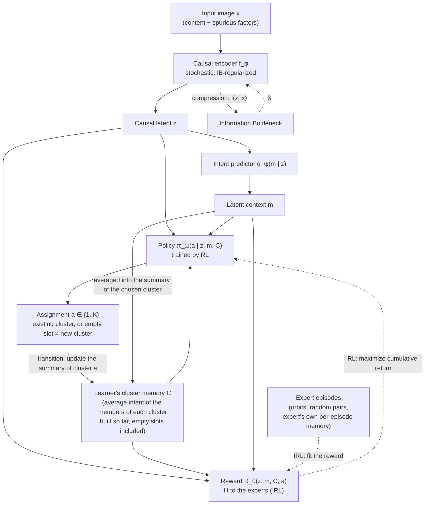

[](https://hub.xerj.org/contributors/Josh012006)
[](https://josh012006.github.io/CIB-IRL/)
[](https://github.com/Josh012006/CIB-IRL/actions/workflows/test.yml)

# CIB-IRL: Causal Information Bottleneck Inverse Reinforcement Learning

**Unsupervised image clustering that groups images by *what they are*, not by *where they appear*, by learning a causal representation (Information Bottleneck) together with a latent reward (multi-intention Inverse RL) from experts built out of image transformations, and a policy that builds the clusters by reinforcement learning.**

> ### 📖 Documentation: [josh012006.github.io/CIB-IRL](https://josh012006.github.io/CIB-IRL/)
> This README is the short version: the idea, the method with the loss of each component, the results and how to reproduce them. **The complete text** (every section, the decisions behind each choice, the failure modes, the ablations, all the figures and the log of the experiments) **is on the documentation site**; the sections that are shortened here end with a link to their full version.

> **Status:** research prototype, work in progress. The conceptual framework is stable; the toy environment is implemented and evaluated (see [Results](#11-results)); the real benchmarks are being built (see [Roadmap](#14-status--roadmap)).

---

## Table of Contents

1. [The Idea](#1-the-idea)
2. [Motivation](#2-motivation)
3. [Background & Reading List](#3-background--reading-list)
4. [Method](#4-method)
5. [Components & Training](#5-components--training)
6. [Where Do the Experts Come From?](#6-where-do-the-experts-come-from)
7. [Decisions & Open Questions](https://josh012006.github.io/CIB-IRL/#7-decisions--open-questions) *(documentation)*
8. [Failure Modes & Monitoring](https://josh012006.github.io/CIB-IRL/#8-failure-modes--monitoring) *(documentation)*
9. [Evaluation Protocol](#9-evaluation-protocol)
10. [Ablations](https://josh012006.github.io/CIB-IRL/#10-ablations) *(documentation)*
11. [Results](#11-results)
12. [Repository Structure](#12-repository-structure)
13. [Setup & Reproduction](#13-setup--reproduction)
14. [Status & Roadmap](#14-status--roadmap)
15. [License](#15-license)

The section numbers are the same here and on the documentation site.

---

## 1. The Idea

**In one sentence:** cluster images the way a child learns categories, by finding the few features that make things *distinguishable* and ignoring everything else.

### 1.1 Intuition

We recognize a cat from a handful of features (ears, whiskers, the shape of the face), not from the sofa it sits on. A baby does this without being taught any label: it simply learns to tell things apart. We want an algorithm that does the same, i.e. groups images by what they *are*, even when the background or style would be an easier (but meaningless) signal.

### 1.2 Clustering as decision-making (the IRL view)

We turn clustering into a sequential decision problem:

- **The policy** is the act of clustering. Images arrive one after the other; for each, the policy decides which group it goes into: one of the clusters **built so far**, or a fresh one. Its decision is conditioned on what already exists, as in any unsupervised method that builds its groups along the way. It is a policy in the RL sense, a separate network trained to maximize a return, **not** a softmax of the reward.
- **The reward** is the intention behind the decision, the *intention of distinction*. It scores a placement by how well the image fits the group it joins **and** how well it is told apart from the other groups. As in any RL problem, the reward says what is worth doing and the policy learns how to do it over a whole sequence of decisions.
- **The expert.** We can see the creator of the data (the world that produced the cats and the dogs) as an expert who, in building these images, optimized some reward. Multi-intention IRL methods such as PEMIRL recover from expert behavior the reward attached to each category. Our expert is imperfect on purpose and **never constrains the learner**: it only guides the reward toward what it means to tell things apart.
- **The intent.** As in Meta-IRL, a group of images has an *intent*: what its members have in common (the context variable $m$). The memory of the groups built so far is made of these intents, so the reward and the policy compare the intent of the arriving image with the intent of each existing group.
- **Our step beyond.** Besides the reward that makes each category what it is, there also exists a reward that **distinguishes categories from one another**, the reason we do not confuse them. Finding it *is* learning to distinguish. Optimizing it by RL, over decisions that depend on the clusters already formed, is clustering.

### 1.3 The obstacle, and our answer

IRL needs expert demonstrations, but an unsupervised problem has none (a supervised version would not be interesting). Our answer is to **build the experts from the images themselves**:

- all the transformed versions of an image (crops, color changes, new backgrounds, transformations of transformations) obviously show the same thing: when one of them arrives and another is already in a group, the expert demonstrates "join that group";
- two random images usually show different things: the expert demonstrates "do not put these together".

The expert never says *which* cluster in absolute terms; it only answers "same group or not?". That is enough to learn a reward that tells clusters apart. These decisions form expert demonstrations: episodes in which the views of a few images arrive one after the other and a rule-based expert places them in its own groups. The data pipeline generated the views, so it knows which ones share an orbit. The expert does not constrain the learner's policy, which builds its own clusters; only the reward learns from the demonstrations. Details in [Section 6](#6-where-do-the-experts-come-from).

### 1.4 Two safeguards against shortcuts

Image datasets are full of spurious cues (background, texture, style) that are easier to use than the object. Two ingredients keep the reward on the object:

- **Information Bottleneck.** An encoder is trained to keep as much information as the reward needs and to compress away the rest, so a feature that does not help the decision is deleted.
- **Invariance check.** If the encoder really removed the useless features, the decision must not change when the image is perturbed in ways that keep the object (e.g. new background). We add this as an explicit term.

### 1.5 At a glance

| Human intuition | In CIB-IRL |
|---|---|
| The few features that make a cat a cat | Causal latent $z$ (encoder + Information Bottleneck) |
| "This looks like a cat-type thing" | Latent intent $m$ (intent predictor $q_\psi$: one per orbit during training, one per image at test time) |
| The groups I have formed so far | The learner's cluster memory $C$: for each cluster, the list of its members and their average intent (empty slots included); it persists across episodes |
| Why this image belongs here and not there | Reward $R_\theta(z, m, C, a)$ |
| Putting it in a group (or starting a new one) | Policy $\pi_\omega(a \mid z, m, C)$, $a\in\lbrace 1,\dots,K\rbrace$, trained by RL |
| Someone who already knows what goes together | A rule-based expert built from transformations, with its own per-episode memory; it guides the reward and never constrains the learner ([Section 6](#6-where-do-the-experts-come-from)) |
| Not being fooled by the background | Compression + invariance of the decision |

---

## 2. Motivation

### 2.1 What already exists

| Family | Examples | Strength | Limitation for our problem |
|---|---|---|---|
| Geometric / statistical clustering | K-Means, GMM | Simple, fast | Depends entirely on the embedding geometry |
| Self-supervised learning | SimCLR, MoCo v3, CLIP | Strong, structured latent spaces | Augmentations alone do not guarantee that backgrounds are discarded |
| Multi-intention / meta IRL | Babeş-Vroman et al. 2011, PEMIRL | Separates unlabeled demonstrations by inferring several reward functions | Designed for **temporal trajectories** of real experts, not static images |
| IRL for grouping images | He et al. 2018 (face grouping) | Learns a merge / not-merge policy and its reward on photo albums | The expert is built from ground-truth identity partitions: **supervised at training time**; an existing clustering algorithm proposes the candidate merges |

### 2.2 The gap

1. **Modality mismatch.** Multi-intention IRL methods operate on sequences of states and actions produced by experts. A static image has no trajectory and nobody demonstrates the choice. We create the sequence ourselves: the *clustering process* is the trajectory (images are assigned one after the other, and each assignment changes the state), and the expert demonstrations are fabricated from transformations.
2. **Spurious correlations.** Applied to images, such methods inherit the shortcut-learning behavior of unsupervised learners. An agent grouping animal images will often cluster by background (ducks and boats together because both contain water) instead of by the causal features of the object.
3. **A single reward.** Most IRL-based methods do not use IRL for the clustering step itself; when they do, they learn what characterizes each cluster (one reward per cluster, or one network conditioned on a per-cluster context). Our approach instead learns a single reward of *distinction*: it compares an arriving image to all existing clusters and does not depend on which slot a cluster occupies. This reward is what the policy optimizes to build the clusters. To our knowledge, this use of IRL for the clustering step is the main novelty of the project; whether it pays off is what the experiments test.

---

## 3. Background & Reading List

Six papers cover the theoretical foundations of the framework and its closest work:

- [ ] He, Y., Cao, K., Li, C., & Loy, C. C. (2018).
  *Merge or Not? Learning to Group Faces via Imitation Learning*. AAAI 2018.
  [PDF](https://arxiv.org/pdf/1707.03986.pdf)
  Closest idea — the only work found that uses inverse reinforcement learning to group images:
  sequential merge / not-merge decisions with a reward learned from an expert. The expert is built
  from ground-truth identity partitions of the training albums, so it is supervised at training time
  (no label is needed at test time), and the candidate merges come from an existing clustering
  algorithm (K-Means, hierarchical, GDL). We build the experts from transformations with no label and
  let the policy build the clusters.

- [x] Yu, L., Yu, T., Finn, C., & Ermon, S. (2019).
  *Meta-Inverse Reinforcement Learning with Probabilistic Context Variables*. NeurIPS 2019.
  [PDF](https://arxiv.org/pdf/1909.09314.pdf)
  Core multi-intention IRL method — learns rewards from unlabeled multi-task demonstrations
  through a latent context variable $m$ inferred from the demonstrations, and infers the reward
  of a new task from a single demonstration. Source of our intent $m$ (Section 5.2).

- [x] Alemi, A. A., Fischer, I., Dillon, J. V., & Murphy, K. (2017).
  *Deep Variational Information Bottleneck*. ICLR 2017.
  [PDF](https://arxiv.org/pdf/1612.00410.pdf)
  Core compression method — turns the Information Bottleneck into a trainable objective with
  a variational bound on $I(z;x)$ (a KL to a prior) and a bound on relevance. Gives the
  $\beta \mathrm{KL}$ term of our encoder (Section 5.1).

- [x] Arjovsky, M., Bottou, L., Gulrajani, I., & Lopez-Paz, D. (2019).
  *Invariant Risk Minimization*. arXiv.
  [PDF](https://arxiv.org/pdf/1907.02893.pdf)
  Foundational theory of causal invariance — features whose predictive relation is stable across
  environments are the causal ones. Frames our nuisance family $\mathcal{T}$ as "environments", and
  introduces Colored MNIST.

- [x] Ji, X., Henriques, J. F., & Vedaldi, A. (2019).
  *Invariant Information Clustering for Unsupervised Image Classification and Segmentation*. ICCV 2019.
  [PDF](https://arxiv.org/pdf/1807.06653.pdf)
  Closest image-clustering approach in spirit — maximizes the mutual information between the
  cluster assignments of two augmented views of the same image. Our forced moves and
  invariance term play a similar role in a different formalism.

- [x] Babeş-Vroman, M., Marivate, V., Subramanian, K., & Littman, M. (2011).
  *Apprenticeship Learning About Multiple Intentions*. ICML 2011.
  [Paper page](https://mlanthology.org/icml/2011/babes2011icml-apprenticeship)
  Early "clustering and IRL together" — clusters unlabeled trajectories by inferring one
  objective per cluster with an EM procedure over IRL. Closest ancestor of the idea that a
  cluster is defined by its reward.

Additional references used by the expert design ([Section 6](#6-where-do-the-experts-come-from)): **Debiased Contrastive Learning** (Chuang et al., NeurIPS 2020), **SCAN: Learning to Classify Images without Labels** (Van Gansbeke et al., ECCV 2020), **SimCLR** (Chen et al., 2020), **MoCo v3** (Chen, Xie, He, 2021), and **Waterbirds / Group DRO** (Sagawa et al., 2020).

---

## 4. Method

The pipeline: an image is encoded into a causal latent $z$, from which an intent $m$ is inferred; a policy places the image in one of the clusters built so far, or opens a new one; a reward learned from the experts tells the policy what is worth doing.



**Episodic MDP over a growing set of clusters.** The learner's policy sweeps the training images one after the other; its cluster memory $C$ persists. Expert episodes (views of a few images placed by a rule-based expert in its own memory) only train the reward.

| Component | Definition |
|---|---|
| State $s_t$ | $(z_t, m_t, C_t)$: the code $z_t=f_\phi(x_t)$ of the arriving image, its intent $m_t=\mu_\psi(z_t)$, and the cluster memory $C_t$, which holds for each of the $K$ slots its number of members $n_k$ and the average intent $c_k$ of its members (an empty slot carries a learned embedding) |
| Action $a_t$ | A slot $a\in\lbrace 1,\dots,K\rbrace$: join that cluster, or open a new one if the slot is empty. $K$ is an upper bound |
| Transition | $n_a \leftarrow n_a + 1$, $c_a \leftarrow c_a + (m_t - c_a)/n_a$ (running mean of the member intents) |
| Reward | $R_\theta(s_t, a_t)$: compatibility with the chosen group and distinctness from the others, learned by IRL from the experts |
| Policy | $\pi_\omega(a \mid s_t)$, a separate network trained by RL to maximize the return of $R_\theta$ (not a softmax of the reward) |

**Joint objective.** Encoder, intent predictor and reward are optimized together (the policy is trained against the reward):

<br>

```math
\max_{\phi,\psi,\theta} \mathcal I\big(f_\phi(x); a, m\big) - \beta\,\mathcal I\big(f_\phi(x); x\big)
```

<br>

The first term keeps in $z$ what the decisions need; the second compresses away the rest (backgrounds, styles); $\beta$ sets the trade-off. Both are turned into trainable losses by variational bounds (below).

**Full version:** [Section 4](https://josh012006.github.io/CIB-IRL/#4-method) on the documentation site.

---

## 5. Components & Training

Four trained components, plus the learner's non-differentiable cluster memory. Notation: $z=f_\phi(x)$ is the code of an image, $m=\mu_\psi(z)$ its intent, $s=(z,m,C)$ the state in which it arrives, $s^E$ the same state in an expert episode (with the expert's memory $C^E$); a bar ($\bar\theta$, $\bar\omega$, $\bar m$, $\bar C$) means stop-gradient. Hyperparameter values are those of the final toy pipeline ([Section 11.1.2](https://josh012006.github.io/CIB-IRL/#1112-hyperparameters-of-the-toy-pipeline)).

### 5.1 Encoder $f_\phi$

The only component that sees pixels. It maps an image to a stochastic code $z=\mu_\phi(x)+\sigma_\phi(x)\odot\varepsilon$, and keeps what the intent and the reward need while discarding the rest.

<br>

```math
\mathcal L_{\text{enc}}(\phi) = \underbrace{\mathcal L_\psi + \mathcal L_\theta}_{\text{utility, through } z} + \beta\,\underbrace{\mathbb{E}_x\,\mathrm{KL}\big(p_\phi(z\mid x)\,\|\,\mathcal N(0,I)\big)}_{\text{compression}} + \lambda\,\underbrace{\mathcal L_{\text{inv}}}_{\text{invariance}}
```

<br>

As in the Deep VIB, the two mutual-information terms of the objective are replaced by variational bounds (with the fixed prior $r(z)=\mathcal N(0,I)$ ):

<br>

```math
I(z;x) \le \mathbb{E}_{x}\,\mathrm{KL}\big(p_\phi(z\mid x)\,\|\,r(z)\big),
\qquad
I(z;a,m) \ge H(a,m) + \mathbb{E}\,\big[\log q_\psi(m\mid z) + \log q_\theta(a\mid z,C,m)\big]
```

<br>

**Invariance term.** A feature is spurious if removing it leaves the decision unchanged. Under nuisance perturbations $g\sim\mathcal T$, the policies on the clean and on the perturbed view must agree, with the policy, the intent and the memory frozen so that the check corrects the encoder and not the policy:

<br>

```math
\mathcal L_{\text{inv}}(\phi) = \mathbb{E}_{x,\,g\sim\mathcal T}\,\mathrm{KL}\Big(\pi_{\bar\omega}(\cdot\mid z,\bar C,\bar m)\,\Big\|\,\pi_{\bar\omega}(\cdot\mid \tilde z,\bar C,\bar m)\Big),\qquad \tilde z = f_\phi(g(x))
```

<br>

Toy values: $\dim_z=32$, $\beta=10^{-4}$ after a warm-up of 300 iterations, $\lambda=1$.

**Full version:** [Section 5.1](https://josh012006.github.io/CIB-IRL/#51-encoder-f_phi) on the documentation site.

### 5.2 Intent predictor $q_\psi$

Infers from $z$ a continuous intent $m$ (what the image is about), the counterpart of the context variable of Meta-IRL. The intent of a cluster is the average intent of its members; it is trained only by its own loss, so that the reward cannot bend it.

<br>

```math
\mathcal L_\psi=\mathcal L_{\text{orbit}}+\lambda_{\text{cov}}\mathcal L_{\text{cov}},\qquad
\mathcal L_{\text{orbit}} = -\mathbb{E}_{i,\,u\in\text{orbit}_i}\big[\log q_\psi(m^*_i \mid z_u)\big],\qquad
\mathcal L_{\text{cov}}=\frac1d\sum_{i\neq j}C_{ij}^{2}
```

<br>

$m_i^*$ is the mean intent over the orbit of image $i$ (a stop-gradient target): all the views of an image must give the same concept. $C_{ij}$ is the covariance matrix of $\mu_\psi(z)$ over an expert batch (not the cluster memory), $d=\dim_m=16$ and $\lambda_{\text{cov}}=3$: without the decorrelation penalty the intent collapses to a single direction and the classes superpose.

**Full version:** [Section 5.2](https://josh012006.github.io/CIB-IRL/#52-intent-predictor-q_psi) on the documentation site.

### 5.3 Reward model $R_\theta$

Scores every placement $(s,a)$: how well the arriving image fits the group in slot $a$ and how well it is told apart from the others. It is a permutation-equivariant network over the slots, $R_\theta(z,m,C,a)=g_\theta\big(z,m,c_a,\mathrm{pool}_{k\neq a} c_k\big)$, trained by maximum-likelihood IRL: the expert is modelled as choosing slot $a$ with the probability

<br>

```math
q_\theta(a\mid s) = \frac{\exp R_\theta(s,a)}{\sum_{a'=1}^{K}\exp R_\theta(s,a')}
```

<br>

and the loss, evaluated in the expert's states, has an attraction, a debiased repulsion and an entropy safeguard against collapse ($\rho=0.1$):

<br>

```math
\mathcal L_\theta = \mathcal L_{\text{pos}} + \mathcal L_{\text{neg}} - \rho\,\mathcal H\big(\mathbb{E}_s\,q_\theta(\cdot\mid s)\big)
```

```math
\mathcal L_{\text{pos}}=-\mathbb{E}\,\big[\log q_\theta(k^+(u)\mid s^E_u)\big],\qquad
\mathcal L_{\text{neg}}=\mathbb{E}_{u}\,\max\Big\{\tfrac{1}{1-\tau^+}\Big(\mathbb{E}_{v}\,\ell(u,v)-\tau^+\,\ell^+(u)\Big),\ \varepsilon\,\mathbb{E}_{v}\,\ell(u,v)\Big\}
```

<br>

with $\ell(u,v)=-\log\big(1-q_\theta(k(v)\mid s^E_u)\big)$ and $\varepsilon=0.1$. $k^+(u)$ is the expert slot of the twin of $u$, $k(v)$ the slot of a random placed view of another orbit, and $\tau^+=1/K$ the share of random pairs that are of the same concept (the debiasing of Chuang et al. 2020). The reward does not read the cluster sizes.

**Full version:** [Section 5.3](https://josh012006.github.io/CIB-IRL/#53-reward-model-r_theta) on the documentation site.

### 5.4 Policy $\pi_\omega$ (separate network, trained by RL)

The agent that builds the clustering: at each step it sees the arriving code and the clusters built so far and picks a slot. It is trained by PPO against the frozen reward (with a critic $V_\xi$), and never sees the expert:

<br>

```math
\mathcal L_\omega = -\mathbb{E}_{\pi_\omega}\,\Big[\sum_{t}\gamma^{t}\,R_{\bar\theta}(s_t,a_t)\Big] - \alpha\,\mathbb{E}\,\big[\mathcal H\big(\pi_\omega(\cdot\mid s_t)\big)\big]
```

<br>

With $K=10$ slots for 5 classes, two slots can carry one class and the reward cannot break the tie. The policy is therefore multiplied by a fixed Chinese-restaurant-process prior on the placements, which reads only the slot sizes $n_k$ (never a label):

<br>

```math
\pi_\omega(a\mid s)\;\propto\;\exp\big(\mathrm{score}_\omega(s,a)\big)\,\pi_0(a\mid s),\qquad \pi_0(k\mid s)=\frac{n_k}{n-1+\alpha_{\text{CRP}}},\qquad \pi_0(\text{open}\mid s)=\frac{\alpha_{\text{CRP}}}{n-1+\alpha_{\text{CRP}}}
```

<br>

Toy values: $\alpha_{\text{CRP}}=1$, $\gamma=0.9$, $\alpha=0.01$, PPO clip $0.2$.

**Full version:** [Section 5.4](https://josh012006.github.io/CIB-IRL/#54-policy-pi_omega-separate-network-trained-by-rl) on the documentation site.

### 5.5 Training, stopping and clean-up

One iteration alternates a **reward step** (IRL: minimize $\mathcal L_{\text{enc}}$ on the encoder, intent predictor and reward, with $\mathcal L_\psi$ and $\mathcal L_\theta$ on a batch of expert episodes and $\mathcal L_{\text{inv}}$ on the learner's states) and a **policy step** (RL: minimize $\mathcal L_\omega$ on the policy and critic, with everything else frozen). At the end of each epoch the summaries of the learner's memory are recomputed with the current encoder. The encoder never receives the gradient of the RL loss.

Training stops when the **output** (the argmax of the policy for every training image, memory frozen) has converged: over 10 epochs, at most $1$ % of the images change cluster, the number of clusters is constant, the twin accuracy is stable and the expert loss plateaus. No label is used. A final clean-up then **renames** the clusters that the memory holds twice (two slots of one class, detected by the gap between the distances of their summaries); it changes no decision.

**Full version:** [Sections 5.5 to 5.8](https://josh012006.github.io/CIB-IRL/#55-joint-training-the-encoder-is-trained-with-the-rest-alternating-reward-and-policy-steps) on the documentation site.

---

## 6. Where Do the Experts Come From?

IRL needs demonstrations and an unsupervised problem has none. **The images provide them:** every transformed version of an image shows the same thing, so the views of one image (its *orbit*, built with a nuisance family $\mathcal T$ of crops, colour changes and background swaps) are the expert's "same group" decisions, and random pairs of images are mostly different. An expert episode shows the views of a few images one after the other, and a rule-based expert places them in its own memory:

- **Forced move** (certain): a view whose twin is already placed joins the twin's slot.
- **Free move**: the first view of an orbit opens a new slot; nothing is demonstrated about where it should go.
- **Repulsion** (probably right): a view must not join the slot of a random view of another orbit; this is wrong with probability $\tau^+\approx 1/K$ (two random images of one concept), and corrected by the debiasing of the reward loss.

The expert is relational (must-link and cannot-link constraints, generated for free), deliberately imperfect, and **never constrains the learner**: only the reward learns from it. It relies on three declared assumptions: the transformations preserve the object and encode prior knowledge about nuisances, not about classes (A1); random pairs are rarely of the same concept (A2); $K$ is a known upper bound (A3).

**Full version:** [Section 6](https://josh012006.github.io/CIB-IRL/#6-where-do-the-experts-come-from) on the documentation site.

---

## 9. Evaluation Protocol

- **Datasets** (engineered spurious correlations): a toy of $4\times4$ block patterns on random background colours (implemented and evaluated), Colored MNIST and Waterbirds (written, not run).
- **Baselines**, fit on the same unlabeled images and scored by the same code: K-Means and a diagonal GMM on the pixels, and the contrastive methods SimCLR (then K-Means) and IIC, which receive the same transformation bank as the model. All with $K=10$, the upper bound given to the model. No IRL method clusters static images without labels ([Section 9.2](https://josh012006.github.io/CIB-IRL/#92-baselines)).
- **Metrics:** ACC (Hungarian matching) and NMI against the true classes, the spurious leakage $\mathrm{NMI}(\text{cluster},\text{background})$, the drop $\Delta\mathrm{ACC}$ between the test set where the background points to the right class and the one where it points to a wrong class, the worst-group ACC, the number of clusters and the failure rate.
- **Partitions.** The model clusters its own unlabeled training images (transductive). It is then frozen and assigns images it never saw, under three backgrounds: `iid` (random colour), `aligned` (the colour of the class) and `inverted` (the colour of another class). The cluster-to-class matching is computed once on the training partition and kept on every test set: with a matching recomputed per set, a method that clusters by colour alone would score $\mathrm{ACC}=1$ on both and $\Delta\mathrm{ACC}=0$.
- **Training regimes.** `spurious` $s$ is the probability that a training background has the colour of its class: $s=0$ is the benchmark as it is, $s=0.9$ puts a colour shortcut in the training set.

**Full version:** [Section 9](https://josh012006.github.io/CIB-IRL/#9-evaluation-protocol) on the documentation site.

---

## 11. Results

Toy environment, 200 seeds (0 to 199), the final pipeline of Section 5. No label is used in the training or in the stopping rule; the labels only evaluate. Each seed draws five classes, $300$ images per class on random background colours; the model has $K=10$ slots and does not know that there are 5 classes. The transformation bank redraws the background of an image exactly: it is the prior knowledge about the nuisance of assumption A1, here an oracle.

**Table 1. Final pipeline, 200 seeds** (mean $\pm$ standard deviation over seeds; "right" is the number of seeds with 5 clusters and ACC $=1$).

| Metric | Train (unlabeled images) | Test `iid` | Test `aligned` | Test `inverted` |
|---|---|---|---|---|
| Right outputs | 194 / 200 | 194 / 200 | 194 / 200 | 194 / 200 |
| Failure rate (Clopper-Pearson 95 %) | 3.0 % [1.1, 6.4] | 3.0 % [1.1, 6.4] | 3.0 % [1.1, 6.4] | 3.0 % [1.1, 6.4] |
| ACC $\uparrow$ | $0.993\pm0.042$ | $0.993\pm0.042$ | $0.993\pm0.042$ | $0.993\pm0.042$ |
| $\mathrm{NMI}(\text{cluster},\text{class})$ $\uparrow$ | $0.9968\pm0.0193$ | $0.9968\pm0.0193$ | $0.9968\pm0.0193$ | $0.9968\pm0.0193$ |
| $\mathrm{NMI}(\text{cluster},\text{background})$ $\downarrow$ | $0.0039\pm0.0014$ | $0.0039\pm0.0012$ | $0.714\pm0.110$ (a) | $0.712\pm0.114$ (a) |
| $\Delta\mathrm{ACC}=\mathrm{ACC}(\text{aligned})-\mathrm{ACC}(\text{inverted})$ | | | $0.000\pm0.000$ | |
| Worst-group ACC $\uparrow$ | $0.970\pm0.171$ | $0.970\pm0.171$ | $0.970\pm0.171$ | $0.970\pm0.171$ |
| Clusters (target 5) | $4.965\pm0.209$ | $4.965\pm0.209$ | $4.965\pm0.209$ | $4.965\pm0.209$ |
| Open share | $0.001\pm0.014$ | $0.001\pm0.014$ | $0.001\pm0.014$ | $0.001\pm0.014$ |

(a) In the `aligned` and `inverted` sets the background is tied to the class, so a partition by class has a high $\mathrm{NMI}$ with the background by construction: this is not leakage. The leakage is the `iid` column ($0.004$), and the check against a background shortcut is $\Delta\mathrm{ACC}$ and the equality of the four columns.

**Table 2. Comparison with the baselines** (toy, seeds 0 to 199, mean $\pm$ standard deviation; "right" = 5 clusters and ACC $=1$). Table 2a: trained on the benchmark as it is ($s=0$). Table 2b: trained with a colour shortcut ($s=0.9$). "Not run" cells are defined by the protocol above and filled by `configs/suites/toy_compare.yml`.

**Table 2a. Clean training ($s=0$)**

| Method | $K$ | Right (train) | ACC (train) | $\mathrm{NMI}(\text{cluster},\text{class})$ (train) | $\mathrm{NMI}(\text{cluster},\text{background})$ (`iid`) | $\Delta\mathrm{ACC}$ | Mean $\lvert\Delta\mathrm{ACC}\rvert$ |
|---|---|---|---|---|---|---|---|
| K-Means on pixels | 10 | 0 / 200 | $0.560\pm0.037$ | $0.842\pm0.006$ | $0.152\pm0.009$ | $-0.010\pm0.292$ | $0.238$ |
| GMM on pixels | 10 | 0 / 200 | $0.596\pm0.036$ | $0.848\pm0.006$ | $0.141\pm0.009$ | $0.008\pm0.263$ | $0.212$ |
| SimCLR + K-Means | 10 | not run | not run | not run | not run | not run | not run |
| IIC | 10 | 4 / 200 | $0.613\pm0.142$ | $0.791\pm0.097$ | $0.002\pm0.001$ | $0.000\pm0.000$ | $0.000$ |
| **CIB-IRL** | 10 slots | 194 / 200 | $0.993\pm0.042$ | $0.997\pm0.019$ | $0.004\pm0.001$ | $0.000\pm0.000$ | $0.000$ |

**Table 2b. Training with a colour shortcut ($s=0.9$)**

| Method | $K$ | Right (train) | ACC (train) | $\mathrm{NMI}(\text{cluster},\text{class})$ (train) | $\mathrm{NMI}(\text{cluster},\text{background})$ (`iid`) | $\Delta\mathrm{ACC}$ | Mean $\lvert\Delta\mathrm{ACC}\rvert$ |
|---|---|---|---|---|---|---|---|
| K-Means on pixels | 10 | 0 / 200 | $0.935\pm0.009$ | $0.934\pm0.006$ | $0.129\pm0.015$ | $0.635\pm0.181$ | $0.635$ |
| GMM on pixels | 10 | 0 / 200 | $0.912\pm0.028$ | $0.923\pm0.011$ | $0.056\pm0.016$ | $0.752\pm0.147$ | $0.752$ |
| **CIB-IRL** | 10 slots | 195 / 200 | $0.994\pm0.040$ | $0.997\pm0.021$ | $0.004\pm0.001$ | $0.000\pm0.000$ | $0.000$ |

SimCLR and IIC have no $s=0.9$ run: they learn only from views whose background is repainted, so $s$ does not reach them ([Section 11.1.4](https://josh012006.github.io/CIB-IRL/#1114-protocol)). ACC and $\mathrm{NMI}(\text{cluster},\text{class})$ are measured on the training images (transductive); for CIB-IRL at $s=0$ the ACC equals the ACC on the three test sets (Table 1). $\mathrm{NMI}(\text{cluster},\text{background})$ is read on the `iid` test set, where the background is independent of the class: it is the leakage ([Section 9.3](https://josh012006.github.io/CIB-IRL/#93-metrics)). $\Delta\mathrm{ACC}$ is computed with the matching of the training partition ([Section 9.4](https://josh012006.github.io/CIB-IRL/#94-train-and-test-partitions)); the last column is the mean over the seeds of its absolute value, because a signed mean can cancel runs that are sensitive to the background in opposite directions. With the true number of clusters ($K=5$) K-Means solves the toy (Section 11.1.3); that case is not in the table.

- **With $K=10$, K-Means and GMM cut the classes.** $\mathrm{NMI}(\text{cluster},\text{class})$ is $0.84$ to $0.85$ while the ACC is $0.56$ to $0.60$ and no seed is right: the clusters are pure but several of them share a class.
- **K-Means and GMM follow the shortcut.** Trained at $s=0.9$, they send `aligned` images to the right cluster and `inverted` images to the wrong one: ACC with the fixed matching is $1.000$ against $0.365$ for K-Means, $0.987$ against $0.235$ for GMM, hence $\Delta\mathrm{ACC}=0.635$ and $0.752$, above $0.2$ on all 200 seeds. The higher ACC (train) at $s=0.9$ ($0.560\to0.935$, $0.596\to0.912$) is this colour: it ties the images of a class together. CIB-IRL has $\Delta\mathrm{ACC}=0.000\pm0.000$.
- **At $s=0$ the mean $\Delta\mathrm{ACC}$ of K-Means and GMM is near $0$ but the runs are not insensitive.** The standard deviation is $0.29$ and $0.26$ and the mean absolute value $0.24$ and $0.21$: a run is moved by the test background in one direction or the other, which is consistent with the classes being split along the brightness of their background ([Figure 2](https://josh012006.github.io/CIB-IRL/#1113-why-it-is-hard)).
- **IIC ignores the background but merges classes.** The bank repaints the background of every view, so IIC is insensitive to it: $\Delta\mathrm{ACC}=0.000$ on 200 seeds, the same ACC on the three test sets, a leakage of $0.002$. But with $K=10$ it collapses to $3.06\pm0.71$ clusters on average (2 for 40 seeds, 3 for 111, 4 for 45, 5 for 4), hence ACC $0.613\pm0.142$ (median $0.6$) and 4 seeds right out of 200: it gets the invariance without the number of classes.
- **Leakage and class information.** CIB-IRL has the highest $\mathrm{NMI}(\text{cluster},\text{class})$ ($0.997$) and a leakage of $0.004$, against $0.06$ to $0.15$ for K-Means and GMM (and $0.002$ for IIC, which merges classes), and $\Delta\mathrm{ACC}=0.000$ on each of its 200 seeds at both $s=0$ and $s=0.9$.

The CIB-IRL cells at $s=0$ are the 200 runs of Table 1. The pipeline gets the right partition from an upper bound of twice the number of classes, with no label and at no cost in leakage.


*Figure. Top left: epoch at which the output has converged (200 runs out of 200). Top right: occupied memory slots before and after the clean-up. Bottom left: ACC per seed on the training images and on the three test sets (identical). Bottom right: distances between slot summaries, merged twins against distinct clusters.*

**The 6 failures** out of 200 are each the union of two whole classes in one cluster (no class is split); a new run of one of them gave the right partition, so the failure rate (3.0 %) is a property of the method over seeds. The shortcut regime of Table 2b is run with the transformation bank of the toy, which redraws the background of every view: it shows that the model is not drawn to the shortcut when its views know the background, and does not test a bank that does not. The other datasets come next.

**Full version:** [Section 11](https://josh012006.github.io/CIB-IRL/#11-results) on the documentation site.

The documentation also has the task and why it is hard, the hyperparameters of the toy, the protocol, how the clusters improve during a run, the training dynamics over the 200 seeds, and the six failures, with all the figures.

---

## 12. Repository Structure

```
cib-irl/
├── README.md, requirements.txt
├── mkdocs.yml, requirements-docs.txt   # the documentation site
├── .github/workflows/                  # tests (pytest) and docs (build and publish the site)
├── cibirl/            # the model: encoder, intent, memory, reward, policy, experts, losses, train, convergence, cleanup
├── baselines/         # K-Means / GMM and SimCLR / IIC behind one interface
├── eval/              # metrics and the evaluation protocol shared by all methods
├── configs/           # benchmarks/ (retained configuration), suites/ (experiments x seeds), transforms/, ablations/, baselines/
├── scripts/           # run_experiment, run_suite, run_baseline, eval_heldout, compare_methods, make_report, toy_data, ...
├── tests/             # pytest suite
├── results/           # one folder per suite; results/toy_final_report/ holds the figures and tables of Section 11
├── data/              # toy images of seeds 0-9 (tracked); MNIST and Waterbirds are downloaded / placed by hand
└── docs/              # the documentation site (index.md) and the log of the experimental decisions (protocol-decisions.md)
```

**Full version:** [Section 12](https://josh012006.github.io/CIB-IRL/#12-repository-structure) on the documentation site.

---

## 13. Setup & Reproduction

Commands are run from the repository root.

### 13.1 Install and test

```
pip install -r requirements.txt
python -m pytest tests -q                    # about 3 minutes; tiny runs and fake data, nothing is downloaded
```

`scikit-learn` (K-Means and GMM of the baselines) and `pillow` (Waterbirds images) are required by the tests. `torchvision` (ResNet features of the baselines on Colored MNIST and Waterbirds) is optional: it is not in `requirements.txt` and no test needs it (`pip install torchvision` to use it).

The toy images of seeds 0 to 9 are stored in `data/toy/`; the generator makes the same images for any seed. Data of the other benchmarks and the loader: [Section 13.2](https://josh012006.github.io/CIB-IRL/#132-data).

### 13.3 Reproduce the toy results

One run of the final pipeline (the retained configuration, `configs/benchmarks/toy.yml`):

```
python scripts/run_experiment.py --data toy --transform toy_oracle --config configs/benchmarks/toy.yml \
       --stop-set max_epochs=300 min_epochs=40 --set seed=0
```

The 200 runs of [Section 11](#11-results), as they were run, then the held-out evaluation and the report:

```
python scripts/run_suite.py configs/suites/toy_cov_k10_final_ac.yml     --cpu-count 2 --skip-existing    # seeds 0-99
python scripts/run_suite.py configs/suites/toy_cov_k10_final_ac_val.yml --cpu-count 2 --skip-existing    # seeds 100-199
python scripts/eval_heldout.py results/toy_cov_k10_final_ac results/toy_cov_k10_final_ac_val --out results/toy_final_report
python scripts/make_report.py  results/toy_cov_k10_final_ac results/toy_cov_k10_final_ac_val --out results/toy_final_report
```

`configs/suites/toy_final.yml` runs the same 200 seeds as one suite from `configs/benchmarks/toy.yml`. It has not been run: `tests/test_benchmark_configs.py` checks that the configuration is the one stored in the runs above. The evolution of one run (Figures 3 and 4) needs a replay of that run with a checkpoint per epoch; the command is in the header of `scripts/make_report.py`.

### 13.4 Baselines and comparison

```
# one seed of each baseline (the contrastive baselines need the transformation bank)
python scripts/run_baseline.py --method kmeans --data toy --set num_clusters=10
python scripts/run_baseline.py --method simclr --data toy --transform toy_oracle --set num_clusters=10 epochs=300
python scripts/run_baseline.py --method iic    --data toy --transform toy_oracle --data-set spurious=0.9 --set seed=3
```

The comparison of Table 2 is one suite of 7 experiments (K-Means and GMM $\times$ $s\in\lbrace 0,0.9\rbrace$, SimCLR and IIC at $s=0$, plus CIB-IRL at $s=0.9$; CIB-IRL at $s=0$ is the 200 runs of [Section 13.3](#133-reproduce-the-toy-results)): $K=10$, seeds 0 to 199 everywhere, 300 epochs for SimCLR and IIC. A part of it can be listed before launching:

```
python scripts/run_suite.py configs/suites/toy_compare.yml --only kmeans_k10_clean simclr_k10_clean --seeds 0 1 2 --dry-run
python scripts/run_suite.py configs/suites/toy_compare.yml --cpu-count 5 --threads-per-run 1 --skip-existing

# our model is scored on the test sets afterwards (the baselines score themselves), with the matching of its training partition
python scripts/eval_heldout.py results/toy_compare --experiment final_spur90 --out results/toy_compare/heldout_final_spur90
python scripts/eval_heldout.py results/toy_cov_k10_final_ac results/toy_cov_k10_final_ac_val --experiment final --out results/toy_final_report
python scripts/compare_methods.py results/toy_compare results/toy_compare/heldout_*/heldout_metrics.json \
       results/toy_final_report/heldout_metrics.json --out results/toy_compare/table.md
```

`scripts/eval_heldout.py` runs `--workers 2` processes by default, each with its own copy of torch (about 650 MB); with `--workers 1` it evaluates in the main process, for a machine with little memory.

### 13.6 Documentation site

The site is built from `docs/` with MkDocs (Material theme, MathJax for the formulas) and published on GitHub Pages by `.github/workflows/docs.yml` at every push to `main` that touches the documentation. The Markdown is written for GitHub as well: `scripts/docs_hooks.py` turns its GitHub-flavoured formulas into plain LaTeX at build time and serves the figures of `results/toy_final_report/`. To preview it:

```
pip install -r requirements-docs.txt
mkdocs serve                      # http://127.0.0.1:8000
mkdocs build --strict             # what the workflow runs: a broken link or anchor fails the build
```

`docs/index.md` is the complete text of the project; the `README.md` is its short version, with the same section numbers.

---

## 14. Status & Roadmap

- [x] Problem statement and literature review
- [x] Architecture and joint objective
- [x] Expert design: fixed expert trajectories with a per-episode expert memory, relational decisions, debiased negatives; Phase 1 / Phase 2 protocol
- [x] Policy design: separate RL policy conditioned on the clusters built so far, $K$ as an upper bound, alternating training
- [x] Design questions settled: experts, policy, $m$ ([Section 7.1](https://josh012006.github.io/CIB-IRL/#71-decisions-taken))
- [x] Expert trajectory generator, learner's persistent memory (member lists, recompute) and monitoring (leakage, churn, non-empty slots, cluster-size entropy)
- [x] Stable reward / policy alternation on the toy (output convergence on 200 runs out of 200)
- [x] Toy pipeline: intent decorrelation, repulsion floor, CRP prior, output-convergence rule, final clean-up ([Section 5](#5-components--training))
- [x] Toy results on 200 seeds, on a held-out test partition ([Section 11](#11-results)): 194 of 200 outputs exactly right
- [ ] Variational formulation validated and consistency term fixed (Section 5.1)
- [x] Toy dataset stored as files (`data/toy/`) with a loader; benchmark abstraction (train builder, test builder, `iid` / `aligned` / `inverted`) for the toy, Colored MNIST and Waterbirds; retained toy configuration in `configs/benchmarks/toy.yml`
- [x] The two baselines (K-Means / GMM, SimCLR / IIC) implemented behind the shared evaluation protocol ([Section 9.2](https://josh012006.github.io/CIB-IRL/#92-baselines)); comparison suite `configs/suites/toy_compare.yml` written and tested on tiny runs
- [ ] Toy comparison: CIB-IRL, K-Means, GMM, SimCLR and IIC $\times$ `iid` / `aligned` / `inverted` $\times$ $s\in\lbrace 0,0.9\rbrace$ (SimCLR and IIC at $s=0$ only) (Table 2)
- [ ] Ablation $\lambda=0$ (`configs/ablations/no_inv.yml`) on the 200 seeds of the toy
- [ ] Ablation reward + prior ( $`\mathrm{softmax}(R_\theta+\log\pi_0)`$ ) instead of the RL policy: readout done on the 100 first final models, acting rule during training to run
- [ ] Toy: a step for the 3 % of runs where two classes end in one cluster
- [ ] Colored MNIST pipeline and baselines (loader and first-design configuration written, not run; MNIST digits: the representation work is in `docs/protocol-decisions.md`, 5.11 to 5.16)
- [ ] Phase 1 on Colored MNIST (expert tolerated as is), with the same-class rate among neighbors in $m$-space
- [ ] Phase 2 (relinking, neighbor-enriched episodes, brakes) and Phase 1 vs Phase 2 comparison
- [ ] Waterbirds pipeline and baselines (loader and first-design configuration written, tested on fake data only)
- [ ] Full ablation suite
- [ ] Write-up

---

## 15. License

MIT License
