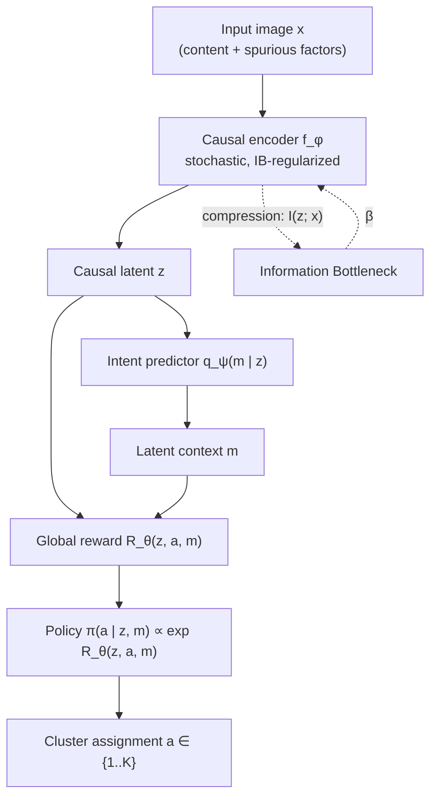

# CIB-IRL: Causal Information Bottleneck Inverse Reinforcement Learning

**Unsupervised image clustering that ignores spurious correlations, by jointly learning a causal representation (Information Bottleneck) and a latent reward (multi-intention Inverse RL).**

> **Status:** research prototype, work in progress. The conceptual framework is stable; the implementation and benchmarks are being built (see [Roadmap](#10-status--roadmap)).

---

## Table of Contents

1. [TL;DR](#1-tldr)
2. [Motivation](#2-motivation)
3. [Background & Reading List](#3-background--reading-list)
4. [Method](#4-method)
5. [Components & Training](#5-components--training)
6. [Open Design Questions](#6-open-design-questions)
7. [Evaluation Protocol](#7-evaluation-protocol)
8. [Ablations](#8-ablations)
9. [Repository Structure](#9-repository-structure-planned)
10. [Status & Roadmap](#10-status--roadmap)
11. [Citation & License](#11-citation--license)

---

## 1. TL;DR

Clustering images by raw distance (K-Means, GMM) or by contrastive features (SimCLR, MoCo) tends to group images by **what is easy to see** (background, texture, style) rather than **what matters** (the object). CIB-IRL fixes this by recasting clustering as a **single-step decision problem**:

- The *state* is a compressed latent code `z = f_φ(x)` of the image.
- The *action* is a cluster assignment `a ∈ {1, …, K}`.
- A *global latent reward* `R_θ(z, a, m)`, conditioned on a latent intent/concept `m`, explains why a given assignment is "good".
- An **Information Bottleneck** on the encoder removes any information that the reward does not need. A feature is *useless* (spurious) if removing it leaves the categorization reward unchanged.

Encoder, intent predictor and reward are trained **jointly, end to end**.

---

## 2. Motivation

### 2.1 What already exists

| Family | Examples | Strength | Limitation for our problem |
|---|---|---|---|
| Geometric / statistical clustering | K-Means, GMM | Simple, fast | Depends entirely on the embedding geometry |
| Self-supervised learning | SimCLR, MoCo v3, CLIP | Strong, structured latent spaces | Augmentations alone do not guarantee that backgrounds are discarded |
| Multi-intention / meta IRL | Babeş-Vroman et al. 2011, Meta-IRL | Separates unlabeled demonstrations by inferring several reward functions | Designed for **temporal trajectories**, not static images |

### 2.2 The gap

1. **Modality mismatch.** Multi-intention IRL methods operate on sequences of states and actions. A static image is categorized in a *single step*, so these methods cannot be applied directly.
2. **Spurious correlations.** When applied to images, such methods inherit the shortcut-learning behavior of unsupervised learners. An agent grouping animal images will often cluster by background (e.g. ducks and boats together because both contain water) instead of by the causal features of the object.

### 2.3 Our idea

We reformulate static image clustering as a **single-step MDP driven by an implicit global reward**, and we pair the IRL pipeline with a **learned causal encoder constrained by an Information Bottleneck**, trained jointly with the reward. Compression removes what the reward does not use; the reward, in turn, is shaped by what the encoder keeps.

---

## 3. Background & Reading List

Five papers cover the theoretical foundations of the framework:

1. **Meta-Inverse Reinforcement Learning with Probabilistic Context Variables**, Yu, Yu, Finn, Ermon (NeurIPS 2019).
   *Why:* extracts an implicit reward tied to a latent context variable `m` in a multi-task setting.
2. **Deep Variational Information Bottleneck**, Alemi, Fischer, Dillon, Murphy (ICLR 2017).
   *Why:* compress the input while retaining task-relevant information, via variational bounds on mutual information.
3. **Invariant Risk Minimization**, Arjovsky, Bottou, Gulrajani, Lopez-Paz (2019).
   *Why:* foundational theory of causal invariance across environments (here: styles/backgrounds).
4. **Invariant Information Clustering for Unsupervised Image Classification and Segmentation**, Ji, Henriques, Vedaldi (ICCV 2019).
   *Why:* maximizing mutual information between augmented views to drive unsupervised clustering.
5. **Apprenticeship Learning About Multiple Intentions**, Babeş-Vroman, Marivate, Subramanian, Littman (ICML 2011).
   *Why:* early demonstration that clustering and IRL can be optimized *jointly* rather than sequentially.

Datasets and baselines referenced below: Sagawa et al. 2020 (Waterbirds / Group DRO), Chen et al. 2020 (SimCLR), Chen, Xie, He 2021 (MoCo v3).

---

## 4. Method

### 4.1 Pipeline



### 4.2 Single-step MDP

| Component | Definition |
|---|---|
| State `s` | Latent vector `z = f_φ(x)` extracted from the raw image `x` |
| Action `a` | Cluster index, `a ∈ {1, …, K}` |
| Latent context `m` | Continuous semantic variable for the underlying concept (e.g. species morphology), inferred by `q_ψ(m \| z)` |
| Reward | `R_θ(z, a, m)`, a single global reward shared across the dataset |
| Policy | Maximum-entropy optimal policy. With a single step there is no horizon, so `Q = R` and `π(a \| z, m) = exp R_θ(z, a, m) / Σ_a' exp R_θ(z, a', m)` |

### 4.3 Joint objective

Encoder `f_φ`, intent predictor `q_ψ` and reward `R_θ` are optimized together:

$$
\max_{\phi,\psi,\theta}\;\; \mathcal{I}\big(f_\phi(x);\, a, m\big) \;-\; \beta\,\mathcal{I}\big(f_\phi(x);\, x\big)
$$

- **Relevance term** `I(f_φ(x); a, m)`: mutual information between the filtered representation and the categorization output under the inferred reward. It keeps in `z` every causal marker needed for clear, confident clustering decisions.
- **Compression term** `I(f_φ(x); x)`: forces the encoder to be as restrictive as possible, deleting bits that vary a lot or do not help clustering (changing backgrounds, styles).
- **`β`** controls the compression / utility trade-off.

The agent's policy `π(a | z, m)` maximizes the extracted reward `R_θ(z, a, m)`.

### 4.4 Tractable training objective

As in the Deep VIB, both terms are replaced by variational bounds. With a stochastic encoder `p_φ(z|x)` and a fixed prior `r(z)`:

$$
I(z;x) \;\le\; \mathbb{E}_{x}\,\mathrm{KL}\big(p_\phi(z\mid x)\,\|\,r(z)\big),
\qquad
I(z;a,m) \;\ge\; H(a,m) + \mathbb{E}\big[\log q_\psi(m\mid z) + \log \pi_\theta(a\mid z,m)\big]
$$

yielding the loss to minimize:

$$
\mathcal{L}(\phi,\psi,\theta) \;=\; -\,\mathbb{E}\big[\log q_\psi(m\mid z) + \log \pi_\theta(a\mid z,m)\big] \;+\; \beta\,\mathbb{E}_x\,\mathrm{KL}\big(p_\phi(z\mid x)\,\|\,r(z)\big) \;+\; \lambda\,\mathcal{L}_{\text{inv}}
$$

### 4.5 Reward-consistency (invariance) term: *proposed*

A feature is spurious if removing it leaves the reward unchanged. We operationalize this with a consistency penalty under nuisance interventions `t ~ 𝒯` (background swaps, color jitter, style transfer):

$$
\mathcal{L}_{\text{inv}} \;=\; \mathbb{E}_{x,\,t\sim\mathcal{T}}\,\Big\| R_\theta\big(f_\phi(x),\cdot,m\big) - R_\theta\big(f_\phi(t(x)),\cdot,m\big)\Big\|^2
$$

This is the bridge to IRM (invariance across environments) and IIC (agreement across views). Its exact form is an open design choice and is covered by the ablations in [Section 8](#8-ablations).

---

## 5. Components & Training

The architecture has four trainable components: the **encoder**, the **intent predictor**, the **reward model** and the **policy**. This section fixes the training signal, then gives for each component its role, its loss, and the intuition behind each term of that loss. It closes with what joint and sequential training would mean in practice.

### 5.0 Notation and training signal

- **Nuisance perturbations.** Let `𝒯` be a set of perturbations that change the style of an image but not its semantic content (background swap, color jitter, style transfer). For an image `x` and `t ~ 𝒯`, write `z = f_φ(x)` and `z_t = f_φ(t(x))`.
- **Two policies.** `π_θ(a | z, m) = softmax_a R_θ(z, a, m)` is the policy *induced by the reward* (Section 4.2). `π_ω(a | z, m)` is the *learned* policy network of Section 5.4.
- **Pseudo-demonstrations.** Classical IRL needs expert demonstrations; we have none. Our working hypothesis (see Open Design Question 1) is that the "expert" is the labeling that stays stable under nuisance perturbations. Targets are computed on the perturbed view and frozen (`sg[·]` = stop-gradient):

$$
m^\* = \mathrm{sg}\big[\mu_\psi(z_t)\big], \qquad a^\* \sim \mathrm{sg}\big[\pi_\theta(\cdot \mid z_t, m^\*)\big]
$$

This specifies the expectation left implicit in Section 4.4: the losses `L_ψ` and `L_θ` below are exactly its utility term.

### 5.1 Encoder `f_φ`

**Role.** The only component that sees pixels. It maps an image to a stochastic code `z = μ_φ(x) + σ_φ(x) ⊙ ε`, `ε ~ 𝒩(0, I)`, and everything downstream sees only `z`. Its job is a trade-off: keep what the intent and the reward need, discard everything else, in particular backgrounds and styles.

**Loss.**

$$
\mathcal{L}_{\text{enc}}(\phi) \;=\; \underbrace{\mathcal{L}_\psi + \mathcal{L}_\theta}_{\text{utility, through } z} \;+\; \beta\,\underbrace{\mathbb{E}_x\,\mathrm{KL}\big(p_\phi(z\mid x)\,\|\,\mathcal{N}(0,I)\big)}_{\text{compression}} \;+\; \lambda\,\underbrace{\mathbb{E}_{x,\,t}\Big\|R_\theta(z,\cdot,m)-R_\theta(z_t,\cdot,m)\Big\|^2}_{\mathcal{L}_{\text{inv}}\;(\theta\text{ frozen})}
$$

For a diagonal Gaussian the KL has a closed form: `½ Σ_j (μ_j² + σ_j² − 1 − log σ_j²)`.

**Reading the terms.**
- **Utility `L_ψ + L_θ`.** The gradients of the intent and reward losses flow back into `z`. This is the "retain as much information as possible" pressure: anything needed to predict the concept and the assignment must survive.
- **Compression `β·KL`.** Pulls every code toward the prior, i.e. makes `z` carry as few bits about `x` as possible. `β` sets how hard it pushes.
- **Invariance `λ·L_inv`.** The check on the encoder: if the useless features were really removed, the reward vector over all clusters must not move when the image is perturbed. `θ` is frozen in this term; otherwise the trivial solution `R_θ ≡ const` would satisfy it for free.

### 5.2 Intent predictor `q_ψ`

**Role.** Infers from `z` a continuous latent concept `m` (what the image is "about", e.g. species morphology) that conditions the reward. As the context variable of Meta-IRL, it lets one global reward express different notions of similarity.

**Loss.**

$$
\mathcal{L}_\psi \;=\; -\,\mathbb{E}_{x,\,t}\big[\log q_\psi(m^\* \mid z)\big]
$$

**Reading the terms.**
- **Log-likelihood of the target `m*`.** The concept predicted from the original image must match the concept predicted from the perturbed one. A concept that changes when only the background changes is penalized, so `m` is pushed toward content.
- **Gaussian case.** With `q_ψ(m | z) = 𝒩(μ_ψ(z), σ_ψ²(z))`, this is a squared error weighted by the predicted precision, plus `log σ_ψ`: the model can express uncertainty but pays for it.
- **Caveat.** Nothing forces `m` to be used; a constant `m` reduces the model to single-intention IRL. The "without `m`" ablation measures this.

### 5.3 Reward model `R_θ`

**Role.** Scores every triple `(z, a, m)`: how well cluster `a` explains the image coded by `z` under concept `m`. It is the object that IRL recovers, a single global reward shared by the whole dataset, and the policy is derived from it.

**Loss.** Maximum-entropy IRL likelihood of the pseudo-demonstrations, plus an anti-collapse bonus:

$$
\mathcal{L}_\theta \;=\; -\,\mathbb{E}\Big[R_\theta(z,a^\*,m)\;-\;\log\sum_{a'}\exp R_\theta(z,a',m)\Big] \;-\; \rho\,\mathcal{H}\Big(\mathbb{E}_x\,\pi_\theta(\cdot\mid z,m)\Big)
$$

**Reading the terms.**
- **`R_θ(z, a*, m)`.** Raises the reward of the demonstrated pair.
- **`log Σ exp R_θ`.** The log-partition term. It lowers the reward of all other clusters, so the reward is *relative*: it cannot be inflated everywhere at once. The first bracket is exactly `−log π_θ(a* | z, m)`.
- **`ρ·H(marginal)`.** Entropy of the average assignment distribution over the batch. It rewards using all `K` clusters and guards against the degenerate "everything in one cluster" solution (Open Design Question 2). It is a safeguard, and `ρ = 0` recovers the pure IRL likelihood.

### 5.4 Policy `π_ω`

**Role.** The agent that picks the cluster. At inference, the assignment is `a = argmax_a π_ω(a | z, m)`. It is trained to act soft-optimally with respect to the current reward. In a single-step MDP the soft-optimal policy has a closed form (`π_θ ∝ exp R_θ`), so `π_ω` is redundant at the optimum. We keep it as a separate network to preserve the standard IRL split between reward and policy, to allow alternating updates, and to leave room for multi-step or large action spaces.

**Loss.**

$$
\mathcal{L}_\omega \;=\; -\,\mathbb{E}\Big[\sum_a \pi_\omega(a\mid z,m)\,R_\theta(z,a,m)\Big] \;-\; \alpha\,\mathbb{E}\Big[\mathcal{H}\big(\pi_\omega(\cdot\mid z,m)\big)\Big] \;=\; \alpha\,\mathbb{E}\,\mathrm{KL}\big(\pi_\omega\,\|\,\mathrm{softmax}(R_\theta/\alpha)\big) + \text{const}
$$

**Reading the terms.**
- **Expected reward.** Choose the clusters the reward scores highly.
- **Entropy bonus `α·H`.** Stay stochastic instead of committing early to one cluster; `α` is a temperature (`α = 1` recovers `π_θ` of Section 4.2, `α < 1` sharpens).
- **KL form.** The same loss says "distill the reward-induced softmax into the network". The loss only updates `ω`; `R_θ`, `z` and `m` are detached.

### 5.5 Joint training

All components are updated at every step, on the same minibatch, from one total loss:

$$
\mathcal{L} \;=\; \mathcal{L}_\psi + \mathcal{L}_\theta + \beta\,\mathrm{KL} + \lambda\,\mathcal{L}_{\text{inv}} + \mathcal{L}_\omega
$$

The first four terms are the objective of Section 4.4; `L_ω` is the RL part. Gradient routing:

| Term | Updates |
|---|---|
| `L_ψ` (intent) | `ψ`, and `φ` through `z` |
| `L_θ` (reward) | `θ`, and `φ` through `z` |
| KL (compression) | `φ` |
| `L_inv` (invariance) | `φ` only (`θ` frozen) |
| `L_ω` (policy) | `ω` only |

**What it means.** "Useless" is defined *relative to the reward currently being learned*: the encoder compresses what the reward and intent do not use, while the reward and intent adapt to whatever the encoder keeps. This co-adaptation is the point of the method, and also its main risk: targets are produced by the model itself, so early training is unstable and a random reward can push the bottleneck to discard useful bits. The practical mitigations are a warm-up of `β` from 0 and, if needed, a slowly-moving (EMA) copy of the model to compute `m*` and `a*`.

### 5.6 Sequential training

Two stages, nothing flowing back from the second to the first.

1. **Encoder alone.** No reward exists yet, so the reward-based utility is replaced by a task-agnostic proxy (a cross-view mutual-information objective such as IIC, or a pretrained SSL encoder), together with `β·KL` and an invariance penalty on the code itself, `‖z − z_t‖²`.
2. **IRL modules on frozen codes.** `φ` is frozen and `L_ψ + L_θ + L_ω` are minimized on `z`. There is no KL, no `L_inv`, and no gradient into the encoder.

| | Joint | Sequential |
|---|---|---|
| Optimization | One stage, all parameters | Encoder first, then intent / reward / policy |
| Does the encoder see the reward? | Yes (through `L_ψ`, `L_θ`, `L_inv`) | No, only a proxy |
| Meaning of "useless" | Irrelevant to the current reward | Irrelevant to the proxy objective |
| Strengths | Matches the definition of the method; the encoder is shaped by what clustering needs | Simple, stable, modular; the IRL stage can be re-run without retraining the encoder |
| Risks | Moving targets, instability, need for warm-up | Frozen stage-1 errors; the proxy may drop cluster-relevant bits or keep spurious ones |

Sequential training is the natural control for the claim that *joint* optimization matters (see [Ablations](#8-ablations)); with `β = 0` it reduces to the "standard multi-intention IRL" baseline.

---

## 6. Open Design Questions

These are the points the implementation must settle, and the ones a reviewer is most likely to ask about:

1. **What plays the role of "demonstrations"?** Classical IRL needs expert behavior. In an unsupervised setting, the supervision signal has to come from somewhere: our current candidate is cross-view consistency of assignments (IIC-style), so that the "expert" is the implicit labeling that stays stable under nuisance transformations.
2. **Self-referential relevance term.** `a` and `m` are produced by the model itself, so maximizing `I(z; a, m)` alone admits trivial or degenerate solutions. The consistency term and a cluster-balance regularizer (e.g. a marginal-entropy bonus on `a`) are the proposed safeguards.
3. **Identifiability of `m`.** What guarantees that `m` captures a semantic concept rather than another nuisance factor? Diagnostics: NMI between `m` and the known spurious attribute.
4. **Choice of `K`.** Fixed and known in the benchmarks; sensitivity to a wrong `K` is part of the ablations.

---

## 7. Evaluation Protocol

### 7.1 Datasets (engineered spurious correlations)

| Dataset | Setup | What it tests |
|---|---|---|
| **Colored MNIST** | Digits are strongly correlated with background/foreground color at training time; correlation is randomized or inverted at test time. 10-class variant for clustering; the binary IRM variant as a sanity check. | Whether the model clusters by digit identity instead of color |
| **Waterbirds** | Landbirds on land and waterbirds on water (strong train-time correlation); minority groups (landbird on water, waterbird on land) at test time. | Whether the model clusters by bird category instead of land/water background |

### 7.2 Baselines

1. **Geometric / statistical clustering:** K-Means and GMM on standard ResNet / ViT embeddings.
2. **Pure contrastive learning:** SimCLR, MoCo v3 (and IIC) followed by clustering, to see whether contrastive augmentations alone discard backgrounds.
3. **Standard multi-intention IRL:** a temporal IRL model adapted to single-step images **without** the causal Information Bottleneck encoder.

### 7.3 Metrics

- **Clustering Accuracy (ACC)** with optimal (Hungarian) cluster-to-label matching, and **Normalized Mutual Information (NMI)**, both measured strictly against the true semantic labels (bird species, digit ID), ignoring background.
- **Out-of-distribution (OOD) robustness:** drop in performance (`ΔACC`) between the correlated test set and the test set where the background correlation is inverted.
- **Worst-group ACC** (Waterbirds): accuracy on the least-represented (class, background) group.
- **Spurious leakage:** `NMI(cluster, background)`. Lower is better; a model that clusters by background scores high.

Reporting: mean ± std over several seeds, with fixed `K` equal to the number of true classes.

---

## 8. Ablations

| Ablation | Question answered |
|---|---|
| `β = 0` (no Information Bottleneck) | Does compression alone remove the spurious features? |
| `λ = 0` (no reward-consistency term) | Is the invariance term necessary, or is the IB sufficient? |
| Sequential training (encoder → IRL) instead of joint | Does joint optimization matter, as Babeş-Vroman et al. suggest? |
| `β` sweep | Where is the compression / utility trade-off, and is there a sweet spot? |
| Wrong `K` | How sensitive is the method to the number of clusters? |
| Without latent context `m` | What does the intent variable contribute? |

---

## 9. Repository Structure (planned)

```
cib-irl/
├── README.md
├── configs/          # experiment configs (datasets, β, λ, K)
├── cibirl/
│   ├── encoder.py    # causal encoder f_φ (stochastic, VIB head)
│   ├── intent.py     # intent predictor q_ψ(m | z)
│   ├── reward.py     # global reward R_θ(z, a, m) and policy π
│   ├── losses.py     # variational IB bound, consistency term
│   └── train.py      # joint optimization loop
├── data/             # Colored MNIST, Waterbirds loaders
├── baselines/        # K-Means/GMM, SimCLR, MoCo v3, IIC, temporal IRL
├── eval/             # ACC, NMI, OOD drop, worst-group, leakage
└── scripts/          # launchers (local and SLURM)
```

---

## 10. Status & Roadmap

- [x] Problem statement and literature review
- [x] Architecture and joint objective
- [ ] Variational formulation validated (Section 4.4) and consistency term fixed (Section 4.5)
- [ ] Colored MNIST pipeline and baselines
- [ ] Waterbirds pipeline and baselines
- [ ] Full ablation suite
- [ ] Write-up

---

## 11. Citation & License

```bibtex
@misc{cibirl,
  title  = {CIB-IRL: Causal Information Bottleneck Inverse Reinforcement Learning},
  author = {TODO},
  year   = {2026},
  note   = {Work in progress}
}
```

License: *TODO*.
